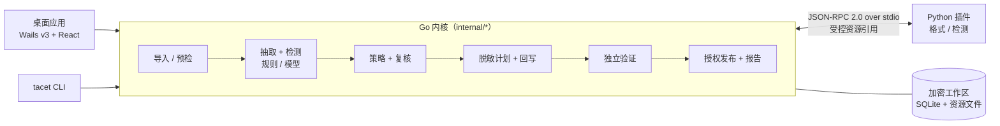

# Tacet

[](https://github.com/jorben/tacet/actions/workflows/ci.yml)
[](LICENSE)


**本地文档隐私脱敏工具**：在本机完成文档解析、敏感信息识别（规则 + 本地模型）、复核、脱敏回写与输出验证，文档内容不上传。

> Tacet 是音乐术语，指某个声部在指定段落中保持沉默——让敏感的部分保持沉默，让其余内容继续表达。

> [!WARNING]
> 项目处于 **M0 / MVP 开发阶段**，尚未发布正式版本。端到端链路已能在 macOS arm64 上跑通，但验收追踪表中所有条目仍为 `partial`，Windows 目前仅做过交叉编译检查。当前状态与限制见 [MVP 后端验证报告](docs/v1/backend/verification-report.md)。

## 主要特性

- **完全本地**：解析、检测、模型推理、回写与验证都在本机执行；对外网络只走单一受控通道（`internal/netgate`），仅用于模型下载、应用更新等，与文档处理互斥。
- **规则 + 模型检测**：内置中国办公规则包 [`cn-office-v1`](resources/rules/cn-office-v1.json)（手机号、座机、邮箱、居民身份证、银行卡号（Luhn 校验）、IPv4、网址、常见密钥 / 令牌 / 私钥、员工工号、个人日期等），并可叠加本地 ONNX 检测模型识别人名、地址等上下文相关信息。
- **多格式插件**：格式处理由进程外 Python 插件完成，通过版本化的 JSON-RPC 协议与 Go 内核通信，新增格式无需改动核心调度。
- **复核与可追溯**：逐条或按分组决定“涂抹 / 保留”，可手动补充遗漏；任务以不可变快照绑定配置、规则、模型与插件版本，上游变化会使下游结果失效，不静默沿用。
- **输出验证**：重新打开候选输出、由内核独立重新检测并核对覆盖范围，通过后才在用户显式授权下发布；报告不含原始敏感值。
- **数据加密与清理**：工作区数据库使用加密 SQLite（Adiantum VFS），用户密钥保存在系统凭据存储（macOS 钥匙串 / Windows DPAPI），任务数据按保留期限以密钥销毁方式清理。
- **资源有界**：解析、推理、导出、验证等阶段受内存、并发与时间预算约束，支持暂停、取消、恢复与重试。
- **桌面 + CLI 共用内核**：桌面应用（Wails v3 + React）与命令行共用同一 `app.Core`，判定与退出状态一致。

## 支持的格式

| 格式 | 插件 | 处理方式（当前实现） |
| --- | --- | --- |
| TXT / Markdown / 日志（`txt` `md` `log`） | [`format-text`](python/plugins/format-text) | 文本抽取、检测与回写 |
| CSV | [`format-csv`](python/plugins/format-csv) | 保持表格结构回写 |
| JSON / JSONL | [`format-json`](python/plugins/format-json) | 保持结构回写；键与数值词素只读，命中则导出失败 |
| DOCX | [`format-docx`](python/plugins/format-docx) | 文本子集；支持密码保护文件解锁；作者、公司等文档属性默认移除 |
| PDF（文字型） | [`format-pdf`](python/plugins/format-pdf) | 基于 PDFium，输出**栅格化**的安全 PDF，页内图像默认涂除；扫描页等仍会被拒绝 |
| XLSX | [`format-xlsx`](python/plugins/format-xlsx) | 单元格值子集；含公式、批注、绘图的文件不被接受 |

格式能力的详细边界见 [验证报告的能力矩阵](docs/v1/backend/verification-report.md)。

## 检测模型

模型不随仓库分发，在桌面应用中按需下载（固定 Hugging Face revision、逐文件 SHA-256 校验），保存在用户目录下的 `Tacet/models`，桌面应用与 CLI 共用。

| 模型 | 清单 | 说明 |
| --- | --- | --- |
| AstrLink Guard（`QuantumNous/astrlink-guard`） | [`resources/models/astrlink-guard-*.json`](resources/models) | 默认模型，对应预设“办公外发（规则 + 模型）” |
| OpenAI Privacy Filter（`openai/privacy-filter`） | [`resources/models/privacy-filter-*.json`](resources/models) | 以英文为主的可选模型，内存需求较高 |

推理使用 ONNX Runtime（Windows 上为 DirectML 版本）。目前模型阈值尚未校准，不具备无人值守资格，预设均为引导（guided）模式。

## 工作原理




- **Go 内核**：`internal/` 下一个模块一个包，负责任务状态机、调度与资源预算、规则匹配、策略与复核、脱敏计划、验证、发布、加密存储等；模块间依赖规则由 `internal/archtest` 在 `go test` 中强制检查。
- **插件协议**：[`protocol/schema/v1`](protocol/schema/v1) 下的 JSON Schema 是宿主与插件间消息契约的唯一来源；传输为 stdin / stdout 上的 JSON-RPC 2.0，4 字节大端长度分帧，大数据经受控资源引用传递，插件拿不到文件路径。详见 [protocol/README.md](protocol/README.md)。
- **Python 插件**：[`python/sdk`](python/sdk) 提供插件 SDK，[`python/plugins`](python/plugins) 为内建格式与检测插件，同属一个 uv workspace、共用一份 [`uv.lock`](python/uv.lock)。

## 环境要求

- 运行平台：**macOS arm64** 或 **Windows x64**（其他平台启动时报告 `RUNTIME_MISSING`）
- Go 1.26（见 `go.mod`；较旧的 Go 会自动下载匹配的工具链）
- Node.js 24 与 npm
- [uv](https://docs.astral.sh/uv/)（Python 3.13 由 uv 管理，见 `python/.python-version`）
- Wails CLI：`go install github.com/wailsapp/wails/v3/cmd/wails3@v3.0.0`

## 从源码运行

```bash
git clone https://github.com/jorben/tacet.git
cd tacet

# 1. 安装 Python SDK 与内建插件（生成 python/.venv，内核从这里启动插件）
(cd python && uv sync --locked --all-packages)

# 2. 开发模式运行桌面应用
wails3 task dev

# 或者：构建开发版 CLI 到 bin/cli/（工作区在 Tacet-dev 下，见“数据位置”）
wails3 task build:cli DEV=true
```

内核在运行时需要找到仓库中的 `resources/rules`、`resources/models`、`python/plugins` 与 `python/.venv`：默认从可执行文件所在目录向上查找包含 `resources/rules` 的目录，也可用环境变量 `TACET_ROOT` 指定。

## CLI 用法

```text
Usage: tacet <command> [options]

Commands:
  preflight  Check files without processing them
  run        Process a file list with an explicit policy and publish authorization
  status     Show batch status and the per-file report
  resume     Resume a batch with its original snapshot
  retry      Retry selected members
  unlock     Enter the passwords of a batch's files on this terminal
  clean      Clean up task data
  version    Print the version
```

示例（仅规则预设，无需下载模型）：

```bash
# 只预检，不处理、不留下任务数据
bin/cli/tacet preflight contract.docx report.pdf

# 处理并发布到已存在的输出目录
mkdir -p out
bin/cli/tacet run --preset builtin-preset-office --authorize --out out contract.docx report.pdf

# 从文件读取输入列表（每行一个路径，"-" 表示 stdin），并输出 JSON Lines
bin/cli/tacet run --preset builtin-preset-office --authorize --out out --list files.txt --json

# 查看、恢复、重试、清理批次
bin/cli/tacet status --batch <id>
bin/cli/tacet resume --batch <id>
bin/cli/tacet retry  --batch <id> --file <member>
bin/cli/tacet clean  --batch <id>

# 为需要密码的文件输入密码（仅交互式终端，不回显）
bin/cli/tacet unlock --batch <id>
```

主要选项：

| 选项 | 适用命令 | 说明 |
| --- | --- | --- |
| `--workspace <dir>` | 全部 | 工作区目录，默认为 CLI 独立的工作区（与桌面应用分开） |
| `--json` | 全部 | 结构化输出，每行一个 JSON 对象 |
| `--batch <id>` | status / resume / retry / unlock / clean | 批次 ID |
| `--list <file>` | preflight / run | 输入列表文件，`-` 表示 stdin |
| `--out <dir>` | preflight / run | 输出目录（必须已存在；`run` 必填） |
| `--preset <id>` | preflight / run | 运行预设（策略），`run` 必填 |
| `--quick` | preflight / run | 单个文件按快捷任务处理 |
| `--authorize` | run | 授权发布策略放行的文件，非交互运行必填 |
| `--allow-partial` | run | 同时授权发布标记为部分完成的结果 |
| `--file <member>` | retry / unlock | 指定成员，可重复 |

内置预设 ID：

| 预设 ID | 内容 |
| --- | --- |
| `builtin-preset-office` | 办公外发（仅规则） |
| `builtin-preset-model` | 办公外发（规则 + AstrLink Guard），需先在桌面应用中下载模型 |
| `builtin-preset-privacy-filter` | 办公外发（规则 + OpenAI Privacy Filter），需先下载模型 |

退出码：`0` 全部按策略发布；`1` 用法错误或批次无法开始；`2` 有文件待复核、阻塞、失败、部分完成或未交付；`3` 被用户中断（可用 `resume` 继续）。

密码不会从命令行参数或环境变量读取；需要密码的文件会被标记为阻塞，再通过 `tacet unlock` 在交互式终端输入。

## 数据位置

`<用户配置目录>` 在 macOS 上为 `~/Library/Application Support`，在 Windows 上为 `%AppData%`。

| 路径 | 内容 |
| --- | --- |
| `<用户配置目录>/Tacet/desktop-workspace` | 桌面应用工作区 |
| `<用户配置目录>/Tacet/cli-workspace` | CLI 默认工作区 |
| `<用户配置目录>/Tacet/models` | 已下载的检测模型（桌面与 CLI、开发版与正式版共用） |

上表是正式构建（`-tags production`）的位置。开发构建（不带这个标签）的工作区放在 `<用户配置目录>/Tacet-dev/` 下，两边不会打开对方的工作区，也不会向钥匙串索取对方的密钥；模型目录仍然共用。

- 正式构建：`wails3 task build`、`wails3 task package`、`wails3 task build:cli`。
- 开发构建：`wails3 task dev`（先以 `DEV=true` 编译）、`wails3 task build:cli DEV=true`，以及直接 `go build`/`go run` 的 `./cmd/tacet`、`./cmd/tacet-desktop`。
- `wails3 task run` 不编译，只运行 `bin/` 里现有的桌面可执行文件：它是哪种构建，取决于上一次是 `wails3 task dev` 还是 `wails3 task build`。
- Windows 上，开发版和正式版工作区的密钥文件都放在 `%LOCALAPPDATA%\Tacet\secrets` 下。文件名按工作区路径区分，互不冲突，但手动删除这个目录会同时删掉两边的密钥。

开发与测试用环境变量：`TACET_ROOT`（运行时组件根目录）、`TACET_DESKTOP_WORKSPACE`（桌面应用使用的独立工作区，需为绝对路径）、`TACET_PREINSTALLED_MODELS`（指向含 `<id>-<variant>` 子目录的文件夹，视为模型已安装）。

## 开发

任务定义在 [`Taskfile.yml`](Taskfile.yml)，用 `wails3 task <任务>` 运行：

| 命令 | 作用 |
| --- | --- |
| `wails3 task dev` | 开发模式运行桌面应用 |
| `wails3 task build` | 编译桌面可执行文件：macOS 为 `bin/tacet`，Windows 为 `bin/tacet.exe` |
| `wails3 task package` | 构建并打包桌面应用：macOS 生成 `bin/tacet.app`，Windows 生成安装程序 |
| `wails3 task build:cli` | 构建 CLI 到 `bin/cli/`（正式构建；`DEV=true` 为开发构建） |
| `wails3 task bindings` | 生成桌面服务的 TypeScript 绑定 |
| `wails3 task test` | Go 测试，含模块依赖规则检查（`internal/archtest`） |
| `wails3 task lint` | `go vet` 与前端类型检查 |
| `wails3 task test:python` | Python SDK 与内建插件测试 |
| `wails3 task check:backend-trace` | 核对后端设计编号与模块、验收证据的映射 |
| `wails3 task check` | 以上全部检查（与 CI 一致） |

前端（`frontend/`）可单独开发：在普通浏览器中运行时自动使用 mock 服务。

```bash
cd frontend
npm ci
npm run dev      # Vite 开发服务器（mock 数据）
npm test         # Vitest
npm run build    # 类型检查 + 生产构建
```

CI（[`.github/workflows/ci.yml`](.github/workflows/ci.yml)）在 macOS 15 与 Windows 上生成绑定、构建前端并运行 `go vet`、`go test` 与追踪检查，并在 Ubuntu / macOS / Windows 上运行 Python 测试。

## 目录结构

| 路径 | 内容 |
| --- | --- |
| `cmd/tacet-desktop` | 桌面应用入口（Wails v3，含系统托盘） |
| `cmd/tacet` | CLI 入口 |
| `internal/<模块>` | Go 内核，一个模块一个包，与[模块设计](docs/v1/tacet-module-design.md) 2.2 节一一对应；`internal/kernel` 为共享值类型 |
| `internal/archtest` | 模块依赖规则检查，随 `go test` 运行 |
| `frontend` | 桌面界面（React + TypeScript + Vite） |
| `protocol` | 插件协议 JSON Schema 与资源编码说明 |
| `python/sdk` | Python 插件 SDK |
| `python/plugins` | 内建格式插件与检测插件 |
| `python/tests` | SDK 与插件测试 |
| `resources/rules` | 内置规则包 |
| `resources/models` | 模型清单（下载地址、版本与校验和） |
| `build` | Wails 构建与打包配置（macOS、Windows） |
| `tools` | M0 技术验证脚本与追踪检查工具 |
| `docs/v1` | 需求、架构、模块设计与后端验证记录 |

## 文档

- [需求规格](docs/v1/tacet-requirements.md)
- [技术架构设计](docs/v1/tacet-architecture.md)
- [模块设计](docs/v1/tacet-module-design.md)
- [交互原型](docs/v1/tacet-prototype.html)
- [插件协议](protocol/README.md)
- [MVP 后端验证报告](docs/v1/backend/verification-report.md)
- [前端架构](frontend/docs/react-architecture.md)

## 许可

Apache-2.0，见 [LICENSE](LICENSE)。
