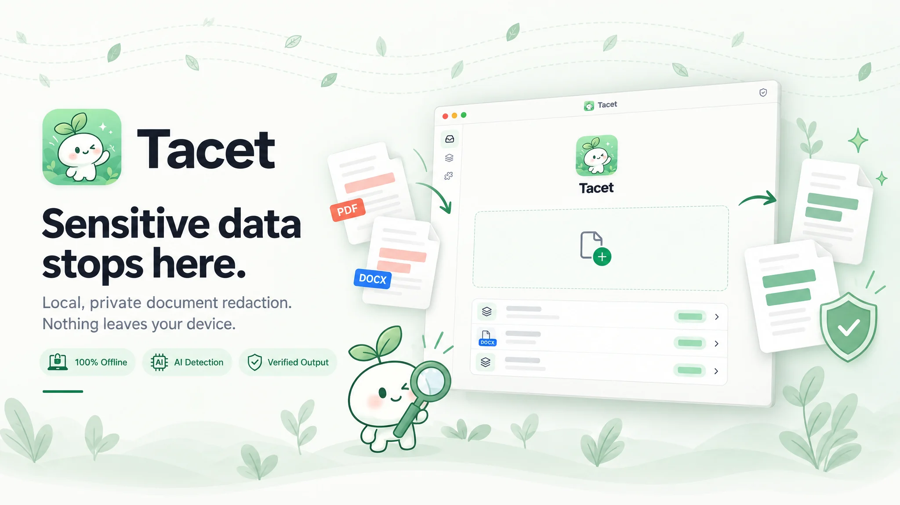

# Tacet

本地文档隐私脱敏工具：在本机完成文档解析、敏感信息识别、复核、脱敏与输出验证，不上传任何文档内容。

> 当前处于 M0 之前的工程骨架阶段：模块边界、接口契约与构建链路已建立，业务逻辑尚未实现。

## 文档

- [需求规格](docs/v1/tacet-requirements.md)
- [技术架构设计](docs/v1/tacet-architecture.md)
- [模块设计](docs/v1/tacet-module-design.md)
- [交互原型](docs/v1/tacet-prototype.html)

## 目录结构

| 路径 | 内容 |
| --- | --- |
| `cmd/tacet-desktop` | 桌面应用入口（Wails v3） |
| `cmd/tacet` | CLI 入口 |
| `internal/<模块>` | Go 内核，一个模块一个包，与模块设计 2.2 节一一对应；`internal/kernel` 为共享值类型 |
| `internal/archtest` | 模块依赖规则检查（模块设计 2.3 节），随 `go test` 运行 |
| `frontend` | 桌面界面（React + TypeScript + Vite） |
| `protocol/schema/v1` | 插件协议 JSON Schema，消息契约的唯一来源 |
| `python/sdk` | Python 插件 SDK |
| `python/plugins` | 内建插件（与 SDK 同属一个 uv workspace，共用一份锁文件） |
| `build` | Wails 构建配置（macOS、Windows） |

## 开发环境

- Go 1.26（`go.mod` 指定，较旧的 Go 会自动下载匹配的工具链）
- Node.js 24 与 npm
- uv（Python 3.13 由 uv 管理）
- Wails CLI：`go install github.com/wailsapp/wails/v3/cmd/wails3@v3.0.0`

## 常用命令

任务定义在 `Taskfile.yml`，用 `wails3 task <任务>` 运行：

| 命令 | 作用 |
| --- | --- |
| `wails3 task dev` | 开发模式运行桌面应用 |
| `wails3 task build` | 编译桌面可执行文件：macOS 为 `bin/tacet`，Windows 为 `bin/tacet.exe` |
| `wails3 task package` | 构建并打包桌面应用：macOS 生成 `bin/tacet.app`，Windows 生成安装程序 |
| `wails3 task build:cli` | 构建 CLI 到 `bin/cli/` |
| `wails3 task test` | Go 测试，含模块依赖规则检查 |
| `wails3 task lint` | `go vet` 与前端类型检查 |
| `wails3 task test:python` | Python SDK 与内建插件测试 |
| `wails3 task check` | 以上全部检查 |

## 许可

Apache-2.0，见 [LICENSE](LICENSE)。

