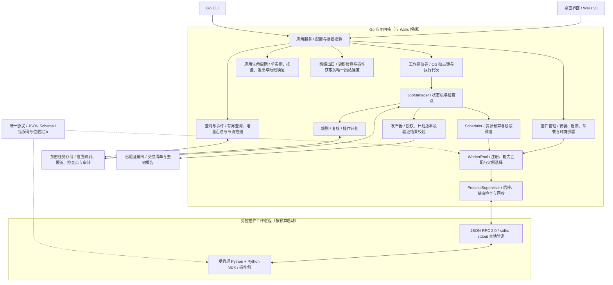
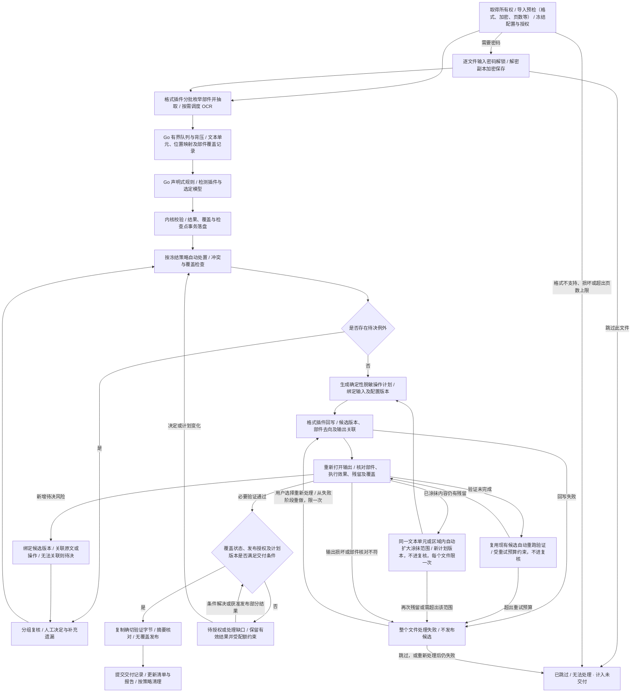
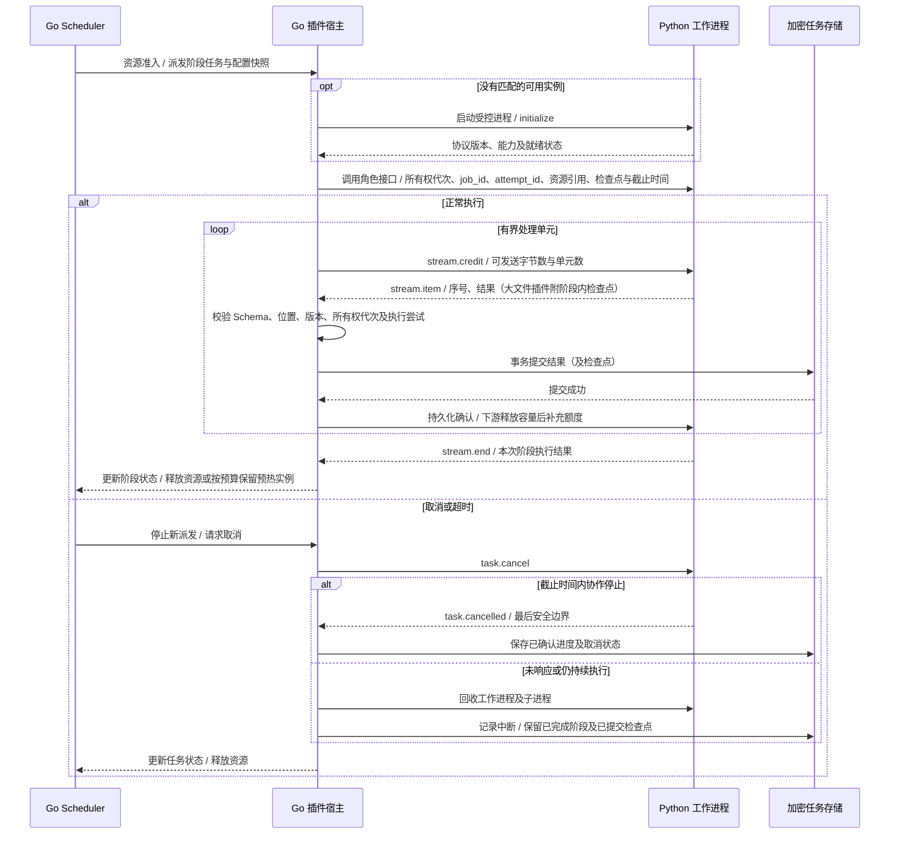
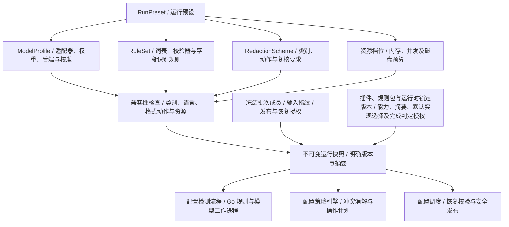

# Tacet：技术架构设计

> 版本：v0.11（依据模块设计文档 v0.1 的评审结论：第 2 节的内核模块在模块设计文档中细化；预检移到批次确认前（第 6 节）；验证中的再检测与部件核对由内核执行（4.1、4.2 节）；发布授权绑定处置结果版本（6.1 节）；快照按阶段分面（第 8 节）；补充阶段记录、处置结果、批次补充词表与发布授权实体（第 5 节）；网络出口以活动租约统一互斥（第 2 节）；查询汇总由发件箱事件维护（第 7 节）。依据需求规格 v0.11，运行预设增加最低置信度（第 8 节））
> 上一版：v0.10（依据交互原型评审及需求规格 v0.10：新增应用生命周期、应用更新与数据迁移、加密文件解锁、规则包与例外类型表；补充模拟效果预览、DOCX 定位与预览、交互优先调度、任务历史及查询与事件、网络出口两个模块；声明式规则以边界属性替代前后断言；GUI 与 CLI 默认分用工作区；PDF 超过页数上限在预检中拒绝）
> 配套文档：[Tacet 需求规格](tacet-requirements.md)、[Tacet 模块设计](tacet-module-design.md)。需求、范围、优先级与验收以需求规格为准；本文描述实现这些需求的架构、协议、数据模型、插件体系、平台实现与技术验证；模块边界、数据所有权与模块内核心逻辑见模块设计文档。
> 状态：设计基线，待 M0 原型验证；不代表已有实现或已完成性能验证。

## 1. 概述

- 已确定的技术基线：Go + Wails v3 桌面入口与共用 CLI 内核；MVP 仅支持 Python 进程外插件，由 Go 直接调度，协议保持语言无关，TS / JS 等运行时不属于 MVP；首发平台、内置模型、第三方插件、许可及首版 PDF 方案按需求文档 1.2、1.5、3.7、4.1 节及第 8 节；v0.8 评审及 v0.9 原型评审后的 MVP 范围决定见需求文档 10.2 节。
- 与需求文档的关系：需求、范围、优先级与验收以需求文档为准；本文的设计不得放宽需求文档中的离线、隐私、覆盖与资源约束。两者不一致时，先修订需求文档或在其中记录决策，再同步本文。
- 与模块设计文档的关系：第 2 节的逻辑模块在模块设计文档中细化为 Go 包级模块，规定职责、数据所有权、依赖规则及核心判定；本文修改模块边界或判定规则时同步修订模块设计文档。
- 编号约定：CORE、INV、FR、BUX、PF、UX、SEC 定义于需求文档，AR 定义于本文，MD 定义于模块设计文档，编号在三份文档中通用。通用约束 INV-01 至 INV-09（需求文档 1.4 节）适用于本文全部设计，本文以编号引用、不再复述。引用其他文档的章节时写作“需求文档 x.y 节”“架构文档 x.y 节”或“模块设计文档 x.y 节”。
- 本文的机制与数值是待 M0 原型验证的设计；验证结论按需求文档第 10 节回写范围决策。

## 2. 总体架构与处理流程

**总体架构。** 桌面入口和 CLI 复用同一 Go 应用内核；下图展示 MVP 的逻辑模块与进程边界。插件统一在受管理的 Python 环境中执行，可实现格式、检测、OCR 或验证角色，由宿主按清单及能力选择；实际角色交付遵循需求文档第 4、10 节的阶段范围。运行时启动适配与角色协议分离，扩展方式见 4.2 节。



插件间调用及数据流转由 Go 协调，插件结果经内核校验后持久化。MVP 通过 6.1 节的工作区独占所有权保证同一工作区只有一个修改者，GUI 与 CLI 默认各用一个工作区；上图表示共用代码和服务边界，不表示多个入口可在同一工作区同时启动相互独立的任务管理器。插件按授权访问受控资源，候选留在私有工作区；只有发布器可按需求文档 3.4 节条件把结果送入交付路径。

**处理流程。** 下图的插件阶段均由上述宿主调度；箭头表示受控数据流，不表示插件之间直接互调。每个文件独立推进，其他文件可在某文件等待复核时继续运行。



导出与验证失败的处置遵守需求文档 3.4 节，覆盖缺口遵守 4.2 节：某处内容的问题由用户在涂抹与保留之间决定，只有整个文件处理失败才提供重新处理。流程图中的回环受自动重试预算、残留扩大限一次及人工重新处理限一次约束，不意味着无限重新检测或重复导出；发布结果记录实际状态。

| 模块 | 职责 | 约束 |
| --- | --- | --- |
| UI / CLI | Wails v3 桌面入口与 Go CLI，调用共用应用服务 | 内核不依赖 Wails；界面线程不执行重计算；文档预览遵守 INV-08 |
| 工作区协调 | OS 独占所有权、执行代次及命令串行化 | MVP 同一工作区仅一个修改者；不以数据库事务或锁文件存在代替进程所有权；跨实例计算准入为 P1 |
| JobManager（任务控制器） | 批次与逐文件状态机、不可变配置快照、检查点、恢复、幂等及依赖失效 | 独立成员不因其他文件待复核而停止；不直接依赖具体文件格式或模型；同一工作区可同时有一个进行中的单文件快捷任务与一个批次，新任务不静默替换未完成任务 |
| Scheduler（资源调度器） | 阶段依赖、交互 / 后台两级优先级与公平派发；内存、CPU、磁盘、并发与超时准入及背压 | 预算覆盖整个应用进程树及所有处理阶段（INV-05） |
| WorkerPool | 注册与能力匹配；按插件及版本、依赖环境摘要、模型摘要 / 后端配置和权限配置选择并复用有上限的实例 | 扩展不进入主应用进程；不为所有插件常驻进程 |
| ProcessSupervisor | 通过运行时启动适配，以结构化参数启动进程，负责初始化握手、健康检查、截止时间、取消及进程树回收 | MVP 只实现 Python 适配；角色协议不依赖 Python |
| 插件环境管理 | 校验与登记已部署的解释器及依赖环境，按摘要查找、检查就绪状态，管理版本引用与回收 | 不在任务运行时解析依赖；与 WorkerPool 的实例生命周期分离；不自动合并包版本，见 7.2 节 |
| 插件管理 | 第三方插件的来源获取、安装确认、依赖环境部署、启用 / 停用 / 卸载及引用检查 | 安装与文档处理分离；只部署固定版本；沙箱未通过验收的平台不开放第三方插件，见 4.3 节 |
| 格式插件 | 格式探测、加密输入解锁、部件枚举、分批抽取、有界预览、位置映射、回写与验证 | 声明覆盖范围，在工作进程运行；返回候选版本、输出关联及部件去向 |
| 检测插件 | 规则、词表、模型及结果解码 | 不直接修改文件，不决定文件输出格式 |
| 规则包 | 内建或第三方的声明式规则数据（词表、正则、字段路径及校验器引用），由 Go 规则引擎执行 | 不含可执行代码，不启动工作进程；安装、引用与预算见 4.7、8.1 节 |
| 策略与操作计划 | 标签映射、自动处置、分组决定、冲突消解、替换策略 | 确定性执行，支持冻结成员范围、版本与复核记录 |
| 本地存储 | 检测结果、检查点、映射、审计及任务历史；加密 SQLite 与分段加密资源文件，见 5.1 节 | 受限磁盘使用；按 INV-07 加密与清理 |
| 验证与发布 | 格式完整性、残留检查、最终报告；核对所用插件版本的默认实现选择与完成判定授权（4.3 节） | 绑定确切的操作计划与输出文件版本 |
| 应用生命周期 | GUI 单实例、托盘常驻、窗口关闭与退出、系统关机及睡眠唤醒、后台节流 | 退出先停派发、到安全边界并回收进程树，再按用户选择保留或清理；见 6.2 节 |
| 查询与事件 | 界面的分页查询、增量维护的状态汇总及版本通知 | 推送只含汇总与版本号并合并节流，明细按需有界查询（INV-05、第 7 节） |
| 网络出口 | 官方模型资源获取、更新检查与下载、第三方插件来源获取及依赖下载 | 主进程唯一的出站通道；文档处理期间不发起连接（INV-06）；界面的“未联网”等状态以其连接记录为依据。与文档处理的互斥以活动租约统一实现：处理、联网（模型下载、更新检查与下载、插件获取）与维护（插件部署、应用更新）三类，处理租约与另两类互斥 |

上表是逻辑模块，模块设计文档将其细化为 Go 包级模块：JobManager 分为任务编排（`jobs`）、快照与兼容性检查（`snapshot`）及依赖失效判定（`lineage`）；策略与操作计划分为处置（`policy`）、例外（`exceptions`）、复核决定（`review`）及操作计划（`plan`）；验证与发布分为验证（`validate`）、交付判定（`verdict`）、发布（`publish`）及报告（`report`）；预检、抽取、Finding、覆盖、预览、模型资源、数据保留与资源引用各设独立模块。每类持久化实体只由一个模块写入；处置、失效、交付等判定写成无 I/O 的确定性函数，由 GUI 与 CLI 共用（AR-10）。

## 3. 架构约束

- AR-01：核心只依赖插件协议与通用数据类型；禁止核心直接导入具体格式实现，禁止格式插件直接耦合某个检测模型。
- AR-02：格式插件须实现可增量读取接口。无法流式处理的格式必须显式声明，使用严格受限的工作进程，并限制其大文件能力。
- AR-03：队列按字节与单元数共同限制；达到上限时暂停上游，不允许无界预读、整文件 tokenization 或无限 futures。
- AR-04：OCR、模型会话、解析器实例和预览缓存复用但有上限；默认低并发，防止多个线程池叠加占满整机。
- AR-05：工作进程异常、超时或超限由控制器回收；UI 与其他任务继续响应。进程隔离用于故障控制，另以 OS 沙箱 / 权限限制控制访问。
- AR-06：原始字节、规范化文本、模型 token 和源文档位置之间保留映射；任何规范化、纠错或跨块拼接均不得丢失可回写关系。候选输出的资源内映射与候选到原始输入 / 操作的关联分别存储并绑定版本，不能混用。
- AR-07：检查点与缓存按 INV-04 绑定输入指纹和配置快照，不匹配时不复用；幂等提交防止恢复后重复替换、重复计数。
- AR-08：进度来自实际处理状态；对扫描、推理、导出、验证分别记录，禁止导出未完成时显示 100%。
- AR-09：性能优化、量化、模型后端切换必须通过检测质量与位置映射回归；不得只比较运行速度。
- AR-10：通过同一内核支持 GUI 与 CLI，避免两套识别和导出逻辑。
- AR-11：命中分组、计数、筛选及批量决定采用可分页索引和有界提交；大量候选的操作不得产生全量前端成员表或逐命中重读整份文件。检查索引、分组及目标残留验证的规模复杂度，避免输入长度与命中数相乘的无界扫描。
- AR-12：等待复核与待发布文件占用的存储计入批次总预算；达到高水位暂停派发新任务，展示释放空间、发布已验证结果或清理的选择，避免后台持续生成候选直至磁盘耗尽。
- AR-13：MVP 同一工作区仅一个进程拥有修改权；发布、决定变更、恢复与清理受同一所有权和版本校验约束，具体见 6.1 节；跨实例计算准入列为 P1。
- AR-14：部件枚举、输出关联、预览和规则编译 / 执行同样纳入 INV-05 的预算、背压、取消及故障隔离；超限未完成按 INV-02 处理。
- AR-15：插件不获得任何文件路径，只经宿主颁发的受控资源引用访问输入、候选及临时区（4.4 节）；工作区内的中间资源落盘前已加密，插件私有临时区的明文使用须声明并计为保护降级。
- AR-16：交互任务（单文件快捷路径、复核中修改后需重新导出的文件）优先于后台批次调度，在“文件 × 阶段”边界或大文件插件的阶段内检查点让出资源，不中断正在执行的阶段（第 7 节）。
- AR-17：主进程的出站网络连接只经网络出口模块，工作进程由 OS 沙箱禁网；文档处理期间不发起任何连接（INV-06）。
- AR-18：工作区数据库、配置存储、资源文件及工作区头文件均记录格式版本；迁移、备份与降级规则见 7.3 节，不在未知版本上读写。

## 4. 插件体系

代码插件分为格式、检测、OCR、验证四种角色，均作为受控的 Python 进程外工作进程运行，由 Go 宿主统一注册、匹配与调度；另有只含声明式规则数据、由 Go 规则引擎执行的规则包。本章依次规定格式插件的能力与部件清单、通用插件协议、第三方插件的安装与生命周期、受控资源引用、首版内建格式插件的实现基线、加密文件的解锁及规则包。

### 4.1 格式插件能力声明与部件清单

覆盖维度（检查状态、输出处置、验证状态）及覆盖缺口的判定规则见需求文档 4.2 节；本节规定格式插件为此必须提供的能力与数据。

每个格式插件分别声明 `read`、`unlock`、`inventory`、`detect`、`preview`、`write`、`output_provenance`、`preserve_structure`、`preserve_layout`、`ocr`、`metadata_cleanup`、`hidden_content_cleanup`、`validate`、`large_file_profile`。每项必须说明支持的子结构、版本 / 定位能力和已知限制。

格式插件还必须提供可分批枚举的 `PartInventory`，证明实际存在的部件均已进入处置清单；仅列出解析器认识的部件不算完整。清单绑定输入指纹，含稳定部件标识、容器 / 关系、内容类型、已知 / 未知分类、大小或受限范围、枚举状态及输出去向。OOXML 枚举全部 ZIP 条目和关系，包括未引用条目、自定义 XML、缩略图和扩展部件；PDF 枚举对象 / 流、附件及历史处置，声明无法解释的对象。完整枚举不要求识别不透明附件内部的全部内容，但必须把附件本身作为未检查部件记录；结构歧义、重复条目名或无法可靠枚举时明确失败或缺口，不按解析器默认行为静默取舍。

- `write` 对输入清单逐项返回保留、脱敏、移除或转换后的输出引用，并列明新生成部件。验证时插件重新枚举实际候选并返回输出部件清单，由内核与 `write` 返回的处置记录核对，插件的自检结论不能代替这一核对；未登记的复制 / 新增部件、声称移除但仍存在的内容或不明残留均不得当作完整通过。移除同时检查相关引用及可恢复副本，不能只从清单隐藏条目。

### 4.2 插件协议

插件分为格式、检测、OCR、验证四种角色。一个包可以实现多个角色，但协议和依赖边界保持独立；角色与实现语言无关。插件清单通过 `runtime.kind` 声明执行环境；MVP 宿主仅实现并接受 `python`，加载前检查目标平台、解释器及依赖兼容性。运行时标识采用可版本化扩展的机制，遇到未知或当前未实现的值，在启动前返回明确的“不支持的运行时”错误，不尝试猜测命令、自动安装运行时或改用其他环境。

| 项目 | 要求 |
| --- | --- |
| 清单 | `id`、版本、协议版本范围、角色、许可证、`runtime.kind`、运行时兼容范围、目标平台、包内入口、依赖、校验摘要、能力与资源声明；Python 发行包另绑定解释器 / ABI、锁文件及依赖环境摘要；运行时专属配置独立且可校验，不进入通用角色消息 |
| 格式识别 | `probe` 只做有预算的探测；扩展名不能作为唯一依据。同时返回加密状态及页数等预检所需的计数，供宿主在预检中判定解锁（4.6 节）或超限拒绝 |
| 解锁 | `unlock` 接收输入引用与密码，写出解密副本并返回其资源引用；密码字段在 Schema 中标为机密，见 4.6 节 |
| 生命周期 | 初始化、健康检查、任务开始、取消、关闭；失败有明确错误码和可重试性 |
| 部件枚举 | `inventory` 按预算分批返回实际输入部件及关系、未知内容、完整性状态和检查点；可与抽取共享解析器，但不得用抽取结果替代全量部件登记 |
| 抽取 | `extract` 以迭代事件返回文本单元、源定位、部件引用及覆盖信息；声明大文件能力的插件另返回阶段内检查点（第 6 节） |
| 预览 | `preview` 接收受控资源引用、输入 / 候选版本、定位、视区 / 游标和预算，返回安全文本或受控栅格图像引用、分页游标及选择到源位置的映射；不返回需要执行的 HTML / JS；返回内容附面向用户的显示定位（第 5 节） |
| 检测 | `detect` 接收文本单元和策略上下文，返回候选敏感片段；处理模型解码和标签映射 |
| 输出 | `write` 接收操作计划与源引用，返回不可变候选标识 / 摘要、实际执行 / 未执行内容清单、部件去向及有界输出关联映射引用 |
| 验证 | `validate` 绑定候选版本和预期计划，返回输出部件清单、格式完整性、检查范围、执行方法、残留及未验证项，不只返回一个布尔值；部件核对由内核完成（4.1 节）；新增风险由内核对候选重新抽取并以同一检测配置检测，格式插件不运行检测模型（AR-01）；未完成（`not_run`，附可重试性）与未通过（`failed`）分别返回，未通过时区分已批准操作的残留（附所在文本单元或区域，供宿主扩大涂抹范围）与输出损坏或部件核对不符 |
| 例外 | 抽取、验证等阶段以 5.2 节的类型码上报需要人工决定的内容、范围及证据；插件不定义动作，也不决定能否整组处理 |
| 协议演进 | 兼容范围明确；不兼容插件加载前拒绝，不能处理到一半才报协议错误 |
| 信任与权限 | 内建插件随应用签名与校验，第三方插件按 4.3 节安装；两者均在 OS 沙箱内运行，只经 4.4 节的资源引用访问数据；某平台沙箱未通过验收时按需求文档 SEC-07、FR-45 处理 |
| 分发 | 内建插件随应用或离线资源包安装，第三方插件按 4.3 节安装；包及依赖使用摘要校验，升级与回退遵守 7.2 节的环境版本规则 |

IPC 基线采用 stdin / stdout 本地管道承载 JSON-RPC 2.0，每帧为 4 字节大端长度加 UTF-8 JSON；读取长度后先检查 4 MiB 消息上限，再分配缓冲。初始化协商协议、插件及运行时版本；任务消息携带 `job_id`、`attempt_id`、工作区所有权代次和协议版本，RPC 请求 ID 与流序号用于关联响应。流式结果、按字节 / 单元数计算的发送额度、心跳、截止时间和取消确认作为 Tacet 协议扩展定义。控制消息须能在数据背压时继续处理；标准输出只传协议，标准错误诊断也须去敏和限量。

以下示例只说明消息形态（省略帧头），字段与取值以 JSON Schema 为准：

```jsonc
// 宿主 → 插件：初始化与版本协商
{"jsonrpc": "2.0", "id": 1, "method": "initialize",
 "params": {"protocol": {"min": "1.0", "max": "1.0"}, "owner_generation": 7,
            "limits": {"max_message_bytes": 4194304}}}
// 插件 → 宿主
{"jsonrpc": "2.0", "id": 1,
 "result": {"protocol": "1.0", "plugin": {"id": "tacet.docx", "version": "0.1.0"},
            "roles": ["format"], "capabilities": {"inventory": true, "write": true}}}

// 宿主 → 插件：流式抽取；资源按 4.4 节以引用传入，handle 为继承给工作进程的平台句柄
{"jsonrpc": "2.0", "id": 2, "method": "format.extract",
 "params": {"job_id": "j_8f2c", "attempt_id": "a_3", "owner_generation": 7, "deadline_ms": 600000,
            "input": {"ref": "res_in_1", "mode": "read", "handle": 3, "digest": "sha256:…"},
            "scratch": {"ref": "res_tmp_1"},
            "stream": {"id": "s_2", "credit": {"bytes": 1048576, "items": 64}}}}
// 插件 → 宿主：流式条目（通知）
{"jsonrpc": "2.0", "method": "stream.item",
 "params": {"stream": "s_2", "seq": 17,
            "item": {"kind": "text_unit", "unit_id": "u_17", "part": "word/document.xml",
                     "text": "……", "source_map": {"ref": "res_map_17"}}}}
// 宿主 → 插件：结果已事务提交，确认并补充额度
{"jsonrpc": "2.0", "method": "stream.credit",
 "params": {"stream": "s_2", "committed_seq": 17, "bytes": 65536, "items": 8}}
// 插件 → 宿主：stream.end，作为请求 2 的响应
{"jsonrpc": "2.0", "id": 2,
 "result": {"type": "stream.end", "stream": "s_2", "last_seq": 412, "status": "completed"}}
```

大图、大文件和大操作计划通过受控资源引用分批访问，不嵌入 JSON 消息。JSON Schema 是消息契约的唯一来源，统一定义错误码、Unicode code point 位置及协议符合性测试；MVP 只提供 Python SDK，封装通信及生命周期。跨进程消息只使用协议定义的 JSON 数据及受控资源引用，不使用 pickle、Python 对象或 Python 专属异常作为传输格式。引入其他运行时只增加受控启动适配与对应 SDK，复用同一契约与符合性测试，不改变调度、覆盖、复核及发布语义。

预览是格式插件的正式能力：插件声明支持的文本 / 图像预览、选文 / 框选及输出差异范围；宿主以通用组件展示，新增格式无需在核心加入专属解析或渲染分支。预览和选择均绑定具体资源及版本，候选选择不能直接当作输入位置；过期选择拒绝提交，不可靠选择转入例外。未支持版式预览时可明确使用足以完成该格式复核的文本或页面图像方案；连定位与必要人工复核都无法完成的格式不能准入。所有返回内容遵守 INV-08 及第 9 节。

**效果预览（模拟）。** 复核中的“效果”“对比”视图，以及悬停在“涂抹 / 保留”上时的即时效果，都是导出前的模拟，不调用 `write`、不生成候选：

- 文本类格式及 DOCX：宿主在已抽取的文本单元上套用当前决定草稿与方案的呈现方式（色块或类型占位符），由通用组件渲染。
- 文字型 PDF：宿主在插件返回的原页面栅格上叠加涂抹样式。目标区域由宿主根据源映射中的字符框及插件声明的外扩参数计算并写入操作计划，插件回写时按计划区域填充（4.5 节）；预览与回写使用同一份区域，不各自实现外扩。
- 页内图像、嵌入对象按当前决定显示为“已涂抹”占位。
- 模拟只在界面内存中计算，只重绘当前视区，不写盘、不改变决定；悬停响应计入需求文档 PF-02。界面标明为预览，以验证后的候选输出为准；已导出的文件可在同一视图查看候选输出的真实预览。

插件商店、自动更新与热更新列为 P2。首版需用一个以第三方方式安装的示例格式插件，证明格式探测、部件登记、检测、预览定位、回写及验证可扩展，无需提前实现完整市场。

### 4.3 第三方插件的安装与生命周期

本节规定第三方插件安装与生命周期的实现约束；产品行为以需求文档 3.7 节（FR-40 至 FR-45）为准，安全要求见 SEC-07、SEC-14。

| 环节 | 要求 |
| --- | --- |
| 开放前提 | 按需求文档 FR-45；沙箱验收以第 10 节平台实现基线为准 |
| 来源 | git 仓库由内置 go-git 获取并检出 FR-40 指定的提交，不依赖系统 git；本地路径复制为不可变快照；二者的摘要记入插件版本标识 |
| 依赖部署 | 插件须提交 `uv.lock`；由应用内置的 uv 按锁文件部署独立环境，只接受目标平台的预编译 wheel，禁止从源码构建（uv 的 `no-build`），不执行安装钩子或构建脚本。联网下载按 FR-41 提示；离线安装使用本地路径并附带预编译 wheel 目录。部署失败或中断不影响其他插件及内建环境 |
| 依赖隔离 | 按 7.2 节：每个第三方插件版本使用独立环境，不得加入内建发布组或写入任何依赖环境 |
| macOS 原生库 | 内建插件使用的解释器保持 hardened runtime 的库签名校验；第三方插件使用单独签名、带 `com.apple.security.cs.disable-library-validation` 权限的解释器副本，以加载其自带的原生库。放宽的只是库签名校验，沙箱约束不变 |
| 启用就绪检查 | 启用前完成协议握手、清单与能力校验及固定样例就绪检查；未通过不得启用 |
| 引用与回收 | 停用、卸载、升级与回退遵守 FR-42 的引用规则：复用 7.2 节的环境引用登记，仍被运行中、待复核、可恢复任务或未到期保留数据引用的代码与环境不得删除或原地改写 |
| 自带模型 | 第三方检测插件可以自带模型与加载代码，按第三方代码管理：受沙箱、资源预算及本节规则约束，不适用内置模型的 8.3 节完整性清单，也不视为产品支持“导入模型” |
| 格式默认实现 | 多个插件声明同一格式时按需求文档 FR-43 由用户选定默认实现；运行快照记录所选插件及版本，安装新插件不改变已冻结的快照 |
| 完成判定授权 | 需求文档 FR-44 的授权绑定插件 ID、版本与摘要并记入运行快照；发布器在标记“已按策略完成”及无人值守发布前核对，升级后须重新授权 |

### 4.4 受控资源引用

插件不接收任何文件路径。宿主为每次调用颁发受控资源引用，插件只能通过引用读写数据；OS 沙箱（第 10 节）不授予插件对用户目录、工作区及其他环境的文件权限，因此引用是插件接触文档数据的唯一途径。

| 资源类型 | 访问方式 | 落盘保护 |
| --- | --- | --- |
| 输入原件 | 宿主校验指纹后以只读方式打开，把句柄继承给工作进程；SDK 包装为可随机读取的 file-like 对象 | 用户原件不额外复制；读取与发布前核对指纹（第 6 节） |
| 工作区资源（候选输出、源映射、输出关联、预览栅格、大操作计划、加密输入的解密副本） | 宿主创建或打开资源文件并继承句柄，在调用消息中附带该资源的密钥；SDK 提供透明加解密的读写对象，读取可随机定位，写入只追加 | 分段认证加密：每 64 KiB 明文一段，AES-256-GCM，资源标识、段序号及末段标记进入 nonce / AAD，可检测篡改、截断与换段；密钥只经管道下发，不落盘 |
| 插件私有临时区 | 每个 `attempt_id` 一个目录，是沙箱内唯一可写的路径，供必须按路径打开文件的原生库或辅助工具使用 | 默认明文，计入配额，执行尝试结束即删除；按需求文档第 7 节记为保护降级，第三方插件须在清单中声明并在安装确认时展示 |

- 引用绑定 `job_id`、`attempt_id`、所有权代次、访问模式及资源版本；执行尝试结束或取消后即失效，迟到的写入被拒绝。写引用的资源在 `stream.end` 后由宿主计算摘要并冻结为不可变资源，之后只能以只读引用访问；重写一律创建新资源及新密钥，避免 nonce 复用。
- 原生库优先使用流式或回调接口读取（如 PDFium 的自定义读取接口），确实只能按路径打开时才在私有临时区落地明文，并在报告中记录；首版内建插件（4.5 节）均按前一种方式实现，不依赖明文临时区。
- 文本单元正文等由宿主写入的内容同样存为工作区资源（5.1 节）。
- 预览栅格由宿主解密后在内存中交给界面，经 Wails 自定义资源处理器按请求提供并设置 `Cache-Control: no-store`，不写入浏览器缓存（第 9 节）。
- 发布时由宿主解密已验证的候选，写入目标卷的独占临时文件后无覆盖发布（需求文档 FR-30）。
- 句柄继承、加密读写吞吐及其在沙箱内的可用性须在 M0 两个平台上验证；不可行时改为宿主经独立数据管道代理读写，不放宽“插件不获得路径”的约束。

### 4.5 首版内建格式插件实现基线

以下为 M0 原型的起点，结论按需求文档第 10 节的格式准入规则回写；所用库均须列入许可清单（需求文档第 8 节）。

**通用。**

- XML 使用 lxml 的增量解析（`iterparse`）与增量写出（`xmlfile`）；解析器关闭实体解析、DTD 加载与网络访问，并限制节点数、深度及单节点文本长度（INV-08）。
- ZIP 容器先由插件自行扫描中央目录与本地文件头：重复条目名、两处头信息不一致、条目重叠、加密条目或超出解压比 / 体积上限时，按需求文档 4.2 节明确失败，不依赖标准库 `zipfile` 对重复名的默认取舍；扫描通过后再用 `zipfile` 逐条目流式读取。
- 输出 ZIP 以不可回写的流方式写出（使用数据描述符），以适配 4.4 节的只追加加密写入。

**DOCX。**

- 不使用 python-docx 等对象模型库整体加载文档：部件清单须覆盖其不认识的条目，回写须精确控制每个部件。
- 部件清单：中央目录的全部条目、`[Content_Types].xml` 及各级 `.rels` 关系，区分已知部件（正文、页眉页脚、脚注尾注、批注、修订、文本框、`customXml`、`docProps`、缩略图、媒体、嵌入对象）、未引用条目与未知扩展。
- 抽取：按段落组装文本单元，源映射记录每个字符所在的 `w:r` / `w:t` 节点及偏移；修订（`w:ins` / `w:del`）、域代码与隐藏文字（`w:vanish`）分别标注，不混入可见正文。
- 回写：只修改命中所在的 run；实体跨多个 run 时按源映射拆分边界 run 并保留各自格式，替换文本写入首个 run，其余被覆盖的 run 置空，不重写整段。未修改的部件按原字节复制，修改的部件流式重写。
- 图片按需求文档 4.2 节替换为占位图时，同步更新关系与内容类型，删除原媒体条目及缩略图。
- 验证：重新打开候选，逐条目核对处置记录，对修改过的部件重新抽取并核对已批准操作；在 Word 与 WPS 约定版本中打开无修复提示作为准入证据。
- 定位：抽取时为每个文本单元记录页码提示、所属章节和段落序号，三者组合为面向用户的定位（需求文档 1.2、4.3 节）。页码依据文档保存的分页标记（`w:lastRenderedPageBreak`、`w:br w:type="page"`、`w:pageBreakBefore` 及分节符）推算，反映的是 Word / WPS 上次保存时的分页，软件、字体或纸张设置不同时可能偏差，界面显示为“约第 n 页”；未保存分页标记的文档（多见于程序生成）不显示页码。章节取最近的标题样式或大纲级别段落，没有标题时省略。段落序号按正文顺序编号，始终可用；表格内容另附“表 k 第 r 行第 c 列”，页眉页脚、脚注尾注、批注与文本框标明所属区域。
- 预览：不引入排版引擎，按段落、标题级别、列表及表格网格输出结构化安全文本，页眉页脚、脚注、批注与文本框分区显示（预览形态待需求文档第 11 节的用户验证）。内嵌图片中能在沙箱内解码的位图格式（PNG、JPEG、GIF、BMP、TIFF）按像素上限转为受控栅格；SVG 使用文档自带的 PNG 回退图；EMF / WMF 等图元文件在 M0 选定沙箱内的转换方案前显示为“无法预览”，仍按默认涂抹处置，用户选择保留时提示该图像未经查看。
- 色块呈现：被删除的文字替换为带纯色底纹的替代字符；涂抹样式中的图案不适用于 DOCX。

**文字型 PDF（栅格化输出）。**

- 使用 pypdfium2；PDFium 不是线程安全的，一个工作进程同一时刻只处理一个文档。输入经自定义读取接口通过 4.4 节的资源引用读取，不落地明文副本。加密 PDF 按 4.6 节解锁；`probe` 报告的页数超过需求文档 5.4 节的上限（初始 2,000 页）时，宿主在预检中拒绝并提示实际页数与上限，不进入抽取。
- 每页先在内存中展平注释与表单（`FPDFPage_Flatten`，不写回原件），重新加载页面后对同一结果抽取文本、字符框并渲染，保证检测内容与输出可见内容一致；展平后的抽取效果须在 M0 验证。
- 文本层一致性：逐字符检查 Unicode 映射错误（`FPDFText_HasUnicodeMapError`）；枚举页面对象（含嵌套表单对象），计算图像对象和密集路径对象的可见区域；按需求文档 4.3 节把无对应文本的可见区域计入覆盖缺口或送入复核，图像区域可按需求文档 4.2 节涂除；记录使用回退字体渲染的页面。密集路径的判定阈值在 M0 用样本调定。
- 输出：按声明 DPI 渲染位图，按操作计划给出的目标区域（已批准操作的字符框外扩区域及授权涂除的图像区域，由宿主计算，见 4.2 节效果预览）以所选涂抹样式填充，编码后交给自研的最小 PDF 流式写出器逐页追加（目录、页树、每页一个图像 XObject 与内容流，交叉引用表最后写出）；内存只保留当前页，不复制原文档的任何对象。
- 验证：以 PDFium 重新打开候选，枚举对象确认只含白名单结构、文本提取为空、页数与页面尺寸一致，并逐个核对已批准区域的像素与所选样式的填充结果一致。
- 涂抹样式（需求文档 FR-29）：纯色、斜纹、马赛克及各类图案均为预先生成、与原内容无关的固定纹理，按目标区域平铺；马赛克不由原图像素降采样生成，以免被还原。样式只改变填充外观，不改变目标区域与验证要求。

**其他首版候选。** TXT / Markdown / 日志按声明编码增量解码，记录字节到 code point 的映射；CSV 使用标准库 `csv` 流式读写，并对输出单元格做公式注入防护；JSON / JSONL 使用能保留原始数值词法与重复键的流式解析器，候选库在 M0 选定；XLSX 值子集不用 openpyxl 改写用户文件（其官方说明打开再保存会丢失形状等不支持的内容），改用与 DOCX 相同的 ZIP + lxml 方式，只重写共享字符串与工作表 XML 中的单元格值，其他部件按部件清单处置。

### 4.6 加密文件的解锁

需求文档 FR-09 为 P0：MVP 支持带打开密码的 DOCX 与文字型 PDF，其他格式的加密文件在预检中标为“不支持的加密方式”。

| 环节 | 要求 |
| --- | --- |
| 探测 | `probe` 返回加密状态：`password_required`、`permission_only`（只设权限口令的 PDF，无需密码即可打开）或 `unsupported`（证书加密、自定义安全处理器、DRM 等）；不尝试猜测或破解密码 |
| 输入 | GUI 在例外队列（5.2 节 `password_required`）或快捷路径的首个界面逐文件输入；交互式 CLI 只从终端无回显读取，非交互运行记为阻塞（需求文档 3.6 节）。不接受命令行参数、环境变量或配置文件传入密码 |
| 传递 | 密码只放在 `format.unlock` 调用消息中经管道下发；Schema 把该字段标为机密，宿主与 SDK 的日志、诊断、错误信息及崩溃信息一律不记录其值。宿主以字节切片持有，调用结束后连同编码后的消息缓冲一起清零；Python 侧的字符串无法清零，SDK 在解锁后立即释放引用，这一点不作为强保证。密码不写入任务存储、检查点或撤销记录 |
| 解密 | DOCX（OOXML 加密包，ECMA-376 标准加密与敏捷加密）使用 msoffcrypto-tool 解密；PDF 由 pypdfium2 以密码打开后，以 `FPDF_REMOVE_SECURITY` 另存为解密副本。解密结果写为工作区资源（4.4 节，随任务 DEK 加密），后续部件枚举、抽取、预览、回写与验证均读取该副本，不在私有临时区落地明文 |
| 密码错误 | 返回 `PASSWORD_INCORRECT`，可重新输入；不计入“重新处理”的一次机会，也不构成整个文件处理失败 |
| 恢复 | 只保存解密副本，不保存密码；“文件 × 阶段”恢复与重新处理直接复用副本，无需再次输入。副本计入任务临时区配额（需求文档 PF-11），按需求文档 7.1 节随任务清理 |
| 指纹 | 输入指纹仍取加密原件；发布前核对原件指纹，原件变化时解密副本及其下游结果按 INV-04 失效 |
| 输出 | 输出不继承原件的加密或权限限制；导出前及报告中注明“原文件已加密，输出未加密” |

DOCX 的“限制编辑”（`w:documentProtection`）不是加密，无需密码，照常处理，并按部件清单记录该设置的去向。msoffcrypto-tool 与 PDFium 另存副本在大文件上的内存表现，以及 WPS 加密文档的兼容性，须在 M0 验证；必要时按 ECMA-376 的分段结构流式解密。

### 4.7 规则包

规则包是只含声明式规则数据的插件包（清单 `kind: ruleset`，不声明 `runtime.kind`），用于分发词表、正则、字段路径及对已注册校验器的引用，例如行业规则集。它不含可执行代码，由 Go 规则引擎按 8.1 节执行，因此不启动工作进程、不进沙箱；需求文档 FR-45 的沙箱前提不适用于规则包（需求文档 FR-46）。

- 来源、固定版本、安装确认、启停、卸载、升级与回退沿用 4.3 节及需求文档 FR-40 至 FR-42；安装确认展示规则数量、涉及类别、词表体积及许可。
- 安装时先按 JSON Schema 校验，再按 8.1 节的预算试编译；含不支持的语法、引用未注册的校验器或超出规则预算时拒绝安装，不截断。解析本身同样受体积、条目数与深度上限约束（INV-05、INV-08）。
- 规则包提供的规则集在界面中只读，复制后成为用户规则集，存入加密配置存储（5.1 节）。
- 运行快照记录规则包版本及摘要；方案或可恢复任务引用的版本按 FR-42 的引用规则不得删除。
- 只由第三方规则包提供检测来源的类别没有经过 Tacet 的评测，策略摘要按需求文档 FR-18 标明来源，不获得无人值守资格（需求文档 6.2 节）。

## 5. 中间数据与位置约定

建议的最小逻辑数据模型：

| 类型 | 关键字段 |
| --- | --- |
| Batch | 冻结成员及版本、共享策略、发布授权、逐文件结果计数、存储总预算与清单版本 |
| Job | 批次引用、状态、调度级别（交互 / 后台）、输入指纹、配置快照、所有权代次、资源档位、检查点、保留期限、错误与覆盖汇总 |
| StageRecord | 任务引用、阶段、`attempt_id`、状态（待派发 / 运行中 / 完成 / 已丢弃）、依赖的快照分面摘要与上游产物版本、产出引用 |
| PartInventory | 输入 / 候选资源标识与摘要、清单版本、稳定部件标识、容器及关系、内容类型、已知 / 未知分类、枚举游标与完成状态 |
| TextUnit | `unit_id`、文本版本、所属输入 / 候选标识与版本、部件引用、顺序、文本、语言提示、结构上下文、显示定位、`source_map_ref`、分块边界 |
| Finding | `finding_id`、产生阶段、所属输入 / 候选及版本、`unit_id` 与文本版本、起止位置、类型、来源、原始分数、结果版本、处置依据、复核状态 |
| ReviewDecision | 决定版本、动作、范围摘要、冻结成员引用、策略 / 输入版本、决定来源、理由、优先级及撤销记录 |
| Disposition | 处置结果版本（由检测结果版本、`dispose` 分面摘要、决定版本与处置引擎版本计算）、目标、动作、依据（自动策略 / 字段规则 / 人工单项 / 人工批量）、决定引用、合并来源，以及低于最低置信度而未处理的计数 |
| SupplementTerms | 批次引用、版本、补充词条（加密）、来源决定；只作用于本批次，不修改冻结的规则集 |
| SourceMap | 绑定资源及文本版本的文本范围到字节 / XML 节点 / 单元格 / 页坐标的多段映射 |
| OutputProvenanceMap | 候选标识 / 摘要与计划版本、输出范围或定位、关联的原始输入范围 / 操作标识、保留 / 生成 / 转换 / 无法关联的归属、可靠性及有界读取引用 |
| PreviewResult | 输入 / 候选与文本版本、预览类型、视区、文本片段 / 栅格资源引用、选择映射、分页游标及限制 |
| RedactionPlan | 计划版本、原始输入版本、关联 findings、稳定操作标识、操作、替换引用、目标范围（PDF 等含宿主计算的目标区域，4.2 节）、涂抹样式及冲突处理结果 |
| CoverageItem | 部件清单版本与部件引用、必查范围、内容类型、检查状态、输出处置与去向、验证状态、方法、原因及缺口 |
| ValidationResult | 输入与候选标识 / 摘要、计划版本、部件核对、操作执行验证、新增风险检查与位置关联状态、范围、状态、保留例外及限制 |
| PublishGrant | 任务、授权来源（显式 / 无人值守常设）、绑定的处置结果版本、范围摘要及失效状态 |
| PublishIntent | 幂等标识、任务及所有权代次、输入 / 计划 / 决定 / 授权版本、候选摘要、目标与输出版本、准备 / 已发布 / 已记账状态 |
| DeliveryItem | 发布意图引用、批次与文件中性标识、输出相对位置和摘要、发布版本 / 状态、失败原因及清单提交状态 |
| ExceptionItem | 类型码（5.2 节）、所属文件与版本、范围（文本范围 / 区域 / 部件 / 整个文件）、证据引用、显示定位、是否导出后发现、决定引用 |
| HistoryEntry | 显示名、文件数、状态汇总、时间、导出目录引用、关联批次或任务（清理后置空） |

文本位置统一采用 Unicode code point 的 0-based 半开区间 `[start, end)`，明确对应具体版本的 `TextUnit.text`。JS UTF-16、UTF-8 字节和模型 tokenizer offset 必须显式转换。原始文件字节范围独立存储，不能混用。组合字符、emoji、全角字符、CRLF、规范化和 OCR 纠错都需进入映射测试。

PDF 坐标包含页码、单位、页面旋转和坐标变换；XML 定位包含部件标识和节点路径 / 稳定标识；表格定位包含工作表、单元格及共享字符串引用。一个实体可以映射到多个不连续源片段。找不到可靠映射时按 INV-09 处理。

面向用户的显示定位（复核队列、报告及清单中的位置）与上述内部定位分开保存：PDF 用页码；DOCX 用页码提示、章节与段落序号（4.5 节）；表格用工作表与单元格；文本类格式用行号。显示定位只用于导航与说明，不参与回写，不能代替源映射。

长文本采用模型特定的有界窗口和重叠策略，避免把所有重叠窗口保存在内存。只保留完成边界合并所需的尾部数据；超长凭证、跨行字段和跨窗口实体需专项规则。上下文的使用遵守需求文档 FR-15。

**候选输出与原始输入的关联。** `SourceMap` 只负责某个资源内的抽取文本定位；候选的 `SourceMap` 不能替代候选到原始输入的 `OutputProvenanceMap`。MVP 的操作计划始终基于同一冻结原始输入重新执行，不在旧候选上连续打补丁。

- 回写后给候选分配不可变标识与摘要；对进入验证的输出范围，记录其来自保留输入、替换操作、结构转换或明确无法关联。输入删除没有对应输出时，通过操作执行记录及残留验证检查，不伪造输出位置。关联可使用字节片段、稳定节点或页坐标等格式专属定位，不要求所有格式逐字节映射，但须满足 INV-09。
- 验证新命中先通过候选 `SourceMap` 定位输出，再通过输出关联定位原始输入或既有操作。源自保留内容的命中生成新的原文操作；源自占位符 / 生成内容的风险调整对应操作或输出构造规则。跨越保留与生成范围的命中需拆解并处理所有相关来源，不按长度差猜测偏移。
- 无法可靠关联时，复核界面同时显示候选上下文和可定位的原文，用户可以在原文重定位或授权可靠的更大范围；无法形成有效计划时阻塞。明确保留需满足策略并绑定该候选、计划及内容范围，不能外推到新版本；用户未授权时不得直接重设候选为输入。
- 输入、计划、候选字节或关联版本的变化按 INV-04 使相关验证、关联决定和未发布授权失效。关联及预览映射通过受控引用分批读取，不能为验证命中逐项重扫整份文件。

### 5.1 任务存储与密钥分层

**存储划分。** 每个工作区一个 SQLite 数据库，保存批次、任务、部件清单、Finding、复核决定、覆盖、验证、发布意图与交付清单等元数据和索引，承担 10 万候选级的分页、筛选与分组查询（需求文档 PF-14、PF-16）。文本单元正文、源映射、输出关联、预览栅格及候选输出等大块内容存为工作区内的分段加密资源文件（4.4 节），数据库只保存引用、位置与摘要，避免数据库随文本量膨胀。

**数据库加密。** 两个候选在 M0 以 10 万候选的查询与写入负载比较后选定：

| 方案 | 特点 | 需关注 |
| --- | --- | --- |
| `ncruces/go-sqlite3` + `adiantum` VFS（MIT） | 无 cgo，构建简单；VFS 加密主库、WAL 与日志（跨库事务的 super journal 除外，设计上不使用跨库事务） | 只提供机密性、不检测篡改；Windows 上的 WAL、性能及临时文件的加密覆盖须实测 |
| SQLCipher Community Edition（BSD 风格许可） | 页级 AES-256 加 HMAC，主库、WAL 与日志均加密，可检测篡改 | 需要 cgo 与加密库；许可要求在应用界面或文档中显著署名 |

两种方案都须：启用 `secure_delete`；临时存储设为内存或经同一加密层；数据库及旁路文件位于私有工作区（第 10 节）。数据库不保存敏感原值：Finding 只存位置、类型与摘要，复核界面需要原值时从任务资源文件按位置读取；同值分组使用批次密钥派生的 HMAC，不存明文或无密钥哈希。

**密钥分层。**

| 层级 | 生成与保存 | 用途与销毁 |
| --- | --- | --- |
| 主密钥（KEK） | 每个 OS 用户一把，随机生成，存 macOS Keychain / Windows DPAPI（用户范围） | 只用于包裹下层密钥；卸载时提供清除选项 |
| 工作区密钥 | 每个工作区随机生成，由 KEK 包裹后存于工作区头文件 | 加密工作区数据库；删除工作区时销毁 |
| 批次密钥 | 每个批次随机生成，包裹后存数据库 | 派生同值分组的 HMAC 键；批次清理时销毁 |
| 任务数据密钥（DEK） | 每个任务随机生成，包裹后存数据库 | 派生该任务全部资源文件的密钥；任务清理或保留到期时删除包裹密钥与资源文件，实现按任务的加密擦除 |
| 资源密钥 | 由任务 DEK 与资源标识派生 | 只经管道下发给持有引用的插件，不落盘 |

- 配置存储（规则集、词表、方案、运行预设及涂抹样式等设置）使用独立的加密 SQLite，由 KEK 包裹的配置密钥保护；由 GUI 与 CLI 共用，写入使用 SQLite 事务并核对对象版本，同时保存各用户配置对象最近 5 个版本的历史（第 8 节）；运行中的任务只使用开始时冻结的快照。
- 删除任务后，数据库残留页仍受工作区密钥保护，大块敏感内容已随任务 DEK 销毁；定期 `VACUUM` 回收空间。不对 SSD 宣称物理删除（需求文档第 7 节）。
- 插件私有临时区的明文按 4.4 节记为保护降级。

**任务历史。** 首页“最近”列表的条目（HistoryEntry）独立于任务数据，保存在工作区数据库，受工作区密钥保护；只含显示名（单文件为文件名，批次为批次名）、文件数、状态汇总、时间及导出目录引用，不含原文、命中、输入路径或报告内容。任务清理（含“停止并清理”）删除任务数据并把条目的关联置空，条目本身保留，使用户能看到该任务已停止或已导出；用户可删除单条，“清理工作区”时一并清空；最多保留最近 100 条，超出按时间淘汰。显示名属于敏感数据，不进入日志、报告或诊断（INV-07）。

### 5.2 例外类型

例外队列中的条目按类型码分组。类型表随协议 Schema 版本化：插件只上报类型码、范围及证据，动作集合、动作后果及能否整组处理由内核依据类型表与冻结策略给出，界面只渲染内核给出的动作。插件不能自定义动作；新增类型码随协议版本发布。所有类型遵守需求文档 2.3 节的两类决定。

| 类型码 | 级别 | 作用范围 | 动作 | 选择“保留”的后果 | 整组处理 |
| --- | --- | --- | --- | --- | --- |
| `password_required` | 文件 | 整个文件 | 解锁 / 跳过此文件 | — | 可整组打开，逐文件输入密码（4.6 节） |
| `file_failed` | 文件 | 整个文件 | 重新处理（限一次）/ 跳过此文件 | — | 可 |
| `strict_confirm` | 文件 | 整个文件 | 确认导出 / 跳过此文件 | — | 不可，逐份确认（需求文档 BUX-08） |
| `scan_page` | 内容 | 整页 | 涂抹 / 保留 | 部分结果 | 可 |
| `image_with_text` | 内容 | 整张图像 | 涂抹 / 保留 | 部分结果 | 可 |
| `embedded_object` | 内容 | 整个附件或对象 | 涂抹 / 保留 | 部分结果 | 可 |
| `uninspected_part` | 内容 | 其他未检查的部件或区域 | 涂抹 / 保留 | 部分结果 | 可 |
| `outlined_text` | 内容 | 疑似文字转曲的区域 | 涂抹 / 保留 | 按 INV-01 记为人工确认（需求文档 4.3 节） | 可 |
| `validator_mismatch` | 内容 | 整个疑似值（如校验位不符的证件号） | 涂抹 / 保留 | — | 可 |
| `type_change` | 内容 | 字段值或键名 | 涂抹（授权改型或改键）/ 保留 | — | 可 |
| `unreliable_location` | 内容 | 可定位的原文范围 | 在原文重定位或授权更大范围后涂抹 / 保留 | — | 不可 |
| `policy_review` | 内容 | 命中范围（含无法确定合并动作的冲突） | 涂抹 / 保留 | — | 按冻结策略 |

- 后果为“部分结果”的类型，只在满足需求文档 4.2 节第 3 种去向的前提时提供“保留”，否则“保留”不可选。
- 整组“保留”或整组“跳过此文件”先展示范围摘要与后果并确认。
- 验证产生的新命中归入对应类型并标注“导出后发现”，不另设类型（需求文档 3.4 节）。
- 预检拒绝（格式不支持、文件损坏、超过页数上限等）不是例外，直接标为“无法处理”并附原因，不提供重新处理。

## 6. 状态、恢复与一致性

单文件主流程建议为：`preflighting → preflighted →（批次确认、冻结快照）queued → extracting_detecting → resolving → exporting → validating → ready_to_publish → publishing → completed`。`resolving` 有未解决例外时进入 `awaiting_review`，无例外时按已授权策略自动前进；验证新增风险也可返回 `awaiting_review`。`validating` 未完成时在重试预算内复用候选重跑验证，超出预算进入 `failed`；已涂抹内容仍有残留时，宿主在同一文本单元或区域内扩大涂抹范围，形成新计划版本后回到 `exporting`，每个文件限一次，再次残留进入 `failed`；回写失败、输出损坏或部件核对不符进入 `failed`。以上均不进入 `awaiting_review`。预检属于批次确认前的草稿阶段，只做只读探测、不冻结快照，使预检汇总（需求文档 BUX-01）能在用户确认策略前展示；确认时格式插件的默认实现已变化的成员重新预检。预检发现需要密码的文件进入 `locked`，批次确认后为 `blocked`（例外 `password_required`，5.2 节），解锁后对解密副本重新预检；预检拒绝（格式不支持、损坏、超过页数上限等）直接进入终止状态 `unprocessable`（“无法处理”），不提供重新处理。`failed` 的文件在例外队列中只提供“重新处理”（沿用原快照从失败阶段重做，每个文件限一次，再次失败即为 `unprocessable`）与“跳过此文件”（进入 `skipped`）（需求文档 3.4 节）。`paused`、`blocked`、`cancelling`、`cancelled`、`skipped`、`partial`、`failed`、`unprocessable` 作为明确分支，并记录恢复阶段。`completed` 必须满足需求文档 3.4 节的完成条件，不能以检测结束或候选输出已验证代替交付。

批次汇总各文件的处理与发布状态，区分“仍在运行”“等待用户处理”“已交付全部”“运行结束但有未交付 / 部分结果”和“已停止”。仅当请求范围的所有成员均完整交付时，才可标记批次完整成功；跳过、取消、失败和部分结果均计入剩余范围。

- MVP 的恢复粒度为“文件 × 阶段”。各阶段（枚举与抽取检测、处置、导出、验证、发布）的结果与覆盖记录按 `attempt_id` 流式落盘以保持内存有界，阶段完成时事务写入完成标记；恢复时直接复用已完成阶段，未完成阶段丢弃该执行尝试的部分结果后从阶段起点重做。复核决定独立事务保存，批量提交通过成员引用和决定版本原子生效；不能因逐条更新中断留下不可解释的部分决定。
- 跨应用恢复的批次在启动后呈现为“已暂停（待继续）”，用户继续后才派发；继续前核对输入指纹及绑定的模型与插件版本（INV-03）。
- 声明大文件能力（需求文档 PF-01）的格式插件另须在页、记录或其声明的稳定单元提交阶段内检查点，恢复时跳过已提交单元；其他插件不要求阶段内检查点。
- 对提供阶段内检查点的插件，非可寻址压缩流可以从上一个稳定锚点或流起点重读，跳过已提交单元；插件须声明恢复成本。
- 导出和验证是否支持中途恢复由插件声明；不能恢复时重建候选输出，但复用已持久化的检测与复核结果。
- 恢复需核对源文件内容指纹及版本；完整指纹计算本身也必须流式执行。预检阶段可以先用轻量信息，但导出发布前必须排除输入已变化。
- 源文件可能被并发修改时，使用可靠只读快照 / 平台机制，或在读取和发布前验证一致性；不能把路径相同视为内容相同。
- 批次策略变更创建新版本并列出受影响成员；按第 8 节的快照分面判定，检测条件改变时重新检测，仅处置改变时复用仍适用的检测结果，重新生成计划、导出和验证；例外复用遵守 INV-04，不以整批重跑替代依赖失效判断。
- 撤销或变更已发布文件的决定不能收回外部副本；界面展示已发布版本与受影响数量，新的交付产生可辨识版本，并标记旧版本已被替代，不能把旧交付记录改成仿佛从未发布。

### 6.1 工作区所有权、GUI / CLI 协调与发布提交

MVP 采用工作区单写者模型，不引入必须常驻的后台服务。GUI 与 CLI 复用同一 Go 内核代码；MVP 中批次由创建它的入口继续管理，GUI 与 CLI 之间交接批次及复核决定列为 P1。单写者锁仍是 P0：它防止两个入口或实例误开同一工作区，交接功能上线时也以它为前提。

- 以可写方式打开任务存储前，取得绑定工作区真实身份的 OS 独占锁，并持有到任务 / 存储关闭；路径别名不得绕过锁。锁依赖平台文件锁或等效句柄，不能用“锁文件存在”、时间戳或可被随意删除的 PID 文件判断所有权。当前配置不能可靠提供锁语义的同步 / 网络工作区不得作为可写任务存储。
- 第二个 GUI / CLI 返回 `WORKSPACE_BUSY` 和不含敏感路径的可解释状态，不直接打开任务数据库或恢复、重试、清理；非交互 CLI 按调用无法启动返回退出码 `1`，不无限等待。忙碌时读取已提交去敏报告快照的只读状态查询列为 P1。MVP 不要求进程间命令转发，不能静默启动第二个调度器。
- GUI 与 CLI 默认使用各自的工作区。MVP 不在两者之间交接批次，分开不损失功能，也避免托盘常驻的 GUI（6.2 节）一直持锁、使 CLI 每次都返回 `WORKSPACE_BUSY`。CLI 可显式指定工作区，指向的工作区被持有时仍返回 `WORKSPACE_BUSY`。两者共用加密配置存储（5.1 节）。
- MVP 不在实例之间分配计算预算：同一 OS 用户同时运行多个 GUI / CLI 实例（即使使用不同工作区）时，各实例分别按资源档执行，由整机可用资源检查兜底（需求文档 5.2 节）。共享的应用级计算准入锁（未取得时返回 `RESOURCE_BUSY` 或可见排队状态）列为 P1。此约束不宣称能控制其他 OS 用户或外部应用。
- 每次取得工作区所有权创建新的执行代次，提交同时核对代次、`attempt_id` 和任务 / 配置版本；旧工作进程的迟到结果被拒绝。主进程退出后的工作进程树应由平台机制回收；异常恢复必须确认旧工作进程已退出或被回收，并核对发布意图和私有候选后再恢复派发，不能仅因锁已释放便假定全部旧计算已停止。
- 单写者进程内部仍对决定变更、计划失效、取消、发布及清理进行版本条件提交。复制已验证字节可在短提交区之外执行；正式发布前必须在同一串行提交区重新核对输入、计划、复核决定、发布授权、候选摘要和所有权，将 `PublishIntent` 持久化，再执行无覆盖发布并记账。变更命令与该提交区排序，不能在最后校验和文件发布之间插入新的决定。
- 单文件快捷路径的“确认并导出”是一条命令：在同一串行提交区内提交复核决定与绑定当前处置结果版本的发布授权，随后导出、验证并发布（需求文档 FR-28）。提交时尚未生成操作计划；由该处置结果确定性生成的计划，包括残留后在同一单元或区域内的一次自动扩大（需求文档 3.4 节），仍在授权范围内。验证产生待决项或处置结果改变时，该授权按 INV-04 失效，文件回到复核且不发布；用户再次确认即形成新授权。批次的发布授权同样绑定各成员的处置结果版本，失效只影响相应成员。
- 文件系统发布与数据库记账不构成一个原子事务。以最终文件成功发布为对外交付时点；该时点之后的决定变更按“已发布版本被替代”处理，清单尚未提交也不能把文件当作从未交付。崩溃恢复先依据发布意图、目标和摘要核对补记；目标存在但摘要不符时进入冲突，不覆盖或盲目重发。
- 任务清理须先停止或回收相关工作进程并确认无正在进行的发布；密钥、候选、插件环境和恢复记录按授权引用回收。不得强行夺取仍被持有的所有权，也不得在其他执行者仍使用数据时删除它。

### 6.2 应用生命周期：单实例、托盘、退出与睡眠

| 情形 | 处理 |
| --- | --- |
| 启动 | GUI 每个 OS 用户单实例，再次启动时唤起已有窗口并转交拖入的文件；启动后先执行需求文档 7.1 节的过期与未授权残留清理，再开放任务操作 |
| 关闭窗口（默认“最小化到托盘”） | 隐藏窗口，内核与进行中的任务继续；托盘菜单显示进度、待处理数量及“打开”“退出”。窗口不可见时事件推送降频，处理不降速 |
| 关闭窗口（设为“关闭程序”）或从托盘退出 | 有未完成任务时集中询问“保存并关闭”或“停止并清理”（需求文档 7.1 节），再按下一行的顺序退出 |
| 退出顺序 | 停止派发 → 请求取消并等待安全边界（需求文档 PF-04 的截止时间）→ 提交已确认的检查点与决定 → 回收工作进程树 → 等待进行中的发布提交区结束 → 按用户选择保留任务，或删除任务 DEK 完成加密擦除 → 释放工作区锁并关闭存储 |
| 系统关机 / 注销 | 平台给出的时间有限：立即停止派发并回收工作进程，依靠已提交的“文件 × 阶段”结果与发布意图；下次启动按授权恢复或清理，不在此时执行长时间清理 |
| 处理中的后台节流 | 有任务运行时，macOS 声明用户发起的活动（允许系统空闲睡眠）以避免 App Nap，Windows 对主进程及工作进程关闭功耗节流（EcoQoS）；不阻止系统睡眠，无任务时撤销声明 |
| 睡眠与唤醒 | 截止时间与心跳按不含睡眠时长的单调时钟计算；收到唤醒通知后先重置心跳计时并探测工作进程存活，再判断超时。外置卷或网络位置上的输入与目标在发布前照常核对（第 6 节） |
| 主进程崩溃 | 工作进程树按第 10 节由平台机制回收；下次启动按 6.1 节先确认旧计算已停止并核对发布意图 |

两个平台的单调时钟在睡眠期间的行为、唤醒通知的可靠性、托盘与单实例在 Wails v3 中的实现及后台节流的实际效果须在 M0 验证；平台接口见第 10 节。

## 7. 技术栈与 Python 插件调度

Wails 负责桌面集成及应用服务绑定，Go 内核负责状态机、资源预算、插件调度、策略与操作计划、恢复和安全发布（模块见第 2 节）。UI 接收进度及版本通知，明细通过有界查询获取；不把插件方法直接暴露为前端调用入口。查询与事件模块合并推送，每个订阅约每秒不超过 5 次；状态计数、待处理数量等由增量维护的汇总提供：各模块在业务事务内追加只含标识与版本的事件（发件箱），查询与事件模块消费后更新汇总，崩溃后按游标重放，不对 10 万候选反复计数（需求文档 PF-16）。

MVP 不引入嵌入式脚本引擎，也不开放 Go 共享库或原生可执行文件插件入口。插件可在声明、校验和权限约束下使用必要的原生库或辅助工具，其依赖、子进程、临时文件和资源均纳入插件包与宿主管理。

MVP 的执行环境是应用管理的 CPython 解释器及版本化依赖环境（7.1、7.2 节），用于文档处理、模型推理、验证及后续 OCR 插件，不依赖用户全局 Python 包。TS / JS 等其他运行时不属于 MVP，未来引入时只增加受控启动适配与对应 SDK（4.2 节），并完成同等的平台验证。

Go 通过受控启动适配直接启动并监督 Python 工作进程，使用已校验解释器的绝对路径及结构化入口参数；插件不得自行承担跨插件调度。插件需要的原生辅助工具须列入依赖清单并纳入进程树控制。格式插件不依赖具体模型，模型适配器不依赖源文件格式。解析得到的文本单元经宿主有界队列交给检测插件，结果由内核校验并事务落盘。

**工作进程调用时序。** MVP 的 Python 插件使用下列语言无关协议；未来其他运行时遵循同一生命周期、流控与提交语义。流式发送额度与持久化确认分别控制内存压力和恢复边界。



- 工作进程实例按需启动；默认每实例同一时刻处理一个重任务。模型可保持预热并做有界微批处理，常驻权重、线程池及缓存计入总预算。等待人工复核不占用格式工作进程或推理执行槽位。
- 解析与检测流水线共同预留资源，或使用有配额的加密缓冲；避免上游占住资源等待下游，而下游因预算不足永远不能启动。发送额度在下游释放容量后补充，持久化确认只能在结果与检查点事务提交后发送。
- 任务取消先停止派发并请求插件到达安全边界；超过截止时间由监督器回收工作进程及其子进程。仅终止直接子进程或设置 Go 运行时内存软限制，不能视为完成进程树资源控制。
- 每次执行使用独立的 `attempt_id`，提交校验规则见 6.1 节；恢复可重新执行未提交单元，但不重复计数或发布。
- 解释器与依赖的分发和部署见 7.1 节，文档处理期间不解析、安装或更新依赖（INV-06）。启动环境采用必要变量白名单，不继承无关凭证和配置，导入路径隔离见 7.2 节；运行时权限声明不等同于 OS 沙箱，仍须满足 SEC-07。

**交互优先。** 单文件快捷路径在后台批次运行时也须及时响应（需求文档 FR-28、UX-00）：

- Scheduler 分交互与后台两级。单文件快捷任务、复核中修改后需重新导出的文件为交互级，其余批次工作为后台级。交互任务到达后，后台不再派发新阶段；正在运行的后台阶段不被打断，在“文件 × 阶段”边界或大文件插件的阶段内检查点让出资源。
- 模型工作进程由两级共用，按处理单元维护优先级队列，交互单元优先进入下一次推理，不加载第二份权重。
- 资源档预算为交互级格式工作进程预留启动余量；余量不足时等待最近的阶段边界，界面显示等待原因。
- 文件拖入后，在预检的同时预热格式与模型工作进程。
- UX-00 的机器耗时目标在无并行批次时考核；有后台批次时另行记录交互任务的等待时间与总耗时。

### 7.1 Python 环境管理与 uv 的定位

uv 在开发、CI 与发布构建阶段解析、锁定和构建依赖，并以固定版本随应用内置、仅用于第三方插件安装；文档处理时由 Go 直接启动已校验的 Python 环境，uv 不进入工作进程启动链路。各阶段规则如下。

| 阶段 | 建议方式 | 约束 |
| --- | --- | --- |
| 插件开发 / CI | 使用 `pyproject.toml` 与提交到版本控制的 `uv.lock` 管理依赖，固定 uv 和 Python 版本；CI 校验锁文件未漂移 | 开发环境可使用 `uv run`；目标平台、Python ABI 与原生依赖兼容性仍须单独验证 |
| 发布构建 | 在目标 OS / CPU 架构对应的构建环境中，使用锁文件安装生产依赖，例如 `uv sync --locked --no-dev --no-editable`，产出受管理解释器与已安装依赖的离线资源包 | 构建步骤可获取依赖，用户运行时不再解析或安装；模型、辅助工具及系统动态库另行锁定和核验，不由 `uv.lock` 自动覆盖 |
| 用户安装 / 资源导入 | 校验并部署目标平台的 Python 解释器、插件与依赖环境；安装后可断网使用 | 用户无需预装 Python、uv 或 pip，不依赖用户全局环境或构建机器的缓存 |
| 第三方插件安装 | 内置 uv 按插件 `uv.lock` 部署独立环境，只接受预编译 wheel | 联网下载需单独提示；禁止源码构建和安装钩子；不修改其他环境，见 4.3 节 |
| 文档处理 | Go 直接启动已校验 Python 解释器及插件入口 | 默认不经 `uv run` / `uvx`，不调用 `uv sync` / pip，不在启动任务时修改依赖环境 |

- 发布资源必须包含解释器、标准库、生产依赖及声明的原生库 / 辅助工具，记录目标平台、Python 版本 / ABI、包版本、摘要与许可；缺失的系统依赖应在预检时明确阻塞。不能把开发机的 `.venv` 直接视为可跨机器分发的运行环境；必须验证最终安装路径、动态库查找、签名和环境迁移后的实际可运行性。
- uv、虚拟环境和依赖锁定不提供 OS 沙箱，也不保证离线分发或原生库兼容；访问权限、禁网、进程树资源预算及取消由 Go 宿主与平台机制负责（第 10 节）。

### 7.2 插件依赖隔离、冲突与复用

第三方插件以“插件版本 × 目标平台 × Python 发行版 / ABI × 已解析依赖集合”作为环境隔离边界；内建插件默认作为一个显式发布组共同解析、锁定和测试，共用一个环境，但仍各自以独立进程执行。Go 宿主按插件清单选择已就绪的环境，以独立进程执行；不同插件不装入同一个 Python 进程，不通过修改 `sys.path` 或重新加载模块切换依赖版本。同一环境可被该插件的多个受控工作进程复用，不为每个输入文件建立环境。

| 对象 | 管理规则 |
| --- | --- |
| 插件依赖声明 | 每个第三方插件是独立 Python 项目，维护自己的 `pyproject.toml` 与 `uv.lock`，锁定含 Python SDK 在内的传递依赖；有冲突的插件不放入同一 uv workspace。内建插件发布组共同解析、共用一份锁文件 |
| 环境标识 | 绑定目标 OS / CPU 架构、Python 发行版及 ABI、锁文件摘要、实际安装产物及原生依赖摘要；插件版本关联精确环境，不能只凭包名或版本范围选择环境 |
| Python 包版本冲突 | 第三方插件依赖同一库的不兼容版本时各自锁定与执行，可以并存 |
| 单插件内部冲突 | 同一插件的依赖链无法解析或 ABI 不兼容时，构建失败并阻止发布；由维护者调整依赖、适配实现或拆成独立协议角色，禁止强装、忽略依赖约束或加载时临时修补 |
| SDK 与协议版本 | 各环境锁定自己的 Python SDK 版本，只要均符合宿主支持的协议即可并存；SDK 通过受控 wheel 安装，不从开发目录或宿主全局环境导入 |
| 原生库与辅助工具 | 跟随环境声明、打包并验证加载路径，避免依赖全局可变动态库搜索路径；系统库、GPU 驱动等无法由虚拟环境隔离的依赖单独预检，不能声称包隔离已解决所有 ABI 冲突 |

- 内建发布组及每个第三方插件分别由各自作者用 uv 求解和锁定依赖；内建插件发布时使用已锁定版本构建目标平台产物，并完成实际导入、协议握手及代表性任务测试，随应用或离线资源包部署。第三方插件在用户机器上由内置 uv 按其锁文件部署（见 4.3 节），部署后同样须通过导入、协议握手及固定样例就绪检查才可启用。预检失败只阻塞依赖该环境的插件，不修改其他环境以尝试“修复”。
- Go 选择环境的精确解释器路径和入口，清理非授权的 `PYTHONPATH` / `PYTHONHOME`、用户级包、当前工作目录导入及动态库搜索路径影响；任务工作区与依赖环境分离，插件只可写获准的临时区和缓存，不可修改解释器或 `site-packages`。该限制仍须由宿主权限 / 沙箱机制落实，不能只依赖插件约定。
- 第三方插件的独立环境优先保证正确性。构建阶段可复用 uv 下载缓存；MVP 不要求对相同产物做存储去重，也不得为节省磁盘把不同版本混入同一可变 `site-packages`。
- 内建发布组在构建阶段共同升级，宿主不在用户机器上自动合并环境；共用环境仍各自以独立进程执行，任一依赖变化产生新的环境版本。
- 部署完成并通过完整性及就绪检查后，原子登记可用环境及其引用；中断部署的半成品不能被调度。环境升级创建新目录及摘要，旧任务、恢复记录和已启动进程继续绑定原版本；回退切换引用，清理仅回收无安装、运行或恢复引用的版本；内建发布组随应用整体更新，规则见 7.3 节。安装失败不能破坏当前可用版本；升级、回退、离线导入及清理均与文档处理分离。
- 包缓存、解释器、环境和未完成部署均计入应用安装 / 资源磁盘预算；与文档任务临时空间分开统计，同时受整机可用空间约束。环境不常驻执行：WorkerPool 按预算按需启动和回收，不能因每插件独立环境而为所有插件常驻进程或重复预热模型。

### 7.3 应用更新、内建组件版本与数据迁移

**内建组件随应用版本。** 内建发布组的解释器、内建插件及其环境、内建规则集位于签名的应用包内，随应用整体更新；内置模型的版本、摘要与许可清单同样绑定应用版本，模型资源在用户选择下载后部署至应用管理的资源目录，不提供模型离线包导入（8.3 节），不提供独立升级到任意模型版本的入口。7.2 节的多版本并存只适用于第三方插件环境，以及同一应用版本之内。更新前按需求文档 SEC-15 展示待复核与可恢复任务的数量，由用户选择：

- 先完成：推迟更新。
- 作废：清理这些任务。
- 更新后重新执行：按 INV-03、INV-04 以新版本重新执行受影响阶段；检测相关组件（模型、规则、格式插件）版本变化的文件重新检测，人工决定在内容与位置核对一致后复用；已发布的输出不受影响。

**第三方插件环境。** 第三方环境位于应用包外的版本化目录，更新后继续可用，但依赖应用内置的解释器副本（4.3 节）。更新改变 Python 次版本或 ABI 时，受影响的插件先标为“需重新部署”并停用，由内置 uv 按原锁文件重新部署，通过就绪检查后恢复；无法部署时保持停用并说明原因，引用它的可恢复任务按上面三种方式处理。同一应用大版本内尽量不改变 Python 次版本。

**数据格式版本与迁移。**

| 对象 | 规则 |
| --- | --- |
| 工作区数据库、配置存储 | 记录 schema 版本；新版本首次打开时在事务内执行只进不退的迁移，迁移前把加密数据库文件复制为备份，下次正常启动后删除；迁移失败时恢复备份并阻止使用该工作区，不带半迁移状态运行 |
| 资源文件、工作区头文件 | 文件头记录格式版本；新版本至少能读取上一格式版本，重写一律使用新格式 |
| 安装旧版本 | 遇到更高的 schema 或格式版本时拒绝打开并说明原因，不尝试读取或改写 |
| 配置导出包（方案、规则、运行预设） | 带 Schema 版本（第 8 节）；导入时向上转换，无法转换的字段明确拒绝。只导出当前版本的内容，不含历史版本；导入的对象从 `v1` 开始，同名冲突按第 8 节处理 |

更新包按第 10 节校验签名；检查、下载与安装只经网络出口模块，不在文档处理期间进行（需求文档 SEC-15）。应用新版本前先完成 6.2 节的退出顺序。

## 8. 模型配置、规则及多方案配置

**配置组合与运行绑定。** 运行预设引用独立版本化的模型、规则、方案及资源档位，引用跟随各对象的最新版本；开始批次时解析为具体版本，连同成员、插件版本及本次授权形成不可变快照。



| 配置对象 | 内容与边界 |
| --- | --- |
| ModelProfile | 检测插件 / 模型适配器、权重及 tokenizer 摘要、后端、标签映射、窗口、校准配置，以及最低置信度的默认值与适配器下限 |
| RuleSet | 正则、边界属性、词表引用、格式校验器、字段路径及有限上下文规则；可来自规则包（4.7 节） |
| RedactionScheme | 启用类别、处理动作、字段策略、保留例外、冲突和人工复核要求 |
| RunPreset | 引用上述对象（跟随最新版本，开始任务时解析为具体版本），组合资源档位、使用模型时的最低置信度及输出选项（含涂抹样式）；批次发布与恢复授权另行冻结 |

Go 管理声明式规则、方案校验、决定优先级、冲突消解与操作计划；专项检测算法通过 Python 检测插件扩展。所有候选统一进入内核，插件不决定发布资格；保存的运行预设不替代本次批次成员与发布范围的授权。

模型适配器封装分词、分窗、输入张量、标签解码及位置转换；更换兼容模型资源可复用适配器，不同输入或解码机制新增适配器。模型类别与语言、规则补充来源、格式动作和资源档位在开始前进行兼容性检查；不能仅替换权重路径就宣称支持任意模型。

配置均具备 Schema 版本、对象版本和摘要；配置变化后的重新检测与结果复用规则见第 6 节。

**快照分面。** 运行快照按各阶段读取的范围分为五个分面，各自计算摘要：`detect`（模型、规则、启用类别与检测模式）、`dispose`（处置动作、最低置信度、保留例外、默认处置与复核要求）、`render`（涂抹样式、占位符形式与输出参数）、`runtime`（插件、环境与协议版本及完成判定授权）、`delivery`（输出位置、命名、发布授权与保留期限）。第 6 节的依赖失效按分面比较，只有 `dispose` 变化时复用检测结果（模块设计文档 5.2、5.4 节）。

**最低置信度。** 使用模型的运行预设设置一个最低置信度（需求文档 FR-11、FR-12）：

- 检测插件不按方案阈值过滤，返回适配器下限以上的全部候选及原始分数；阈值在处置阶段生效，属于 `dispose` 分面，修改后复用已有检测结果、只重新处置。
- 模型来源且分数低于阈值的候选不作为处置目标，不形成例外，单独计数并写入策略摘要与报告；用户在复核中对其选择涂抹时按人工决定处理。规则、词表、校验器、整字段规则与人工补充的命中不受影响。
- 默认值与适配器下限随 ModelProfile 版本冻结；默认值在 M0 校准，同时作为低置信度提示的界线。保存时校验阈值不低于适配器下限；改选模型时重置为新模型的默认值。阈值高于默认值时，开始任务的兼容性检查不给依赖模型的类别无人值守资格（需求文档 6.2 节）。

**配置对象版本。** 用户的 RuleSet、RedactionScheme 与 RunPreset 按需求文档 FR-19 管理版本：

- 对象版本是单调递增的整数，界面显示为 `v{n}`。摘要按规范化后的内容计算，不含名称与备注；保存时摘要不变即不产生新版本，因此只改名称、备注不升版本。
- 保存在一个事务内核对当前版本（5.1 节）并写入新版本，同时清理超出最近 5 个的旧版本。回滚读取所选历史版本的内容，按普通保存写为新版本，中间版本保持不变。
- 运行快照保存解析后的配置内容、版本及摘要，而不仅是引用，因此历史版本清理不影响运行中、待复核或可恢复的任务。
- 复制与导入生成新的对象标识，从 `v1` 开始，不记录来源，与原对象或规则包不再关联。导入按同类对象的名称检测冲突，冲突时不写入，提示冲突对象，由用户改名后导入或取消。
- 内建对象与规则包提供的规则集只读，使用应用或插件版本（4.7 节），不进入上述版本历史。

### 8.1 声明式规则的预算与执行边界

规则配置不提供任意脚本执行入口。Go 内核内的正则使用 Go 标准正则或具有等效可预测复杂度的实现；不支持的回溯、反向引用等语法在加载前拒绝，不能偷偷切换为不可控引擎。词表采用有界索引和明确的规范化 / 边界规则；字段路径及上下文表达式使用受限语法，不使用 `eval`、任意导入、远程 schema 或网络查询。

- Go 正则（RE2 语法）不支持前后断言。需要“前后不是数字 / 字母”等条件时，规则使用声明式的边界属性（如 `boundary: digit`、`word`、`cjk`），由引擎在匹配后检查命中前后的字符；某次匹配被边界条件拒绝时，从该匹配起点的下一个字符继续查找，结果与前后断言的语义一致，重试计入下方的工作量预算。含 `(?<=`、`(?<!`、`(?=`、`(?!` 的表达式在加载时拒绝，并提示改用边界属性；内建中国场景规则集与规则包均按此编写。
- M0 按资源档冻结规则数量、单表达式 / 词条长度、词表累计体积、编译内存、表达式深度、每单元与单任务总工作量及截止时间。单条正则复杂度可控不代表数万条规则的总成本可接受，预检及运行时均需计费。
- 编译、词表构建和匹配在后台有界执行，不阻塞 UI 或任务控制命令；按受限处理单元检查取消，单次不可中断工作量也必须足够小以满足取消门槛。无法证明有界或可取消的算法进入受控 Python 检测工作进程，不在 Go 控制器内执行。
- 校验器仅可引用已注册、版本化的受信确定性实现；新增可执行校验器按代码 / 插件审核与分发，不能借规则包注入代码。编译产物只复用匹配摘要的版本，计入缓存预算。
- 规则编译失败、超时或超限时明确阻塞受影响类别 / 任务，不得截断规则（INV-02）。

### 8.2 内置模型接入

| 候选 | 本轮调研信息 | 使用建议与需验证项 |
| --- | --- | --- |
| `QuantumNous/astrlink-guard` | 约 36.9M 参数，中英文本，512 token 窗口；INT8 权重约 36 MiB，Apache 2.0 | MVP 唯一内置模型（中文 / 混排，R1 可用）；日期、账号、证件及凭证按需求文档 6.2 节独立验收，不凭总体 F1 获得默认资格 |
| `openai/privacy-filter` | 总参数约 1.5B、每 token 激活约 50M，8 类，最长 128K token；主要英语，Apache 2.0 | 2026-11-01 起为可选下载模型（int8，权重约 1.6 GB），定位英文文档：独立内建方案，AstrLink 仍为默认；设备内存 ≥ 16 GiB 才能下载；512 token 窗口重叠 128 时实测峰值约 2.3 GiB（4096 窗口 5–7 GiB），超出 R1 的 2 GiB 预算，因此不在 R1 上提供；约束 Viterbi 解码移植自上游实现；未校准、需人工复核（`docs/v1/backend/m0-decisions.md`） |

MVP 以 AstrLink Guard 为默认模型，配合 Go 声明式规则、词表与校验器（8.1 节），不支持导入模型权重；OpenAI Privacy Filter 为可选下载模型（见上表）。AstrLink 在 M0 未达到需求文档 6.2 节目标时，优先补充专项规则，或替换为其他满足 R1 预算的候选，但“MVP 一个内置模型、不支持导入”的边界不变。第二个模型作为 M2 可选模型资源包，由项目方构建并签名，同样按 8.3 节校验；第三方检测插件自带的模型按 4.3 节作为第三方代码管理。

模型卡参数仅表示特定版本的作者说明。实现必须固定 revision / 文件摘要，并在发布文档注明实际版本，不能使用未锁定的 `main` 作为可复现配置。

本轮复核的 AstrLink Guard 0.1.3 模型卡说明 INT8 / FP32 权重沿用 0.1.2：INT8 个人日期检出率为 81.5%，证件日期 74.9%，就诊 / 其他预约 70.8%；该日期指标仅要求片段重叠，尚非本产品的完整覆盖召回率。模型也没有政府证件号专用类别。这些是作者数据，不能直接当作 Tacet 实测；但足以说明默认模型必须配合专项规则与自有评测，不能以通用 F1 掩盖 P0 子类的已知薄弱项。来源见第 14 节第 3 项。

- 使用专用 token classification / span detection 接口；各模型分词、标签、边界解码和后处理必须与评测一致。
- 长上下文上限不替代资源分块；活跃参数少也不代表只加载活跃权重。
- 模型未原生覆盖的类别使用规则或专项模型补充；标签映射不能凭空创造识别能力。
- 每个量化与加速后端独立回归质量；后端异常时只可执行用户策略允许的 CPU 降级并记录（INV-03）。
- 模型加载、预热和就绪状态可观察，避免用户将加载误判为卡死。
- MVP 模型推理由 Python 检测工作进程接入，遵循第 8 节适配器及配置边界；Python ONNX Runtime 作为首个验证路径。必须按解释器、依赖、OS 和 CPU 架构验证模型加载、质量、内存释放及取消行为；未来增加 TS / JS 推理插件时须重新完成相同验收，不因同一模型或某个绑定可用就推导新运行时已兼容。

### 8.3 内置模型包的加载校验

MVP 只内置由应用签名清单固定版本的 AstrLink Guard，来源与许可审核在构建阶段完成。模型资源通过联网下载部署，不提供模型离线包导入或用户自备权重；下载并通过检查后可断网使用。资源准备遵循需求文档 3.4.1 节：

- 模型包内全部文件（ONNX 图、外部权重数据、tokenizer、标签映射及配置）列入随应用签名的完整性清单；加载前逐一校验摘要与大小，任一缺失或不符即阻塞，不加载、不接触用户文档（INV-02），并使相关会话与结果失效。
- 只从已校验的应用安装目录或应用管理的模型资源目录内、与应用签名清单匹配的固定路径加载，不直接从下载地址、用户选定的原包或包外路径加载；首条路径为 Python ONNX Runtime，不执行模型包内的任何代码。
- 官方模型下载只经网络出口，在用户明确操作后启动，与文档处理互斥；请求仅含资源标识、版本和平台，不携带文档信息。下载前预检完整包、展开文件与临时副本所需空间。断点数据绑定精确资源版本、摘要及服务端实体标识，恢复时核对；校验失败清理不可信半成品，断网 / 暂停保留受限续传数据。退出程序暂停传输，下次打开显示继续入口，不静默联网。
- 下载文件先放入受限暂存区，按应用清单检查全部文件后原子登记可用资源；展开不得执行代码，路径限制在暂存区内。中断部署不可被调度，失败不覆盖已有可用资源；模型资源与暂存区计入独立安装预算。
- 模型资源管理采用目录与逐模型记录，键包含模型 ID、版本、摘要和后端。每个模型的资源状态、传输、错误与会话就绪状态独立；首发目录只有 AstrLink Guard，后续目录项沿用相同准备流程。模型选择属于 ModelProfile / RunPreset，下载不修改选择；任务及等待操作冻结具体模型 ID 和摘要，已下载的其他模型不作为静默替代。插件页将模型区块置于格式上方，逐模型显示下载与状态操作；首页呈现通用准备引导并跳转插件页，顶栏模型入口仅在所有模型均待下载时显示，下载开始后隐藏，不定义全局所选模型；插件页不设置当前模型。各方案分别绑定模型，任务提交后才按方案及冻结快照展示具体模型的缺失与修复指引。
- 对 UI 提供待下载、下载中、已暂停、校验中、准备中、已就绪与可恢复错误状态；下载完成只进入校验。模型加载与固定样例试运行通过后才登记本次会话就绪，工作进程回收后须重新加载检查，已安装文件不因此重新下载。等待模型的文件仅保存选择与配置，不进入检测；就绪后用户明确继续，任务开始 / 恢复时再次核对绑定摘要（INV-03、INV-04）。
- 加载、预热与推理计入工作进程资源预算（INV-05），加载状态对用户可见。
- 界面、报告与交付清单显示的模型版本取自完整性清单（如 `AstrLink Guard 0.1.3 · INT8`），与 8.2 节固定的 revision 一致，不另起版本名。
- 下载来源（2026-11-01）：Hugging Face，按清单固定的 revision 取文件，逐个按清单的大小与 SHA256 校验；只允许 `huggingface.co` 及 `.hf.co` 子域（CDN 跳转）。模型不随应用分发，装在每个用户一个的共享模型目录，桌面端与命令行共用。
- 可选加速构建：同一模型同一 revision 的另一构建（如 Apple Silicon 上经 Core ML 运行的 FP16），须有自己的完整性清单且标签文件摘要与基线构建一致。它不是独立的模型选择：作为模型目录中的独立构建在插件页下载、校验、编译并试运行；设置中的“GPU 加速”只表示条件允许时使用它（默认关闭，短文本上 GPU 反而更慢）；批次开始时把实际执行的构建（模型 ID、清单摘要、执行提供器）冻结进快照，恢复按冻结值运行，构建缺失即失败，不回退、不静默替换。插件加载后核对实际生效的执行提供器。编译缓存按清单摘要与运行时版本分目录，置于私有工作区（决策记录见 `docs/v1/backend/m0-decisions.md`）。

面向不受信任模型的安全加载防御推迟到支持导入模型的版本，与该能力一起设计和验收，包括：拒绝 pickle / joblib 等危险序列化格式与模型代码、ONNX 外部数据的路径与偏移越界检查、自定义算子与执行提供器白名单、恶意计算图的资源超限隔离、准入记录及编译缓存隔离。M2 可选模型资源包由项目方构建，适用本节的签名与摘要校验。

## 9. 原文与候选预览的安全边界

MVP 默认由格式插件在受控工作进程中提供安全文本或受控栅格图像，宿主使用可信的通用组件展示；文本通过文本节点 / 安全控件呈现，不作为 HTML 执行，插件不能提交脚本、组件代码或任意 HTML 给应用主 WebView。渲染原始 PDF / Office / 图片等不受信任文件的解析器仍在受限进程内，结果图像受类型、尺寸、解码及缓存预算约束。

- Markdown 默认显示安全文本；需要格式化时由受信渲染器使用受限语法，禁用原始 HTML、脚本、事件处理器、表单、活动 SVG 和自动远程资源。文件名、错误信息、标签和上下文片段也按相同规则转义，不能只保护正文。
- 预览不自动加载文档指定的 HTTP、文件、UNC 或自定义协议资源，不允许文档触发页面导航、窗口创建、下载或外部程序；外链仅可通过宿主明确提供的用户操作处理，不能让页面自行访问本地路径。
- 主应用 WebView 仅加载受信应用资源并设置 CSP。若以后增加 HTML / 富文档查看器，须在没有 Wails 绑定、无同源应用权限的独立隔离上下文中运行；禁止文档脚本并限制资源及导航。仅靠 HTML 清理或 CSP 不足以允许文档进入拥有宿主权限的页面。
- 预览只得到当前任务、资源版本及获准视区的数据。选择消息通过限定的 Schema 接口提交，由宿主核对任务授权、资源 / 文本版本、坐标范围和映射，不接受来自文档内容的任意服务调用、路径或可执行命令。跨隔离上下文时还须核对发送来源与实例凭证。
- 预览缓存、渲染产物及选择映射遵循需求文档 7.1 节的加密、配额与清理要求；不得在 `localStorage`、浏览器磁盘缓存、Service Worker 或诊断日志中额外保留原文。预览失败或被安全策略拒绝时显示明确状态，不回退到外部预览器或拥有应用权限的 HTML 页面。

## 10. 首发平台实现基线（macOS arm64 / Windows x64）

文档中与平台相关的要求按下表落实。各项须在 M0 以原型验证；未通过的项目按对应条款缩小范围，不能以文档声明代替实现。

| 机制 | macOS（arm64） | Windows（x64） |
| --- | --- | --- |
| 插件沙箱与禁网（SEC-07，内建与第三方插件） | Seatbelt 沙箱配置（`sandbox-exec` 已被官方标记为废弃）；长期方案候选为给解释器副本签署 App Sandbox 权限，不授予文件与网络权限，只经继承句柄访问资源（4.4 节），需验证对标准库与依赖环境的只读访问；两者在 M0 首批验证中比较；限制网络、文件访问与进程派生 | AppContainer，不授予网络能力即禁网；结合受限令牌与文件 ACL 限制访问范围 |
| 进程树回收与内存上限（AR-05、PF-06） | 无系统级进程树硬限制：使用进程组、沙箱禁止逃逸式派生，并监控内存、超限即回收；PF-06 在 macOS 按软限制验收 | Job Object 设置内存上限，并在关闭时连带结束所有子进程 |
| 工作区独占锁（6.1 节） | 基于真实路径的平台文件锁，持有句柄期间有效 | `LockFileEx` 或独占句柄 |
| 无覆盖发布（FR-30） | `renamex_np(RENAME_EXCL)`；目标卷不支持时声明发布限制 | `MoveFileEx` 不带 `MOVEFILE_REPLACE_EXISTING`；目标卷不支持时声明发布限制 |
| 密钥存储（SEC-04、5.1 节） | Keychain | DPAPI / Credential Manager |
| 句柄传递（4.4 节） | 子进程继承文件描述符（Go `ExtraFiles`） | 句柄继承（`SysProcAttr.AdditionalInheritedHandles`），须验证在 AppContainer 进程中可用 |
| 应用更新（SEC-15） | Wails v3 内置 updater，按配置的公钥校验更新包并原子替换；新版本保持 Developer ID 签名与公证；更新暂存于 `.app` 同级目录，须可写 | 同一 updater；安装目录须当前用户可写（如按用户安装），与安装器形式一并决定 |
| 私有工作区（需求文档 7.1 节） | `~/Library/Application Support` 下，避开 iCloud 同步的“桌面与文稿”；排除 Time Machine 备份与 Spotlight 索引 | `%LOCALAPPDATA%` 下，避开 OneDrive 重定向的已知文件夹；设置不建立内容索引 |
| 签名与分发 | Developer ID 签名、hardened runtime 与公证；内置解释器及全部原生库逐个签名；不通过 Mac App Store 分发 | 代码签名证书，积累 SmartScreen 信誉；安装器形式待定 |
| 单实例与托盘（6.2 节） | Wails v3 的单实例与系统托盘能力 | 同左 |
| 后台节流（6.2 节） | `NSProcessInfo` 的 `beginActivityWithOptions:`（`NSActivityUserInitiatedAllowingIdleSystemSleep`），避免 App Nap | `SetProcessInformation` 的 `ProcessPowerThrottling`，关闭执行速度节流（EcoQoS） |
| 睡眠唤醒（6.2 节） | `NSWorkspaceDidWakeNotification` | `WM_POWERBROADCAST`（`PBT_APMRESUMEAUTOMATIC`） |
| CLI 取用主密钥（5.1 节） | GUI 与 CLI 以同一 Team ID 签名，钥匙串条目同时授权两者；SSH 等无图形会话或钥匙串锁定时返回明确错误（退出码 `1`），不弹窗等待、不改用明文 | 用户范围 DPAPI；SSH 公钥登录等不带用户凭据的会话可能无法解密，同样返回明确错误 |
| 导出目标的系统授权 | 首次写入“桌面”“文稿”“下载”会触发系统的文件夹访问授权：应用内先说明再触发；用户拒绝时改用系统保存面板选择位置（面板选择即授予访问）。UX-00 分首次与后续分别计时 | 开启“受控文件夹访问”时，写入受保护文件夹会被拒绝：按“目标暂不可写”处理（需求文档 BUX-14），提示改选位置或在系统设置中允许 Tacet |

- Windows on ARM 设备只能以 x64 模拟运行，首版不承诺其性能与兼容性，发布说明须注明。
- Apple Silicon 的统一内存由 CPU 与 GPU 共享；若启用 GPU / Neural Engine 后端，其占用计入整机内存预算。Core ML 首次编译模型的峰值显著高于稳态（FP16 构建实测约 1.8 GiB，稳态约 310 MiB），因此准备过程与文档处理互斥。
- Wails v3.0.0 于 2026-10-26 正式发布；工程锁定 v3.0.0（`go.mod` 及 CI 安装的 wails3 CLI），并预留跟进补丁的时间。

## 11. 成熟组件与采用边界

| 组件 | 可复用能力 | 需要产品自行完成的部分 |
| --- | --- | --- |
| Presidio | 可扩展规则、校验、NER、脱敏算子；MIT | 仅作识别器与校验逻辑的设计参考；MVP 规则在 Go 宿主实现（8.1 节），不作为运行依赖 |
| doc_redaction | 多格式脱敏应用、UI、本地 OCR 等参考；AGPL-3.0 | 仅作设计参考，不复用其代码 |
| lxml | XML 增量解析与写出；BSD-3-Clause | OOXML 部件处理的基础；安全解析配置与节点预算见 4.5 节 |
| pypdfium2 / PDFium | PDF 文本与字符坐标提取、注释与表单展平、页面渲染、带密码打开及去除加密另存；Apache-2.0 / BSD-3 | MVP 的 PDF 检测、预览与栅格化渲染；文本层一致性检查、字符框外扩、流式输出写出及验证由产品完成（4.5 节） |
| PyMuPDF / MuPDF | PDF 提取、坐标、渲染及保留结构的 redaction；AGPL / 商业双许可 | MVP 不随应用分发；M2 保留结构的 PDF 删除按需求文档第 8 节决定采用商业授权或单独发布的插件 |
| `ncruces/go-sqlite3` / SQLCipher | 加密 SQLite；MIT / BSD 风格许可（后者须在界面或文档中署名） | 二选一，见 5.1 节 |
| openpyxl | XLSX 普通与只读 / 只写模式；MIT | 官方说明打开再保存会丢失形状等不支持的内容，不用于改写用户文件；可用于生成测试样本 |
| PaddleOCR / Tesseract | 本地文字识别与定位；项目采用 Apache 2.0 | 字符级对齐、低质量区域复核、具体权重和语言包的分发核查 |
| ONNX Runtime | 本地推理、量化后端、线程控制；MIT | 总资源预算、跨后端质量验证及模型解码 |
| uv | Python 项目、依赖锁定和构建环境管理；Apache-2.0 / MIT 双许可 | 定位与边界见 7.1 节 |
| go-git | 纯 Go 的 git 实现；Apache-2.0 | 第三方插件从 git 仓库获取固定提交，不依赖系统 git；凭据、子模块与 LFS 的支持范围需另行声明 |
| msoffcrypto-tool | OOXML 加密包解密（ECMA-376 标准加密与敏捷加密）；MIT | 加密 DOCX 的解锁（4.6 节）；大文件内存表现与 WPS 加密文档兼容性须验证 |
| Pillow（候选） | 位图解码与缩放；MIT-CMU | DOCX 内嵌图片预览（4.5 节）；在沙箱内运行，格式白名单与像素上限由产品设置；M0 选定 |
| pluggy 等 Python 扩展框架 | 可选用于 Python 工作进程内部的 hook 组织 | Go 与插件之间统一采用 4.2 节协议；不替代跨语言 IPC、覆盖要求、权限和故障隔离 |

组件能力成熟不意味着整条产品流程已有保证。选型必须基于目标格式、资源基线和输出验证的原型，而不是只依据格式支持列表。

## 12. 技术验证与验收

### 12.1 技术测试集

以下测试组与需求文档 9.1 节的必备测试集共同构成发布前测试范围。

| 测试组 | 样本 / 操作 | 必须证明 |
| --- | --- | --- |
| Python 插件与协议扩展边界 | 使用 Python SDK 编写并以第三方方式安装一个示例格式插件，含版本不兼容、未知 / 未实现运行时、超大消息、背压、阻塞取消、进程崩溃及离线缺资源 | 新增格式不改核心；语言无关 JSON 契约与 Python 实现分离；不支持的运行时在启动前明确拒绝；可回收进程树并恢复，失败按 INV-02 处理 |
| Python 离线环境 | 在未安装 Python、uv、pip、Bun 或 Node.js 的干净目标系统上，部署发布资源包后断网运行；覆盖依赖缺失、包损坏、不同安装路径及升级回退 | 不调用包管理器、不依赖开发缓存或全局包；解释器及原生库可加载，环境版本与任务快照匹配；运行中环境不被升级改写 |
| 插件依赖隔离 | 两个第三方示例插件分别依赖同一库的不兼容版本；混入用户级同名包、传递依赖冲突、原生库缺失、部署中断及旧任务恢复 | 各自加载锁定版本，用户环境不污染插件；内部冲突在构建时失败，坏环境只阻塞相关插件；升级 / 清理不改写或删除被引用环境，依赖环境不能被插件写入 |
| 平台沙箱 | macOS 与 Windows 上的第三方插件尝试联网、读取未授权目录、写入解释器或其他环境、派生逃逸进程、超出内存；主进程崩溃后的孤儿进程 | 访问被拒绝并记录，进程树可回收；macOS 放宽库签名校验的解释器仍受沙箱约束；沙箱未通过的平台不开放第三方插件 |
| 模型包完整性 | 模型图、外部权重、tokenizer 或配置文件缺失、被篡改或大小不符 | 加载前按完整性清单拒绝，未通过校验的模型不接触用户文档，失败按 INV-02 处理 |
| 规则执行预算 | 大词表、大量正则、超长表达式、不可支持语法（含前后断言）、边界属性、深层上下文、编译 / 匹配中取消及超限 | 加载前拒绝非法配置，合法规则总成本受限；边界属性与前后断言语义一致；控制器与 UI 可响应，取消满足目标，未完成检查按 INV-02 处理 |
| 有界预览与隔离 | TXT / Markdown / PDF / DOCX 的分段预览、选文 / 框选、候选差异、版本失效；恶意 HTML / SVG / 事件属性、远程图片、UNC / 文件链接、导航、伪造选择与桥接调用 | 通用预览接口可扩展且资源有界；文档不执行脚本、不自动联网 / 读包外文件，不获得 Wails 绑定；过期或伪造选择被拒绝，原文不进入浏览器持久缓存 |
| 候选隔离与发布 | 共享 / 同步目标、强制验证失败、复制中断、竞争同名目标、最终校验与发布间变更决定 / 取消、发布意图提交后及清单提交前崩溃 | 未验证候选不进入目标路径；发布与决定变更有确定顺序，摘要及版本匹配，不覆盖竞争目标；崩溃可按意图补记，已出现的外部副本不被记作从未交付 |
| GUI / CLI 所有权 | GUI 与两个 CLI 同时打开同一工作区、路径别名、持锁进程 / 孤儿工作进程异常退出、清理与发布竞争 | 每工作区只有一个修改者；忙碌有明确状态，迟到结果拒绝，恢复先回收旧计算并核对发布，清理不删仍被引用数据 |
| 资源引用与加密存储 | 插件尝试按路径打开输入或工作区文件、使用过期引用、执行尝试结束后继续写入；资源文件截断、换段或篡改；任务清理后的资源与密钥；10 万候选下的加密数据库查询 | 插件只能经引用访问，过期写入被拒绝；资源篡改被检测并阻塞；清理后资源不可解密；查询满足需求文档 PF-16 |
| 加密文件 | 带打开密码的 DOCX（标准 / 敏捷加密，含 WPS 生成）与 PDF（RC4 / AES）；只设权限口令的 PDF；证书加密等不支持的方式；密码错误；恢复与重新处理；对日志、存储、诊断及进程参数的扫描 | 不支持的方式在预检中明确标出；密码不出现在任何落盘内容、日志、诊断及进程参数中；解密副本加密落盘并随任务清理；恢复无需再次输入；报告注明输出未继承加密 |
| DOCX 定位与预览 | 有 / 无分页标记、无标题、多级标题、表格、页眉页脚与文本框；同一文件经 Word 与 WPS 保存后的分页差异；PNG / JPEG / SVG / EMF 图片 | 每个命中都有可用定位：段落序号始终存在，页码只在有分页标记时显示且标为约数；可解码图片受控显示，图元文件显示“无法预览”且默认涂抹 |
| 效果预览 | 悬停切换决定、类别改为占位符、PDF 字符框外扩、页内图像涂除、旋转页、各涂抹样式 | 预览与导出后的候选在目标区域上一致；悬停响应满足需求文档 PF-02；预览不写盘、不改变决定；马赛克等图案与原像素无关 |
| 交互优先 | 后台运行 200 份批次时拖入单份文档并“确认并导出” | 单份不排在批次之后，后台正在执行的阶段不被中断；两者结果与单独运行一致；确认与发布授权一次提交 |
| 应用生命周期 | 托盘常驻时运行 CLI；有运行中 / 待复核任务时关闭窗口与退出；系统关机；睡眠数小时后唤醒；处理中窗口隐藏 | CLI 默认工作区不受 GUI 影响；退出顺序完整、无孤儿进程；唤醒后不误判超时；窗口隐藏时处理不被节流 |
| 更新与迁移 | 存在待复核与可恢复任务时更新；Python 次版本变化后的第三方插件；数据库迁移中断；安装旧版本打开新工作区 | 满足需求文档 SEC-15 与 7.3 节；迁移失败可回到备份，旧版本拒绝打开新格式；需重新部署的插件在就绪前不可用 |
| 规则包 | 含前后断言、未注册校验器或超大词表的规则包；被方案引用时卸载；在第三方代码插件未开放的平台安装 | 安装时按 Schema 与预算拒绝；引用规则同需求文档 FR-42；只读展示，复制后可编辑 |
| 配置版本 | GUI 与 CLI 并发保存同一对象；只改名称或备注；连续保存超过 5 次；回滚；任务开始后修改并清理其引用的版本；同名导入 | 并发写入按对象版本拒绝后写者；摘要不变不升版本；历史只留最近 5 个；快照内容不受清理影响，恢复后结果一致；同名导入不写入 |
| 平台授权与密钥 | macOS 首次导出到桌面并拒绝授权；Windows 开启受控文件夹访问；SSH 会话中运行 CLI | 授权说明先于系统提示，拒绝后可改选位置；受控文件夹拒绝按目标暂不可写处理；无法取得主密钥时 CLI 明确报错、不改用明文 |

### 12.2 M0 技术验证

需求文档第 10 节规定 M0 的目标与退出条件；以下为其中的技术原型与验证要求。

**首批验证（按风险排序）。** 以下任一项失败都会改变 MVP 范围或架构，须最先完成，结论出来后再展开其余原型：

1. DOCX 跨 run 回写与完整部件清单，输出在 Word 与 WPS 约定版本中打开无修复提示（4.5 节）。
2. PDFium 栅格化链路：注释展平、文本层一致性检查与流式写出，以及 100 MiB 级、数百页样本在 R1 上的内存与耗时（4.5 节）。
3. AstrLink Guard 加规则在中文办公语料上的逐类别质量，重点为个人日期、证件号、账号与凭证（8.2 节）。
4. 平台沙箱：macOS 比较 `sandbox-exec` 与 App Sandbox 辅助进程方案，Windows 验证 AppContainer；两者都须验证沙箱内的句柄继承与禁网（第 10 节、4.4 节）。第三方插件保留在 MVP，此项结论直接决定其能否在对应平台开放。
5. 受管理 Python 运行环境在两个平台上的签名、公证与离线部署（7.1 节）。
6. 加密存储方案在 10 万候选下的查询与写入性能，以及 Wails 界面在大列表下的内存占用（5.1 节；需求文档 PF-14、PF-16）。

M0 同时完成 Go + Wails v3 入口与 CLI 共用内核原型、Python SDK 及一个使用标准协议的示例格式插件，以及模型配置与多方案配置原型；通过流式背压、取消、进程树回收、崩溃恢复及幂等提交测试后冻结协议 v1。核对 JSON Schema、受控资源引用和运行时启动适配的语言无关边界，明确拒绝未实现运行时。Python 示例用于证明新增格式无需修改核心，不自动计入首版准入格式清单，也不作为已实现跨语言兼容的证据。

M0 还需验证受管理 Python 与生产依赖的离线打包，在未安装 Python / uv 的干净 macOS arm64 与 Windows x64 系统上跑通实际处理、取消和恢复，并完成内置解释器与原生库的签名、公证（uv 的定位见 7.1 节）。冻结解释器来源 / 版本、内建插件发布组环境与第三方插件独立环境、环境摘要、目标平台原生依赖和安装路径验证方式，并验证不兼容包版本的插件并存。

M0 还必须以固定样例走完：未知部件登记与输出核对、长度变化后新命中关联、恶意预览及过期选择拒绝、GUI / CLI 竞争与孤儿进程恢复、发布提交期间变更决定、模型文件摘要不符时拒绝加载、规则编译 / 执行超限取消、内建与第三方插件越权访问被沙箱拒绝、加密 DOCX / PDF 解锁、托盘常驻时运行 CLI 及睡眠唤醒。记录实际实现、失败行为及验证证据；不能只把这些边界留作 M1 的设计 TODO。

M0 另需测量：目标用户样本中带分页标记的 DOCX 比例（决定页码定位的实际可用面）、PDF 效果预览的重绘延迟、后台批次运行时交互任务的等待时间，以及 macOS CLI 取用钥匙串主密钥的方式。

### 12.3 技术验收清单

以下条目与需求文档 9.2 节的首版验收清单共同作为发布门槛。

- [ ] Go + Wails v3 入口与共用 CLI 内核可运行；Python SDK 及示例插件通过语言无关协议符合性、取消、背压、故障恢复和离线分发验收；未知 / 未实现运行时在启动前明确拒绝；模型配置和多方案配置的兼容性与失效规则通过验证。
- [ ] 在无全局 Python / uv / pip 的干净目标系统上，使用发布资源完成断网处理；解释器、依赖及原生库按版本与摘要部署，文档处理阶段不经包管理器启动或安装依赖，环境升级及回退不改变运行中任务。
- [ ] 依赖不兼容版本的两个第三方 Python 插件可通过独立环境及进程运行，内建插件发布组环境验证通过；用户全局包不能污染环境，单插件传递依赖冲突不能强行发布；部署中断、回退、引用回收及环境只读检查通过。
- [ ] 候选、文本及输出关联均带版本，验证新命中可可靠关联原文 / 操作；跨来源、无法关联和旧候选场景有可执行复核或阻塞路径，不误用偏移、不无限循环。
- [ ] 有界预览、选文 / 框选和格式扩展通过验证；文档、插件预览及元数据不取得应用桥接权限，恶意内容不执行或自动取外部资源，过期选择不可提交。
- [ ] GUI / CLI 工作区单写者、执行代次及清理引用规则通过并发与故障测试；发布意图、最终版本校验与决定变更排序通过，崩溃后交付可准确补记。
- [ ] 内置模型包加载前的摘要校验有效，规则编译 / 执行预算通过恶意输入、超限与取消测试；未完成检查符合 INV-02，不靠规则脚本扩大权限。
- [ ] 第 10 节平台实现基线各项在 macOS arm64 与 Windows x64 上完成原型验证；未通过的项目已按对应条款缩小范围。
- [ ] 插件只经受控资源引用访问数据，工作区资源落盘前已加密，任务清理后资源不可解密；加密存储满足 10 万候选的查询性能。
- [ ] 恢复符合“文件 × 阶段”粒度，声明大文件能力的插件阶段内检查点有效。
- [ ] 加密 DOCX / PDF 按 4.6 节解锁，密码不落盘、不进日志与诊断；不支持的加密方式与超过页数上限的文件在预检中明确拒绝。
- [ ] 例外按 5.2 节的类型表分组，动作与整组处理由内核给出；规则包按 4.7 节安装与引用，前后断言规则在加载时拒绝。
- [ ] 效果预览与导出结果在目标区域上一致；DOCX 定位在有无分页标记、有无标题时均可用。
- [ ] 交互任务在后台批次运行时优先调度；应用生命周期（6.2 节）及更新迁移（7.3 节）通过故障测试，托盘常驻不阻塞 CLI 默认调用，退出与关机不留孤儿进程。

## 13. 技术待决策事项

以下技术事项需在对应实现开始前形成决策记录；产品与范围类事项见需求文档第 11 节。

| 事项 | 建议默认方向 | 决策时点 |
| --- | --- | --- |
| 首发平台及构建矩阵 | 已确定：Go + Wails v3（锁定 v3.0.0）、前端 React + TypeScript（Vite）、MVP 仅支持 Python 进程外插件、首发 macOS arm64 与 Windows x64。待定：离线运行时打包方式 | M0 开始前 |
| Python 环境与构建工具 | 按 7.1 节的 uv 定位；冻结解释器来源、版本 / ABI、内建发布组与第三方独立环境及平台打包方案 | M0 原型及依赖冻结前 |
| TS / JS 插件扩展 | 保留语言无关协议与运行时启动适配边界；具体 Bun / Node.js 选型、SDK 与实现按后续需求决定，不要求 MVP 交付 | 对应扩展阶段开始前 |
| 工作区协调 | MVP 同工作区一个修改者，GUI 与 CLI 默认分用工作区；GUI / CLI 交接与跨实例计算准入为 P1；冻结 OS 锁、进程树回收、发布意图及提交排序实现 | 任务存储与发布实现前 |
| 部件清单与输出关联 | 冻结格式部件枚举边界、未知内容默认处置、候选到输入 / 操作的映射及无法关联的复核路径 | 格式插件协议 v1 冻结前 |
| 预览隔离与模型校验 | MVP 通用文本 / 栅格预览不提供文档脚本权限；内置模型只做摘要校验（8.3 节）；冻结预览隔离、模型包完整性清单及规则预算 | 对应原型及依赖冻结前 |
| 插件沙箱 | 内建与第三方插件均进沙箱；macOS 在 `sandbox-exec` 与 App Sandbox 辅助进程之间选定，Windows 用 AppContainer 与 Job Object，见第 10 节；任一平台未通过即不开放该平台的第三方插件，内建插件按需求文档 SEC-07 降级并标明 | M0 首批验证 |
| 签名与分发渠道 | macOS 采用 Developer ID 签名与公证，不上 Mac App Store；Windows 的代码签名方式与安装器形式待定 | M0 打包原型时 |
| 任务存储与加密 | 在 `ncruces/go-sqlite3` + adiantum 与 SQLCipher 之间选定；冻结资源文件格式与密钥分层（5.1 节） | M0 首批验证后 |
| 资源引用实现 | 句柄继承加 SDK 加密读写；不可行时改为宿主代理数据管道（4.4 节） | M0 首批验证后 |
| 应用更新 | Wails v3 updater 与签名公钥管理；首次启动时由用户选择是否自动检查；安装位置须当前用户可写（需求文档 SEC-15） | M0 打包原型时 |
| DOCX 图元文件预览 | EMF / WMF 在沙箱内转为位图的方案及其许可；选定前显示“无法预览”（4.5 节） | M0 首批验证后 |
| CLI 取用主密钥 | 同一 Team ID 签名并共享钥匙串条目 / 用户范围 DPAPI；无图形会话时明确报错（第 10 节） | M0 打包原型时 |
| 后台节流与睡眠 | 按 6.2 节；默认不阻止系统睡眠，是否为长批次提供“处理中阻止睡眠”选项按 M0 实测决定 | M0 |
| 数据迁移 | 按 7.3 节冻结 schema 版本号规则、备份保留与降级拒绝的实现 | 任务存储实现前 |

## 14. 参考来源

下列链接用于追溯组件和模型的公开说明，不构成对本产品能力的测试证据。仓库及模型卡可能更新，实际选型时固定版本并重新核查。

1. [OpenAI Privacy Filter 模型卡](https://huggingface.co/openai/privacy-filter)
2. [OpenAI Privacy Filter 实现](https://github.com/openai/privacy-filter)
3. [AstrLink Guard 模型卡、评测与局限](https://huggingface.co/QuantumNous/astrlink-guard)
4. [Presidio 项目](https://github.com/data-privacy-stack/presidio)
5. [doc_redaction 项目](https://github.com/seanpedrick-case/doc_redaction)
6. [doc_redaction 许可证](https://github.com/seanpedrick-case/doc_redaction/blob/main/LICENSE)
7. [lxml API：iterparse 与 xmlfile 增量处理](https://lxml.de/api.html)
8. [PyMuPDF 内容删除 API](https://pymupdf.readthedocs.io/en/latest/page.html#Page.apply_redactions)
9. [PyMuPDF 许可说明](https://pymupdf.readthedocs.io/en/latest/about.html#license-and-copyright)
10. [SQLCipher 设计：页加密、WAL 与临时文件](https://www.zetetic.net/sqlcipher/design/)
11. [openpyxl 只读 / 只写模式](https://openpyxl.readthedocs.io/en/stable/optimized.html)
12. [ONNX Runtime 线程管理](https://onnxruntime.ai/docs/performance/tune-performance/threading.html)
13. [PaddleOCR](https://github.com/PaddlePaddle/PaddleOCR)
14. [pluggy 插件机制](https://pluggy.readthedocs.io/en/stable/)
15. [uv 项目与依赖管理](https://docs.astral.sh/uv/)
16. [uv 管理 Python 解释器](https://docs.astral.sh/uv/concepts/python-versions/)
17. [uv 构建与运行环境分离示例](https://docs.astral.sh/uv/guides/integration/docker/#non-editable-installs)
18. [uv workspace 的适用范围与依赖冲突限制](https://docs.astral.sh/uv/concepts/projects/workspaces/#when-not-to-use-workspaces)
19. [uv 依赖锁定与环境同步](https://docs.astral.sh/uv/concepts/projects/sync/)
20. [Transformers 安全策略：模型文件与模型代码](https://github.com/huggingface/transformers/security/policy)
21. [ONNX Runtime 模型验证与不受信任模型的资源风险](https://onnxruntime.ai/docs/#model-validation)
22. [pypdfium2](https://github.com/pypdfium2-team/pypdfium2)
23. [Artifex 许可说明（MuPDF / PyMuPDF 双许可）](https://artifex.com/licensing)
24. [GNU GPL FAQ：单纯聚合与独立程序](https://www.gnu.org/licenses/gpl-faq.html#MereAggregation)
25. [App Store 审核指南（2.5.2）](https://developer.apple.com/app-store/review/guidelines/)
26. [Apple：disable-library-validation 权限](https://developer.apple.com/documentation/bundleresources/entitlements/com.apple.security.cs.disable-library-validation)
27. [Windows AppContainer 隔离](https://learn.microsoft.com/en-us/windows/win32/secauthz/appcontainer-isolation)
28. [Windows Job Objects](https://learn.microsoft.com/en-us/windows/win32/procthread/job-objects)
29. [go-git](https://github.com/go-git/go-git)
30. [uv no-build 设置](https://docs.astral.sh/uv/reference/settings/#no-build)
31. [Wails v3 更新日志](https://wails.io/changelog/)
32. [ncruces/go-sqlite3 adiantum 加密 VFS](https://github.com/ncruces/go-sqlite3/blob/main/vfs/adiantum/README.md)
33. [SQLCipher 许可说明](https://www.zetetic.net/sqlcipher/license/)
34. [Wails v3 应用内更新](https://v3.wails.io/guides/updater/)
35. [PDFium fpdf_flatten.h](https://pdfium.googlesource.com/pdfium/+/main/public/fpdf_flatten.h)
36. [PDFium fpdf_text.h（含 FPDFText_HasUnicodeMapError）](https://pdfium.googlesource.com/pdfium/+/main/public/fpdf_text.h)
37. [openpyxl：打开再保存会丢失不支持的内容](https://openpyxl.readthedocs.io/en/stable/tutorial.html)
38. [Apple：在沙箱应用中嵌入命令行工具](https://developer.apple.com/documentation/xcode/embedding-a-helper-tool-in-a-sandboxed-app)
39. [msoffcrypto-tool（MIT）](https://github.com/nolze/msoffcrypto-tool)
40. [MS-OFFCRYPTO：Office 文档加密结构](https://learn.microsoft.com/en-us/openspecs/office_file_formats/ms-offcrypto/3c34d72a-1a61-4b52-a893-196f9157f083)
41. [Go regexp/syntax：RE2 语法](https://pkg.go.dev/regexp/syntax)
42. [Apple ProcessInfo：活动声明与 App Nap](https://developer.apple.com/documentation/foundation/processinfo)
43. [Windows SetProcessInformation：功耗节流](https://learn.microsoft.com/en-us/windows/win32/api/processthreadsapi/nf-processthreadsapi-setprocessinformation)
44. [Windows 受控文件夹访问](https://learn.microsoft.com/en-us/defender-endpoint/controlled-folders)
