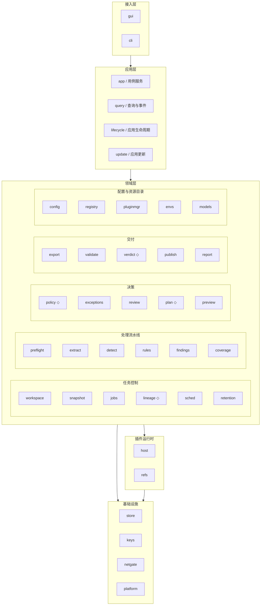
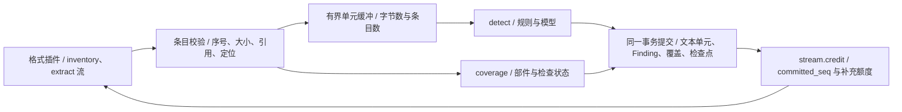
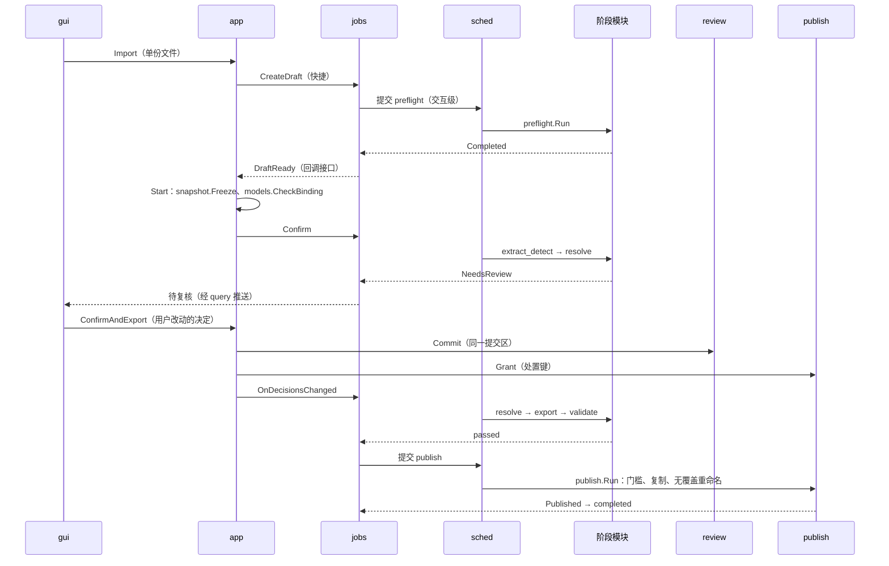

# Tacet：模块设计

> 版本：v0.1（依据需求规格 v0.11、技术架构设计 v0.11 及交互原型，把架构文档第 2 节的逻辑模块细化为模块边界、核心逻辑与模块间契约；评审决定见第 14 节）
> 配套文档：[Tacet 需求规格](tacet-requirements.md)、[Tacet 技术架构设计](tacet-architecture.md)、[交互原型](tacet-prototype.html)。需求、范围与验收以需求文档为准，机制、协议与平台实现以架构文档为准；本文规定“哪个模块负责、模块内如何判定、模块之间如何协作”。
> 用途：M0 原型分工、M1 任务拆解，以及代码评审时检查模块边界。
> 状态：设计基线，待 M0 原型验证；不代表已有实现。

## 1. 范围与拆分原则

### 1.1 与配套文档的关系

- 本文不新增需求，也不放宽 INV-01 至 INV-09 及 AR-01 至 AR-18。编号沿用两份文档，引用写作“需求文档 x.y 节”“架构文档 x.y 节”；本文新增的设计约束编号为 MD-xx。
- 本文对架构文档的调整见第 13 节，已同步到架构文档 v0.11；评审确认的设计决定见第 14 节。之后两者如有不一致，以架构文档为准并同步修订本文。
- 插件内部实现（架构文档 4.5 节）、协议字段（以 JSON Schema 为准）及界面视觉不在本文范围。

### 1.2 拆分原则

| 编号 | 原则 | 判据 |
| --- | --- | --- |
| MD-01 | 数据单一写者 | 每类持久化实体只由一个模块的代码写入（3.2 节）；其他模块经该模块的接口或 `query` 的只读投影读取。多个模块可在同一事务中各写各的表 |
| MD-02 | 判定与执行分离 | 处置、例外动作、失效范围、计划几何、交付判定等规则写成无 I/O 的确定性函数（下文标为“纯逻辑”）；调度、插件调用与持久化放在外层。GUI 与 CLI 调用同一函数（AR-10），规则可用表驱动测试覆盖 |
| MD-03 | 依赖单向 | 接入层 → 应用层 → 领域层 → 插件运行时 / 基础设施；领域模块不导入 Wails、SQLite 驱动、OS API 或具体插件，平台差异只在 `platform` |
| MD-04 | 按版本引用协作 | 模块之间传递 `ArtifactRef`（类型、标识、版本、摘要）与分页游标，不传大对象，也不共享可变结构；下游结果是否失效统一由 `lineage` 判定（INV-04） |
| MD-05 | 命令显式编排，事件只用于派生 | 改变状态的后续动作由 `app`（用户触发）或 `jobs`（阶段结果触发）显式调用；领域事件在事务提交后发出，只含标识与版本，只用于读模型、任务历史、界面推送及调度唤醒。消费者幂等，并以存储状态为准 |
| MD-06 | 变化原因隔离 | 格式差异只在格式插件，模型差异只在检测插件的适配器与 `ModelProfile`，入口形态差异只在 `gui` / `cli`，平台差异只在 `platform`；新增格式或模型不改内核（CORE-04、AR-01） |
| MD-07 | 封闭的结果类型 | 阶段结果、验证结论、例外动作等跨模块结果使用有限枚举；未知取值按失败处理（INV-02），不依赖字符串约定或单个布尔值 |

## 2. 模块总览

### 2.1 分层与模块



◇ 表示核心为纯逻辑（MD-02）。模块名即 Go 包名；插件进程中的格式、检测、OCR、验证实现不属于内核模块，内核只通过 `host` 的角色客户端调用它们。

### 2.2 模块清单

| 子系统 | 模块 | 职责 | 架构文档对应 |
| --- | --- | --- | --- |
| 接入层 | `gui` | Wails 服务绑定、事件桥、预览资源处理器；不含业务判定 | UI |
| 接入层 | `cli` | 命令解析、无回显密码输入、结构化进度、退出码映射 | CLI |
| 应用层 | `app` | 用户命令的用例编排、参数与授权校验、错误码 | 应用服务 |
| 应用层 | `query` | 读模型与增量汇总、有界分页查询、节流推送 | 查询与事件 |
| 应用层 | `lifecycle` | 启动与恢复顺序、单实例、托盘、退出顺序、关机、睡眠唤醒 | 应用生命周期 |
| 应用层 | `update` | 更新检查、下载、签名校验、待处理任务处置与应用 | 7.3 节 |
| 任务控制 | `workspace` | OS 独占所有权、执行代次、串行提交区 | 工作区协调 |
| 任务控制 | `snapshot` | 运行预设解析、兼容性检查、不可变快照与分面摘要 | 应用服务（授权校验）、第 8 节 |
| 任务控制 | `jobs` | 批次与文件任务的状态机、阶段记录、结果处理、次数预算、恢复 | JobManager |
| 任务控制 | `lineage` ◇ | 阶段产物的依赖表与失效判定 | JobManager（依赖失效） |
| 任务控制 | `sched` | 资源准入、两级优先级、背压、压力与磁盘高水位处理 | Scheduler |
| 任务控制 | `retention` | 保留授权与期限、清理与加密擦除、启动清扫、任务历史 | 本地存储、需求文档 7.1 节 |
| 处理流水线 | `preflight` | 路径安全、格式探测、加密与超限预检、批次预检汇总、解锁 | 格式插件 `probe` / `unlock` 的宿主侧 |
| 处理流水线 | `extract` | 抽取与检测阶段：驱动部件枚举与抽取流、保存文本单元与源映射 | 格式插件 `extract` 的宿主侧 |
| 处理流水线 | `detect` | 规则与模型检测编排、模型推理通道、标签归一化 | 检测插件的宿主侧 |
| 处理流水线 | `rules` | 声明式规则的编译、预算、匹配与校验器注册 | 8.1 节 |
| 处理流水线 | `findings` | Finding 存储、分组键与同值 HMAC、分组索引、人工补充 | 本地存储 |
| 处理流水线 | `coverage` | 部件清单、三维覆盖记录、缺口判定、部件对账 | 4.1 节、需求文档 4.2 节 |
| 决策 | `policy` ◇ | 冻结策略下的处置判定与冲突消解，产出处置结果与例外草稿 | 策略与操作计划 |
| 决策 | `exceptions` | 例外类型表、可用动作判定、例外项的生命周期与聚合 | 5.2 节 |
| 决策 | `review` | 复核决定、范围物化、批量提交与撤销、决定复用、复核位置 | 策略与操作计划 |
| 决策 | `plan` ◇ | 操作计划生成、目标区域几何、残留后的范围扩大 | 策略与操作计划 |
| 决策 | `preview` | 有界原文 / 候选预览、模拟效果、选择到源位置的校验 | 4.2 节、第 9 节 |
| 交付 | `export` | 导出阶段：调用回写、登记候选与输出关联 | 验证与发布 |
| 交付 | `validate` | 验证阶段：结构与执行核对、再检测、新命中关联、结论分类 | 验证与发布 |
| 交付 | `verdict` ◇ | 文件与批次的交付判定、结果状态及 CLI 退出码 | 验证与发布（完成判定） |
| 交付 | `publish` | 发布授权、发布意图、无覆盖发布、交付记录与崩溃补记 | 发布器 |
| 交付 | `report` | 去敏报告、交付清单与本地定位索引 | 验证与发布（报告） |
| 配置与资源目录 | `config` | 规则集、方案、运行预设、模型配置的版本与历史，应用设置 | 第 8 节、5.1 节 |
| 配置与资源目录 | `registry` | 插件版本登记、能力匹配、默认实现、完成判定授权、引用登记 | 插件管理 |
| 配置与资源目录 | `pluginmgr` | 第三方插件与规则包的安装、启停、卸载、升级与回退 | 插件管理 |
| 配置与资源目录 | `envs` | Python 环境登记、就绪、引用与回收 | 插件环境管理 |
| 配置与资源目录 | `models` | 模型目录、下载状态机、完整性校验、会话就绪 | 8.3 节 |
| 插件运行时 | `host` | 工作进程池、监督、协议编解码与流控、角色客户端 | WorkerPool、ProcessSupervisor |
| 插件运行时 | `refs` | 受控资源引用的颁发、冻结与吊销，资源文件读写 | 4.4 节 |
| 基础设施 | `store` | 加密数据库、资源文件、迁移、事务、发件箱、存储计量 | 本地存储 |
| 基础设施 | `keys` | 密钥分层、包裹与派生、加密擦除 | 5.1 节 |
| 基础设施 | `netgate` | 唯一出站通道、活动互斥、连接记录 | 网络出口 |
| 基础设施 | `platform` | 沙箱启动、进程树、文件锁、无覆盖重命名、密钥库、电源等平台接口 | 第 10 节 |

### 2.3 依赖规则

允许的依赖（未列出的即不允许）。各模块都可以在 `store` 事务中读写自己的表，下表不再逐行列出 `store`。

| 模块 | 可依赖 |
| --- | --- |
| `gui`、`cli` | `app`、`query` |
| `app` | 领域层各模块、`workspace` 提交区、`update` |
| `query` | 各领域模块的只读接口 |
| `lifecycle` | `app`、`workspace`、`jobs`、`sched`、`host`、`publish`、`review`、`retention`、`platform` |
| `update` | `netgate`、`envs`、`registry`、`query`；退出顺序经组装代码注入的 `Quitter` 接口调用，不导入 `lifecycle`，否则 `app` → `update` → `lifecycle` → `app` 成环 |
| `jobs` | `workspace`、`snapshot`、`lineage`、`sched`、`exceptions`、`verdict`、`retention`，以及各领域模块的只读汇总接口 |
| `snapshot` | `config`、`registry`，`models` 的只读状态 |
| `sched` | `netgate`（处理租约）、`platform`（内存监控） |
| `retention` | `keys`、`registry`，`publish` 的只读状态；各模块的清理逻辑经 `retention.Purger` 接口注册，`retention` 不导入它们 |
| 阶段模块（`preflight`、`extract`、`policy` 的处置阶段、`export`、`validate`、`publish`） | `workspace`、`sched`（实现 `StageRunner`）、`snapshot`（读取分面）、`host` 角色客户端、`refs`，以及各自小节写明的领域模块；文件事实从 `StageContext` 取得，不反向依赖 `jobs` |
| `detect` | `rules`、`host`（`DetectClient`） |
| `review` | `findings`、`exceptions` |
| `preview` | `host`、`refs`、`plan`（几何）、`extract` 的只读接口 |
| `report` | 各领域模块的只读接口、`publish.WriteArtifact` |
| `config` | `rules`（保存校验） |
| `registry`、`envs` | `platform` |
| `pluginmgr` | `netgate`、`envs`、`registry`、`host`、`rules` |
| `models` | `netgate`、`host` |
| 纯逻辑模块（`lineage`、`policy` 与 `plan` 的核心、`verdict`、`exceptions` 的类型表、`jobs` 的迁移函数） | 只依赖共享类型（3.1 节） |
| `host`、`refs` | `platform`、`keys`、`store`（资源文件）、`envs`（启动规格） |
| `store`、`keys`、`netgate` | `platform` |

上表与下列禁止项由 `internal/archtest` 在 `go test` 中检查，修改依赖规则时两处同步修改。

明确禁止：

- 阶段模块之间不互相调用 `Run`，阶段之间的衔接只经 `jobs`；可复用的处理组件以不依赖任务状态的库函数提供（如 `extract.Pipeline`，6.2 节）。`sched` 只认 `StageRunner` 接口（5.5 节），不依赖任何阶段模块。
- 只有 `publish` 可以写入用户可见目录（`platform` 的无覆盖发布接口只有它调用）；只有 `netgate` 发起出站连接（AR-17）；只有 `host` 启动插件进程；只有 `refs` 向插件颁发资源访问（AR-15）。
- `host`、`refs` 不理解任务语义，只把 `job_id`、`attempt_id`、所有权代次当作值校验。
- `query` 只读，不写其他模块的数据；`report` 只读其他模块的数据，报告与清单文件经 `publish.WriteArtifact` 写出。
- 任何模块不得在日志、错误信息或事件中携带原值、文档片段、完整路径或密码（INV-07）。

## 3. 共享类型、数据所有权与事件

### 3.1 共享类型

共享类型包（`kernel`）只放稳定的值类型与校验函数，不放业务流程；修改须评审，因为它影响所有模块。

| 类型 | 内容 |
| --- | --- |
| `ArtifactRef` | 产物类型、标识、版本、摘要；跨模块引用一律使用它（MD-04） |
| `Span` | Unicode code point 的 0-based 半开区间，绑定 `unit_id` 与文本版本（架构文档第 5 节） |
| `SourceLocator` | 格式专属的内部定位（XML 节点、页坐标、单元格等），对内核不透明，只存取和转交给格式插件与 `plan` 几何 |
| `DisplayLocator` | 面向用户的显示定位（页码、约第 n 页 + 章节 + 段落序号、工作表与单元格、行号），只用于导航与说明，不参与回写 |
| `AttemptRef` | `job_id`、`attempt_id`、所有权代次、任务版本 |
| `ErrorCode` | 稳定错误码、可重试类别（`none`、`resource`、`transient`）与去敏的说明参数 |
| `ResourceClaim` | 内存、CPU 槽位、工作进程种类、临时盘、候选盘、队列字节数及调度级别 |
| `MonoTime` | 不含睡眠时长的单调时钟读数（架构文档 6.2 节），截止时间与心跳只用它 |

### 3.2 数据所有权

“工作区库”是每个工作区的加密 SQLite，“应用库”是 GUI 与 CLI 共用的加密配置存储（架构文档 5.1 节），“资源文件”是工作区内的分段加密文件（架构文档 4.4 节）。

| 实体 | 写入模块 | 主要读者 | 存放 |
| --- | --- | --- | --- |
| 工作区头文件、执行代次 | `workspace` | 全部 | 工作区头文件 |
| RuleSet、RedactionScheme、RunPreset、ModelProfile 及其历史；应用设置 | `config` | `snapshot`、`gui` | 应用库 |
| 插件版本、清单、默认实现、完成判定授权、引用登记 | `registry` | `snapshot`、`pluginmgr`、`host` | 应用库 |
| 安装操作记录 | `pluginmgr` | `query` | 应用库 |
| 运行环境记录 | `envs` | `host`、`pluginmgr` | 应用库 |
| 模型资源与下载状态 | `models` | `snapshot`、`app`、`query` | 应用库 + 模型资源目录 |
| RunSnapshot 及分面 | `snapshot` | 全部阶段 | 工作区库 |
| Batch、Job、StageRecord、执行尝试 | `jobs` | `query`、`verdict` 的事实收集 | 工作区库 |
| 预检结果、解密副本引用 | `preflight` | `jobs`、`extract` | 工作区库 + 资源文件 |
| TextUnit 元数据、源映射 | `extract` | `detect`、`policy`、`plan`、`preview` | 工作区库 + 资源文件（正文与映射） |
| Finding | `findings` | `policy`、`review`、`query` | 工作区库 |
| PartInventory、CoverageItem | `coverage` | `policy`、`verdict`、`report` | 工作区库 |
| 处置结果（Disposition） | `policy` | `plan`、`report`、`query` | 工作区库 |
| ExceptionItem | `exceptions` | `review`、`query` | 工作区库 |
| ReviewDecision、决定成员、撤销记录、复核位置 | `review` | `policy`、`query` | 工作区库 |
| RedactionPlan | `plan`（由 `export` 调用写入） | `export`、`validate` | 工作区库 + 资源文件（操作明细） |
| 候选输出、OutputProvenanceMap | `export` | `validate`、`publish` | 资源文件 + 工作区库 |
| ValidationResult | `validate` | `verdict`、`report` | 工作区库 |
| PublishGrant、PublishIntent、DeliveryItem | `publish` | `verdict`、`report`、`query` | 工作区库 |
| 报告、交付清单、本地定位索引 | `report` | 用户 | 输出目录（去敏）/ 工作区（加密索引） |
| 保留授权、清理任务、HistoryEntry | `retention` | `query` | 工作区库 |
| 读模型与汇总计数、发件箱消费游标 | `query` | `gui`、`cli` | 工作区库 |
| 发件箱事件 | `store`（各模块在事务内追加） | `query`、`retention`、`report` | 工作区库 |
| 连接记录 | `netgate` | `query` | 内存（有界） |

### 3.3 领域事件

事件在事务内写入发件箱，提交后由 `store` 分发；进程崩溃后从各消费者的游标重放。事件只携带标识与版本（MD-05），消费者需要明细时回查拥有者。

| 事件 | 发出者 | 消费者 |
| --- | --- | --- |
| `BatchChanged`、`JobStateChanged` | `jobs` | `query`、`retention`（任务历史）、`lifecycle`（托盘计数） |
| `FindingsCommitted` | `findings` | `query` |
| `ExceptionsChanged` | `exceptions` | `query` |
| `DecisionsCommitted`、`DecisionsReverted` | `review` | `query` |
| `CandidateRegistered`、`ValidationRecorded` | `export`、`validate` | `query` |
| `Published`、`DeliverySuperseded` | `publish` | `query`、`retention`（清理中间数据、任务历史）、`report`（单文件报告） |
| `StorageHighWater`、`ResourcePressure` | `sched` | `query`、`preview`（释放缓存）、`host`（回收预热实例） |
| `ModelStatusChanged` | `models` | `query` |
| `PluginChanged`、`ConfigSaved` | `registry`、`config` | `query` |
| `ActivityChanged` | `netgate` | `query` |

`jobs` 推进任务不依赖事件：阶段结果经 `StageRunner` 返回值直接交给 `jobs`，用户决定由 `app` 显式通知 `jobs`（MD-05）。

## 4. 接入层与应用层

### 4.1 `app` 用例服务

一个用户命令对应一个用例：校验参数与可用动作 → 在提交区内按版本条件写入 → 返回带错误码的结果。耗时工作只提交给 `jobs` / `sched` 异步执行；`app` 不直接调用插件。用户触发的编排都在 `app`，阶段结果触发的编排都在 `jobs`（MD-05）。

| 用例 | 编排 | 关键校验 / 结果 |
| --- | --- | --- |
| 导入 `Import` | 按文件数与用户选择决定走快捷路径或批次草稿（阈值 M0 冻结，FR-28）→ `jobs.CreateDraft` → 提交预检阶段；有进行中的网络活动时只登记选择（需求文档 3.4.1 节） | 已有未完成的快捷任务或批次时返回 `QUICK_TASK_ACTIVE` / `BATCH_ACTIVE`，由用户继续或取消原任务，不静默替换 |
| 开始 `Start` | 快捷路径在预检通过后自动调用，批次由用户在预检页确认（处理模式、保留期限、发布授权方式）→ `snapshot.Freeze` → `models.CheckBinding` → 就绪则 `jobs.Confirm`，否则记为等待操作 | `CompatReport.Blocking` 非空时拒绝；`NeedsNarrowing` 须附用户确认；等待操作不创建检测任务，模型就绪后须用户明确继续 |
| 提交决定 `CommitDecisions` | `review.Commit` → `jobs.OnDecisionsChanged(受影响任务)` | 物化后的成员数与界面展示的范围摘要不一致时返回 `SCOPE_CHANGED` |
| 确认并导出 `ConfirmAndExport` | 同一提交区内 `review.Commit` + `publish.Grant`（绑定处置键，MD-16）→ `jobs.OnDecisionsChanged` | 快捷路径专用（FR-28、架构文档 6.1 节） |
| 授权发布 `AuthorizePublish` | 按成员当前处置键调用 `publish.Grant`；部分结果另需授权 | 范围为“当前符合条件的成员”或复核摘要中的全部成员（BUX-12、BUX-15） |
| 解锁 `Unlock` | `preflight.Unlock`，作为交互级阶段派发 | 密码错误可重输，不计入重新处理（FR-09） |
| 重新处理 / 跳过 | `exceptions.Actions` 核对可用动作 → `jobs` | 每个文件限一次重新处理 |
| 暂停 / 继续 / 取消，调整顺序，暂停派发，只停止选定任务 | `jobs` → `sched` | 取消默认“停止并清理”（FR-05、BUX-12） |
| 修改批次方案 | `snapshot.NewVersion` → 逐成员 `lineage.EarliestStale` → `jobs.Invalidate` | 先展示受影响成员数；已发布成员按“被替代”处理 |
| 重试选定成员 | `jobs.Retry` | 只重试失败、阻塞条件已解除或用户选定的成员，不重做已发布结果（BUX-14） |
| 预览、模拟效果、提交选择 | `policy.Simulate` + `preview` | 只读；提交选择返回校验后的源位置或拒绝 |
| 清理任务、清理工作区、删除历史条目 | `retention` | |
| 配置、插件、模型、更新 | `config`、`pluginmgr`、`models`、`update` | 需联网的操作先取得 `netgate` 活动租约（MD-19） |

公共错误码：`WORKSPACE_BUSY`、`VERSION_CONFLICT`（配置或任务版本已变）、`ACTIVITY_BUSY`（联网与文档处理互斥）、`QUICK_TASK_ACTIVE`、`BATCH_ACTIVE`、`SCOPE_CHANGED`、`KEYSTORE_UNAVAILABLE`。错误说明只含去敏参数（INV-07）。

等待模型的操作（PendingStart）由 `app` 在内存中持有，同一时刻至多一个，只含文件句柄令牌与运行预设引用；批次的等待状态即批次草稿，由 `jobs` 持久化。取消等待操作不取消独立的模型下载（需求文档 3.4.1 节）。

### 4.2 `query` 查询与事件

- 读模型：批次总览（机器进度、已自动解决数、低于最低置信度而未处理数、待决项与分组数、覆盖缺口、待发布、已交付，BUX-11）、文件状态列表、模型与插件状态、任务历史。读模型由消费发件箱事件增量维护，不对 10 万候选反复计数（PF-16）。
- 分页查询：明细查询转交拥有者的索引查询，统一施加页大小上限与游标（INV-05）；需要精确数量的命令（如批量范围摘要）由拥有者直接计数，不读读模型。
- 推送：每个订阅合并节流，约每秒不超过 5 次，只推汇总与版本号（架构文档第 7 节）；窗口隐藏时降频，处理不降速。
- 剩余时间：按最近吞吐样本给出机器剩余时间的范围，样本不足时不给出；人工剩余只给数量与可用批量动作（BUX-11）。
- 结果页条件、批次阶段等业务判定一律取自 `verdict`，`query` 不自行推导。

### 4.3 `lifecycle` 应用生命周期

启动顺序（每一步完成后才进行下一步）：

1. 单实例检查：已有 GUI 实例时转交拖入的文件后退出。
2. 先显示主窗口框架和“正在恢复”状态，以满足 PF-15；以下步骤在后台执行。
3. `workspace` 打开工作区：取得锁，递增代次。
4. `host` 确认上一代次的工作进程树已全部退出或被回收（架构文档 6.1 节）。
5. `publish.Reconcile` 依据发布意图补记或标为冲突。
6. `retention.Sweep` 清理过期及未获恢复授权的残留（需求文档 7.1 节）。
7. `review.DropPending` 删除未提交的批量决定，`jobs.Recover` 把未完成阶段重置到起点。
8. `sched` 开始派发，开放任务操作。

退出顺序按架构文档 6.2 节，由 `lifecycle` 依次调用：`sched` 停止派发 → `jobs` 请求取消到安全边界（PF-04 截止时间）→ 提交检查点与决定 → `host` 回收进程树 → 等待 `publish` 提交区结束 → `retention` 按用户选择保留或加密擦除 → `workspace` 释放锁并关闭存储。系统关机时跳过等待与清理，只停派发并回收进程。

唤醒通知到达时，先让 `sched` 与 `host` 重置心跳基准并探测工作进程存活，再判断超时。有任务运行时经 `platform` 声明用户发起的活动，空闲时撤销。

### 4.4 `update` 应用更新

- 检查与下载只经 `netgate`，取得网络租约后进行，因此不会与文档处理同时发生（SEC-15）；检查请求只含版本号、平台与通道。
- 更新包校验签名后才可应用；离线更新包走同一校验。
- 存在待复核或可恢复任务时，经 `query` 展示数量，由用户选择先完成、作废，或更新后按 INV-03、INV-04 重新执行受影响阶段（架构文档 7.3 节）。
- 应用前经注入的 `Quitter` 接口执行 `lifecycle` 的退出顺序；新版本首次启动由 `store` 迁移，Python 次版本或 ABI 变化时由 `envs` 把第三方环境标为“需重新部署”。

### 4.5 `gui` 桌面适配

- 只把 `app` 命令与 `query` 读取暴露为 Wails 服务；不把插件方法暴露给前端（架构文档第 7 节）。
- 拖入与选择的文件转为 OS 句柄令牌，前端只拿到显示名，不持有完整路径。密码以字节数组传给 `app`，调用后清零。
- 预览栅格经自定义资源处理器按请求提供，设置 `Cache-Control: no-store`；所有文档来源的字符串按文本节点渲染（架构文档第 9 节）。

原型视图与模块的对应：

| 原型视图 | 主要命令（`app`） | 主要读取（`query`） |
| --- | --- | --- |
| 首页：导入区、方案选择、模型准备引导、最近 | `Import`、`Start`、继续等待操作 | 模型状态、活动状态、任务历史 |
| 单文件：处理中、复核、对比、导出 | `CommitDecisions`、`ConfirmAndExport`、取消 | 文件进度、例外与命中分页、预览 |
| 批次 · 预检 | `Start`、移除成员、调整顺序 | 预检汇总（BUX-01） |
| 批次 · 运行 | 暂停派发、停止、发布符合条件的文件 | 批次总览（BUX-11） |
| 批次 · 复核 | `CommitDecisions`、`Unlock`、重新处理、跳过、撤销 | 分组、成员分页、代表样例、范围计数 |
| 批次 · 清单与结果 | 打开导出文件夹、保存清单 | 交付清单、结果汇总（BUX-16） |
| 历史 | 继续、清理、删除条目 | 任务历史 |
| 插件：模型、格式、规则包、安装 | 模型下载 / 暂停 / 继续 / 重新准备，插件安装 / 启停 / 卸载 | 模型与插件状态 |
| 方案：方案、规则集 | 保存、复制、回滚、导入、导出 | 配置对象与历史版本 |
| 设置与关于 | 关闭行为、自动检查更新、清理工作区 | 设置、许可清单、沙箱状态 |

### 4.6 `cli` 命令行适配

- 子命令：预检、运行、状态 / 报告、恢复、重试选定成员、清理（需求文档 3.6 节），全部映射到 `app` 用例，不另写判定逻辑（AR-10）。
- 非交互运行必须显式给出版本化策略与发布授权；缺少时返回退出码 `1` 及原因，不猜测默认授权。
- 密码只在交互式终端无回显读取；非交互运行遇到需要密码或人工决定的文件，由 `jobs` 记为阻塞并继续其他成员，不读 stdin。
- 进度以结构化行输出，内容与 GUI 推送相同的去敏汇总（INV-07）；退出码取自 `verdict.ExitCode`；收到中断信号时请求取消到安全边界后返回 `3`。
- 默认使用独立于 GUI 的工作区；工作区被占用返回 `WORKSPACE_BUSY` 与退出码 `1`；无法取得平台密钥时返回 `KEYSTORE_UNAVAILABLE` 与退出码 `1`，不弹窗等待。

## 5. 任务控制

### 5.1 `workspace` 工作区所有权与提交区

职责：取得工作区独占所有权，维护执行代次，提供串行提交区。不负责任务状态（`jobs`）、迁移内容（`store`）及锁的平台实现（`platform`）。

1. 打开：解析真实路径与卷内文件标识 → 对工作区头文件句柄加 OS 独占锁，失败返回 `WORKSPACE_BUSY`，说明中不含路径 → 读头文件格式版本，高于当前版本即拒绝（AR-18）→ `keys` 解包工作区密钥 → `store` 打开并迁移 → 代次加 1 并落盘（fsync）后才对外提供会话。
2. 提交区：单个串行执行器。所有改变任务、决定、授权、发布与清理状态的命令以闭包排队，闭包内开一个事务并做版本条件检查。闭包内禁止插件调用与大块 I/O，唯一例外是发布时的无覆盖重命名，以满足架构文档 6.1 节“变更命令与发布排序”的要求。
3. 准入：阶段结果写入前核对所有权代次、`attempt_id` 与任务版本，任一不符即丢弃（迟到结果）。
4. 默认位置：GUI 与 CLI 各自的默认工作区由 `platform` 给出私有目录；CLI 可显式指定。

```go
type Session interface {
    Generation() uint64
    Commit(ctx context.Context, fn func(tx store.Tx) error) error // 串行、带版本条件；tx.AfterCommit 注册提交后动作
    Admit(a kernel.AttemptRef) error                                // 代次、执行尝试与任务版本校验
}
```

### 5.2 `snapshot` 快照与兼容性检查

职责：把运行预设解析为具体版本的内容，做兼容性检查，冻结为不可变快照；批次策略变更时生成新版本并给出变化的分面。不负责配置编辑与历史（`config`），也不决定哪些阶段重跑（`jobs` + `lineage`）。

**MD-09 快照分面。** 快照按阶段的读取范围分成分面，每个分面单独计算摘要；阶段只读取自己声明的分面，失效判定按分面比较，不按整份快照比较。

| 分面 | 内容 | 读取阶段 |
| --- | --- | --- |
| `detect` | 模型 ID 与清单摘要、后端、标签映射与校准；规则集内容与规则包版本；启用类别、字段识别规则；检测模式（含仅规则 / 整字段） | 抽取与检测、批次补充扫描、验证（再检测） |
| `dispose` | 各类别处置动作、模型最低置信度（MD-12）、保留例外、图像与嵌入内容默认处置、人工复核要求、处理模式 | 处置 |
| `render` | 涂抹样式、占位符与掩码形式、PDF 分辨率 / 色彩 / 压缩、输出形式 | 导出（计划） |
| `runtime` | 各格式所选插件的 ID、版本、摘要与环境摘要，协议版本，完成判定授权（FR-44） | 所有调用插件的阶段 |
| `delivery` | 输出位置、命名规则、发布授权方式、部分结果规则、恢复与保留期限 | 发布、保留 |

核心逻辑：

1. 解析：读取运行预设当前版本及其引用对象的最新版本（FR-19），把内容（不只是引用）连同版本号与摘要写入快照；插件按 `registry` 的默认实现解析为确切版本；模型取 `ModelProfile` 绑定的模型 ID 与清单摘要。
2. 兼容性检查（纯逻辑）返回 `CompatReport{Blocking, NeedsNarrowing, Warnings}`：
   - 每个启用类别至少有一个适用的检测来源（模型标签映射覆盖且语言匹配，或规则、整字段规则）。仅规则模式下依赖模型的类别列入 `NeedsNarrowing`，用户确认缩小后才能冻结（FR-18）。
   - 成员格式的插件支持方案选择的处置动作；不支持时形成预检提示与例外（BUX-02）。
   - 模型与资源档位的内存需求不超出预算（PF-06、PF-07）。
   - 无人值守模式下，未获完成判定授权的第三方格式插件（FR-44）及只由第三方规则包提供来源的类别（FR-46）不具资格，列入 `Blocking` 或缩小自动发布范围。
   - 使用模型的方案须设置最低置信度，且不低于模型适配器下限；阈值高于模型校准值时，依赖模型的类别不具无人值守资格（MD-12、需求文档 6.2 节）。
3. 冻结：快照与分面摘要不可变；同时向 `registry` 登记对插件版本、环境、规则包与模型的引用，供停用、卸载与回收检查（FR-42）。
4. 变更：`NewVersion(batch, change)` 生成新快照版本并返回变化的分面集合。批次成员不能经此悄悄增加；新增文件只能作为新批次或新成员版本（BUX-01）。

### 5.3 `jobs` 批次与任务编排

职责：批次与文件任务的状态机、阶段记录、阶段结果处理、自动重试与次数预算、快捷任务与批次并存、暂停 / 取消 / 恢复。不负责资源准入（`sched`）、插件调用（阶段模块），也不判定处置与例外动作（`policy`、`exceptions`）。

数据：

- Batch：类型（快捷 / 普通）、处理模式（引导 / 无人值守 / 严格）、阶段（草稿 / 运行 / 停止中 / 已停止 / 已结束）、快照版本、成员顺序、是否暂停派发、保留授权引用。
- Job：批次与成员序号、输入版本（指纹，或解密副本引用）、状态、阶段游标、恢复阶段、次数计数（验证重跑、自动扩大、重新处理）、原因码、乐观锁版本、交互提升标记。
- StageRecord：阶段、`attempt_id`、状态（待派发 / 运行中 / 完成 / 已丢弃）、输入版本（分面摘要与上游产物版本）、产出 `ArtifactRef`。

**MD-08 预检属于草稿阶段。** 预检只读探测、不冻结快照，在批次确认前进行，使预检汇总（BUX-01）可以在用户选择策略之前展示；确认时才冻结快照并进入 `queued`。确认时若格式插件的默认实现已变化，只对受影响成员重做预检。

**状态迁移**（迁移函数为纯逻辑，`transition(state, stage, outcome, counters)`）：

| 当前状态 | 触发 | 下一状态 | 说明 |
| --- | --- | --- | --- |
| `preflighting` | 探测通过 | `preflighted` | 草稿阶段 |
| `preflighting` | 需要密码 | `locked` | 草稿阶段；确认后为 `blocked`（`password_required`） |
| `preflighting` | 格式不支持、损坏、超出页数或体积上限、不支持的加密方式 | `unprocessable` | 终止；不进例外队列，不提供重新处理 |
| `preflighted` | 批次确认 | `queued` | 冻结快照 |
| `blocked`（密码） | 解锁成功 | `preflighting` → `queued` | 对解密副本重新探测 |
| `queued` | `sched` 派发 | `extracting_detecting` | |
| `extracting_detecting` | 完成 | `resolving` | 覆盖缺口不是失败，交给处置阶段 |
| `resolving` | 无待决例外 | `exporting` | |
| `resolving` | 有待决例外 | `awaiting_review` | 不占用工作进程 |
| `awaiting_review` | 相关决定提交 | `resolving` | 例外清零前可多次往返 |
| `exporting` | 完成 | `validating` | |
| `validating` | 结论见 8.2 节 | `validating` / `exporting` / `resolving` / `ready_to_publish` / `failed` | 自动重跑、自动扩大、新命中、通过、失败 |
| `ready_to_publish` | 授权有效且交付条件满足 | `publishing` | “待发布” |
| `publishing` | 发布成功 | `completed` / `partial` | |
| `publishing` | 名称冲突、目标不可写 | `blocked`（目标） | 集中处理，可复用已验证候选（BUX-14） |
| `exporting` / `validating` / `extracting_detecting` | 整个文件处理失败 | `failed` | 例外 `file_failed` |
| `failed` | 重新处理（首次） | 失败阶段的起点 | 沿用原快照（FR-07） |
| `failed` | 跳过 / 重新处理后再次失败 | `skipped` / `unprocessable` | 终止 |
| 非终止状态 | 暂停 / 取消 | `paused` / `cancelling` → `cancelled` | 记录恢复阶段 |
| 非终止状态 | `lineage` 判定上游已变 | 最早失效阶段的 `queued` | 已发布成员另生成新交付版本 |
| 非终止状态 | 输入已变化 | `blocked`（输入变化） | FR-08 |

终止状态为 `completed`、`partial`、`skipped`、`unprocessable`、`cancelled`。架构文档第 6 节的“`failed` 并标为无法处理”在本文对应 `unprocessable`。

**MD-10 完成标记与迁移同事务。** 阶段内的流式结果按 `attempt_id` 分批提交；阶段完成标记、状态迁移与下一阶段的派发登记在同一事务内写入，派发在提交后生效。

```go
func (m *Jobs) OnStageOutcome(a kernel.AttemptRef, out StageOutcome) error {
    return m.ws.Commit(ctx, func(tx store.Tx) error {
        if err := m.ws.Admit(a); err != nil {
            return err // 迟到结果：旧代次或旧执行尝试
        }
        job, rec := m.load(tx, a)
        next := transition(job.State, rec.Stage, out, job.Counters) // 纯逻辑，查上表
        m.completeStage(tx, rec, out.Artifacts)                     // MD-10
        m.apply(tx, job, next)
        if next.Dispatch != nil {
            tx.AfterCommit(func() { m.sched.Submit(*next.Dispatch) })
        }
        return nil
    })
}
```

**自动重试与次数预算：**

| 情况 | 处理 | 预算与超出后 |
| --- | --- | --- |
| 验证未完成（`not_run`） | 复用现有候选自动重跑验证，不询问用户 | 默认 2 次（M0 冻结），超出即整个文件处理失败 |
| 已涂抹内容仍有残留 | 由 `validate` 调用 `plan.Widen` 在同一单元或区域内扩大，形成新计划版本后重新导出 | 每个文件 1 次；再次残留或需超出范围即失败 |
| 资源类原因（磁盘不足、内存压力回收、目标暂不可写） | 记为阻塞并说明原因，条件解除后只重排受影响成员（BUX-03） | 不计入重新处理次数 |
| 插件崩溃、超时、协议错误、回写失败、输出损坏 | 整个文件处理失败 | 用户可重新处理 1 次，再次失败为 `unprocessable` |
| 密码错误 | 保持 `blocked`，可重输 | 不计次数 |

**并存与优先级。** 同一工作区至多一个未完成的快捷任务与一个未完成的批次（FR-28）。快捷任务的全部阶段为交互级；复核中修改后需重新导出的文件，其导出、验证与发布阶段也提升为交互级，直到发布或回到复核（AR-16）。

**暂停、取消与恢复。**

- 暂停：批次级“暂停派发”只停止派发新阶段；文件级暂停请求正在运行的阶段到安全边界，声明大文件能力的插件保存阶段内检查点，其他插件丢弃本次执行尝试，继续时重做该阶段（FR-05、PF-05）。
- 取消：进入 `cancelling`，经 `sched` 向运行中的阶段发出取消信号，阶段经 `host` 请求协作停止，超过 PF-04 截止时间即回收进程树；进入 `cancelled` 后默认调用 `retention` 清理，选择“停止并保留”时登记保留授权。
- 恢复（启动时）：运行中的阶段记录标为已丢弃，由各拥有模块按 `attempt_id` 删除其部分结果，已提交的大文件检查点保留；状态重置到该阶段的 `queued`。跨应用恢复的批次以“已暂停（待继续）”呈现，用户在首页“最近”或历史中继续后才派发；继续前核对输入指纹、绑定的模型与插件版本（INV-03）。
- 输入变化：每次派发前先做快速核对（大小、修改时间、卷内文件标识），不一致时做完整摘要比对；确认变化后任务进入 `blocked`（输入变化），全部下游失效，不把旧映射用于新内容（FR-08）。

### 5.4 `lineage` 依赖与失效（纯逻辑）

职责：集中实现 INV-04 的依赖失效判定，供 `jobs`、`app` 与 `publish` 调用。没有自己的存储，输入来自 `jobs` 的阶段记录与当前版本。

| 产物（产生阶段） | 依赖的上游产物 | 依赖的快照分面 |
| --- | --- | --- |
| 文本单元、源映射、部件清单、检测结果、检查状态（抽取与检测） | 输入版本（指纹或解密副本） | `runtime`、`detect` |
| 批次补充扫描的命中（补充扫描，MD-18） | 文本单元版本、批次补充词表版本 | — |
| 处置结果与例外（处置） | 检测结果版本、决定版本 | `dispose` |
| 操作计划（导出开始时生成） | 处置结果版本、自动扩大补丁 | `render` |
| 候选与输出关联（导出） | 计划版本 | `runtime` |
| 验证结果（验证） | 候选摘要、计划版本 | `detect`、`runtime` |
| 发布授权 | 处置键（MD-16） | `delivery` |
| 交付记录（发布） | — | 不失效，只能被替代 |

```go
// EarliestStale 返回需要重做的最早阶段；StageNone 表示全部有效
func EarliestStale(recs []StageRecord, cur Current) StageKind
// FacetsChanged 比较两个快照版本，返回变化的分面
func FacetsChanged(a, b SnapshotDigests) FacetSet
```

- 检测相关分面或格式插件版本变化：从抽取与检测重做；已有人工决定由 `review.Rebind` 在内容与位置核对一致后复用（INV-04）。
- 只有 `dispose`（含最低置信度）或决定变化：复用检测结果，从处置重做（架构文档第 6 节）。
- 只有 `render` 变化：从导出重做。
- 已发布成员的任何上游变化都产生新的交付版本，旧版本标为被替代，不改写成从未发布。

### 5.5 `sched` 资源调度

职责：阶段的资源准入、两级优先级、背压、整机压力与磁盘高水位处理、截止时间。`sched` 的状态只在内存中，启动时按 `jobs` 的待派发记录重建。

阶段契约由 `sched` 定义、各阶段模块实现，并在 `app` 组装时注册；`sched` 不依赖任何阶段模块：

```go
type StageRunner interface {
    Kind() StageKind                    // preflight | unlock | extract_detect | supplement_scan | resolve | export | validate | publish
    Claim(j JobView) kernel.ResourceClaim // 依据预检计数、插件资源声明与资源档位估算
    Run(ctx StageContext) StageOutcome  // ctx 携带 AttemptRef、截止时间、取消信号、预算计量及 jobs 收集的文件事实
}

type StageOutcome struct {
    Kind      OutcomeKind   // Completed | NeedsReview | Blocked | Retry | Failed | Cancelled
    Detail    OutcomeDetail // 阶段专属的封闭枚举，如验证结论（MD-07）
    Artifacts []kernel.ArtifactRef
    Err       *kernel.ErrorCode
}
```

派发规则：

1. 交互级队列非空时只从交互级派发新阶段；正在运行的后台阶段不打断，在“文件 × 阶段”边界或大文件插件的阶段内检查点让出（AR-16）。
2. 同一级别内先推进已开始文件的下游阶段（发布 > 验证 > 导出 > 处置），再按成员顺序开始新文件的抽取。这样合格文件可以先交付，候选占盘也能尽早释放（BUX-12、AR-12）。
3. 申请须同时满足内存（整个进程树）、CPU 槽位、各类工作进程实例数、临时盘、候选盘与队列字节数的余量（INV-05、PF-10、PF-11）；交互级为格式工作进程保留启动余量。
4. 首个文档处理阶段派发前向 `netgate` 取得处理租约，全部阶段空闲后释放；取不到即保持排队并展示原因（MD-19）。
5. 批次累计存储（待复核、待发布、检查点、解密副本与候选）达到高水位时，暂停派发会产生新数据的阶段（抽取、导出），发出 `StorageHighWater`，由界面提供发布已验证结果、释放空间或清理的选择（AR-12、PF-17）。

整机压力处理（依次执行，前一步无效才进行下一步）：停止准入 → 通知 `preview` 释放缓存、`host` 回收空闲预热实例、`detect` 减小推理批量 → 请求最大的后台阶段到安全边界后让出，按资源类重排，不计失败 → 交互阶段仍超预算时，相应文件以资源类原因阻塞并说明。不依赖系统交换空间维持运行（需求文档 5.2 节）。

截止时间按探测、页面、窗口、导出等单元分别设置，心跳不能无限续期（需求文档 5.4 节）；计时一律使用单调时钟，唤醒后重置心跳基准。

### 5.6 `retention` 数据生命周期与任务历史

职责：保留授权与期限、清理与加密擦除、启动清扫、任务历史（需求文档 7.1 节）。

- 保留授权：批次开始时选择是否跨应用恢复及期限（默认 7 天），快捷路径默认关闭（FR-28）。期限从最近一次用户明确保存或恢复的时刻起算，后台心跳不续期。
- 触发与动作：消费 `Published` 后清理该文件的中间文本、原图、映射、撤销数据与私有候选；“停止并清理”时加密擦除；失败时只保留已授权的必要数据与仍有效的已验证输出；到期时先阻止继续使用再清理。
- 清理步骤：由调用方（`jobs` 或 `app`）保证任务已停止，`retention` 再确认无进行中的发布（`publish`）→ 删除任务包裹密钥（`keys` 加密擦除）→ 依次调用各模块注册的 `Purger` 删除其数据与资源文件 → 撤销 `registry` 中的引用登记 → 把任务历史条目的关联置空。每一步的状态可见、失败可重试；不能只隐藏任务卡片就标为已清理。
- 启动清扫：在开放任务操作前清理过期和未获恢复授权的数据；离线期间残留的密文不声称已物理删除。
- 共享对象（批次补充词表、缓存、去重对象）按授权引用计数回收，不因其他任务仍在运行而保留已清理任务的可恢复原文。
- 任务历史：批次创建时生成条目，消费 `JobStateChanged`、`Published` 更新状态汇总与导出目录引用；最多 100 条，可逐条删除，清理工作区时清空（架构文档 5.1 节）。

## 6. 处理流水线

### 6.1 `preflight` 预检与解锁

职责：在批次确认前对每个成员做只读探测（MD-08），汇总预检结果；处理加密文件的解锁。

逐成员的预检步骤（有界并发，作为 `preflight` 阶段派发）：

1. 路径安全：解析真实路径与卷内文件标识，记录符号链接的解析结果；源文件与任何输出目标（含路径别名、硬链接）指向同一文件时拒绝该目标（FR-03）。
2. 指纹：先取快速指纹（大小、修改时间、卷内文件标识）；完整摘要在后台流式计算，发布前必须完成（架构文档第 6 节）。
3. 格式识别：按扩展名与文件签名从 `registry` 取候选插件，调用有预算的 `format.probe`，取得实际格式、加密状态、页数、图像与嵌入对象计数及体积信息；扩展名不作为唯一依据（FR-02）。
4. 上限：页数或体积超出上限即为 `unprocessable`，附实际值与上限（需求文档 5.4 节）；其他复杂度上限在抽取中流式检查。
5. 加密：`password_required` 为 `locked`；`permission_only` 照常处理并记录；`unsupported` 为 `unprocessable`（不支持的加密方式，架构文档 4.6 节）。

批次预检汇总（BUX-01）：格式分布、无法处理与需要密码的成员、图像与嵌入内容的默认处置及受影响的文件数与图像数、输出命名预览与同名冲突、空间预算（含按分辨率估算的栅格化 PDF 体积）、恢复期限、已知覆盖限制、绑定模型的就绪情况及方案的最低置信度。

解锁：

- 密码以字节切片从 `app` 传入，只放进 `format.unlock` 的调用消息，调用结束后连同编码后的消息缓冲一起清零；不写入存储、检查点、日志或诊断（FR-09、架构文档 4.6 节）。
- 返回 `PASSWORD_INCORRECT` 时保持 `locked` / `blocked`，可重输，不计入重新处理次数。
- 成功后把解密副本登记为该任务输入版本的数据来源（随任务 DEK 加密的工作区资源），并对副本重新探测计数；输入指纹仍取加密原件，原件变化时解密副本及其下游按 INV-04 失效。
- 预检汇总与报告注明“原文件已加密，输出未加密”。

### 6.2 `extract` 抽取与检测阶段

职责：驱动格式插件的部件枚举与抽取流，保存文本单元与源映射，把文本单元交给 `detect`，按单元事务提交。流水线以库函数 `Pipeline` 提供，不依赖任务状态；抽取阶段对输入使用，验证阶段对候选使用（8.2 节）。



1. 经 `refs` 取得输入（或解密副本）的只读引用、源映射的写引用及临时区，调用 `inventory` 与 `extract`（插件声明可共享解析器时合并为一个流）；声明大文件能力的插件同时传入上次提交的阶段内检查点。
2. 逐条校验流条目：序号连续；文本单元不超过 1 MiB（需求文档 5.4 节）；部件引用已登记或随同登记；源映射引用属于本次执行尝试；显示定位字段完整。校验失败按协议错误处理，本阶段失败，不猜测位置（INV-09）。
3. 文本单元正文写入资源文件，数据库只存元数据：`unit_id`、部件、顺序、结构上下文、显示定位、源映射引用及位置可靠性标记。插件附带的检测上下文（表头、相邻段落）单独保存并标为不可回写（FR-15）。
4. 部件条目交给 `coverage` 登记；检查状态与缺口条目（页内位图、Unicode 映射错误区域、疑似文字转曲、展平失败的注释等）交给 `coverage` 记录。
5. 文本单元进入有界缓冲后交给 `detect`。单元的文本、检测结果、覆盖记录及检查点在同一事务提交；提交后才向插件确认 `committed_seq` 并补充额度（架构文档第 7 节、AR-03）。
6. 完成条件：`stream.end` 为 `completed`，部件枚举带完成标记，且所有已抽取单元均已完成检测。任一条件不满足都不算完成（INV-02）：插件失败、超时或枚举无法完成时本阶段失败；单个部件抽取失败只把该部件记为 `failed` 检查状态，形成缺口，不使整个文件失败。

### 6.3 `detect` 检测服务

职责：对一批文本单元运行规则与模型检测，产出统一的候选片段。被抽取阶段、批次补充扫描（只用规则）与验证阶段的再检测共用；不保存结果，结果由调用方交给 `findings`。

```go
type Detector interface {
    // 任一来源失败即返回错误，不返回部分结果（INV-02）
    DetectUnits(ctx StageContext, units []UnitRef, facet snapshot.DetectFacet) ([]Candidate, error)
}
```

- 单元级编排：规则与模型并行，两者都成功该单元才算检测完成。
- 模型推理通道：每个模型实例键一个优先级队列，交互级单元先进入下一次推理；按 token 与字节上限组成有界微批，两级共用一份权重（架构文档第 7 节）。分词、分窗、重叠与解码由检测插件中的模型适配器完成，返回单元内 code point 区间。
- 整字段规则（FR-17）：结构化单元的字段路径或列与快照中的字段规则匹配时，整值直接产生 `field_rule` 来源的候选，不等待模型；计数与模型识别分开。
- 归一化：模型标签按 `ModelProfile` 映射为 Tacet 类别，未映射标签只计数不产生候选；落在检测上下文中的片段丢弃（FR-15）；越出单元文本范围的片段按协议错误处理。
- 分数：`detect` 不按方案的最低置信度过滤，保存模型适配器下限以上的全部候选及原始分数；适配器下限随 `ModelProfile` 版本冻结，任务中不能改变。分数低于模型校准值的候选标为低置信度（FR-21）。方案阈值在处置阶段生效（MD-12，7.1 节）；不同模型的分数不直接比较（FR-12）。
- 仅规则 / 整字段模式下不使用模型通道；依赖模型的类别已在快照兼容性检查中缩小（FR-18）。

### 6.4 `rules` 规则引擎

职责：声明式规则的编译、预算与匹配（架构文档 8.1 节），以及已注册校验器的管理。调用方为 `detect`、批次补充扫描、`pluginmgr`（规则包安装校验）与 `config`（保存校验）。

- 编译：`Compile(content, budget)` 按摘要缓存，缓存计入预算。含前后断言或反向引用、引用未注册的校验器、超出数量 / 长度 / 词表体积 / 编译内存 / 表达式深度预算时拒绝，不截断（INV-02）。
- 匹配：正则使用 RE2 语法，边界属性在匹配后检查，被拒绝时从该匹配起点的下一个字符继续查找；词表使用多模式匹配，按规则声明的大小写、全半角与边界规范化，并保留规范化文本到原始 code point 的映射，使命中位置可回写；上下文规则只在有限窗口内检查关键词。
- 校验器：Go 内注册、带版本的确定性实现（如银行卡校验位、居民身份证校验码）。格式符合但校验失败、规则标为“疑似”的命中带 `validator_mismatch` 标记，由 `policy` 转为对应例外。
- 工作量：按单元与任务两级计费，每处理一定步数检查取消；超出预算返回 `RULE_BUDGET_EXCEEDED`，受影响的类别或任务阻塞（INV-02、AR-14）。

### 6.5 `findings` 候选存储与索引

职责：保存 Finding，维护分组键与索引，提供分页、分组聚合与代表样例查询。

- 字段：除架构文档第 5 节所列字段外，增加来源（`rule`、`dictionary`、`model`、`field_rule`、`manual`、`user_term`）、产生阶段（检测 / 补充扫描 / 导出后）、低置信度与校验不符标记、执行尝试，以及分组键：类别、来源、字段路径、模板结构键（如 DOCX 样式路径、表头签名）和同值 HMAC。
- 同值 HMAC 以批次密钥派生的键计算，明文值只在流水线内存中短暂存在，数据库不存原值或无密钥哈希（架构文档 5.1 节）。复核界面需要原值时，按位置从文本单元资源读取有界上下文。
- 结果版本：每个任务的检测结果版本在新增命中的阶段（抽取与检测、补充扫描、验证再检测）完成时递增，是处置键的组成部分。
- 查询：按任务与筛选条件分页，筛选条件含来源与分数区间（用于查看低于最低置信度的候选，MD-12）；分组聚合返回命中数、涉及文件数和差异；代表样例按稳定顺序选取，刷新后不跳动（BUX-05）。
- 人工补充：`AddManual` 只接受 `preview` 校验通过的位置（7.5 节）。

### 6.6 `coverage` 覆盖台账与部件对账

职责：部件清单与三个独立维度（检查状态、输出处置、验证状态）的记录，缺口判定，部件对账（需求文档 4.2 节、架构文档 4.1 节）。三个维度分别只在对应阶段写入，不用单个状态混合表达。

- 必查范围：由快照（启用类别、方案要求的内容类型）与部件内容类型决定。文本部件对启用类别必查；页内图像、扫描页与嵌入文件在 OCR 交付前必然未检查；范围外的类别在台账中单列，不能借验证通过宣称已检查。
- 缺口判定（纯逻辑）：必查且检查状态不是 `inspected`、处置为保留或尚未决定的部件，以及未知 / 不透明内容，均为缺口。缺口按内容映射为例外类型：扫描页为 `scan_page`，无对应文本的图像区域为 `image_with_text`，附件与嵌入对象为 `embedded_object`，疑似转曲区域为 `outlined_text`，其余为 `uninspected_part`。部件枚举本身未完成不是缺口，而是整个文件处理失败。
- 部分结果前提（纯逻辑）：`PartialEligible` 分两步判定。导出前判定未检查范围是否都能明确界定（每个缺口都是已登记的部件或已知范围的区域）；验证后再判定文件边界、结构有效性及已批准操作的效果。前一步决定例外中能否选择“保留”，两步都满足才能作为部分结果发布。
- **MD-14 部件对账由内核执行。** 插件 `write` 返回的部件去向与 `validate` 返回的输出部件清单，由 `coverage.Reconcile` 比对：输出中存在既无来源去向又未声明为新生成的部件、声称已移除的部件或其引用仍存在、声称保留的部件缺失、内容类型不符，均记为部件核对不符，交由 8.2 节判为整个文件处理失败。插件的自检结论只作为参考，不能替代内核核对。
- 汇总：按三个维度给出计数与缺口清单，供 `verdict`、`report` 与 `query` 使用。

## 7. 决策

### 7.1 `policy` 策略处置

职责：在冻结策略下，把候选、缺口与决定转为每个目标的处置结果和例外草稿。核心 `Resolve` 为纯逻辑；外层是处置阶段的 `StageRunner` 与只读的 `Simulate`。

`Resolve` 的判定顺序：

1. 收集目标：当前结果版本的 Finding、`coverage` 缺口、插件上报的内容级例外、结构化值的改型或改键需求。模型来源且分数低于方案最低置信度的候选不作为目标，只计入“低于最低置信度”统计；用户已对其做出涂抹决定的除外（MD-12）。
2. 决定优先级（FR-14）：人工单项决定 > 人工批量决定 > 方案的明确规则（整字段规则、保留例外、类别动作）> 自动检测建议。
3. 类别动作：取方案中该类别的动作；格式插件不支持该动作时形成 `policy_review`，原因为“格式不支持所选动作”。
4. 重叠合并（FR-13）：同一单元内重叠或相接的目标都是去除类动作时，合并为区间并集并取最强动作（删除 > 类型占位符 > 部分掩码）；保留决定与去除动作部分重叠，或两种替换互不兼容时，形成 `policy_review`（冲突），不静默丢弃高风险片段。
5. 位置可靠性：源映射标为不可靠的目标形成 `unreliable_location`（INV-09）。
6. 结构化值：数值改为占位符字符串或 `null`、改键，须有方案授权，否则形成 `type_change`（需求文档 4.3 节）。
7. 校验不符：带 `validator_mismatch` 标记的候选形成同名例外，方案明确规定自动处置的除外。
8. 覆盖缺口：按方案的默认处置执行（内建策略默认整体涂除 / 移除，按“已移除”报告），或形成对应类型的例外；图像覆盖页面大部分且无可用文本层的扫描页默认形成 `scan_page`（需求文档 4.2 节）。
9. 严格复核模式：方案要求人工的类别形成 `policy_review`，每个文件另形成 `strict_confirm`。
10. 低置信度：达到最低置信度、但分数低于模型校准值的候选标为低置信度，照常按类别动作处置；严格复核模式下方案要求人工确认低置信度候选时，形成 `policy_review`（MD-12）。

**MD-12 最低置信度在处置阶段过滤。** 使用模型的方案设置一个最低置信度（FR-11、FR-12）：

- 只作用于模型来源的候选；规则、词表、校验器、整字段规则、人工补充与批次补充词表的命中不受影响，同一范围内另有规则命中时照常处置。
- 低于阈值的候选仍由 `findings` 保存，但不作为处置目标：不涂抹、不形成例外、不进入默认复核分组。处置统计、策略摘要与报告列出阈值及未处理数量，不把它们表述为没有敏感信息（INV-01）。
- 阈值属于 `dispose` 分面：修改后只重做处置，复用已有检测结果，不重新推理（5.4 节）。
- 用户在复核中按筛选查看低于阈值的候选并选择涂抹时，形成人工决定，按 FR-14 的优先级生效（7.3 节）。
- 默认值取模型的校准值（随 `ModelProfile` 版本冻结），同时是低置信度提示的界线；阈值不得低于适配器下限；改选模型时重置为新模型的默认值（9.1 节）。

输出为处置结果（目标、动作、依据：`auto_policy` / `field_rule` / `human_item` / `human_bulk`、决定引用、合并来源）、例外草稿（类型、范围、证据、是否导出后发现）及按 INV-01 分列的统计（另列低于最低置信度而未处理的数量）。

处置键（resolution key）由检测结果版本、`dispose` 分面摘要、决定版本与处置引擎版本组成，处置结果版本即其摘要，供 `plan`、`publish` 与 `lineage` 使用。处置阶段按文件分页读取输入，以版本条件提交：计算期间决定版本已变时重新计算（有次数上限），随后调用 `exceptions.Sync`。

`Simulate(job, draftDecisions, viewport)` 只对视区内的目标计算处置，结果留在内存，供模拟效果预览使用，不写库、不改变决定。

### 7.2 `exceptions` 例外目录与例外项

职责：持有例外类型表（架构文档 5.2 节），判定可用动作，管理例外项的生命周期与聚合。

- 类型表随协议 Schema 版本化。插件只能上报类型表中的内容级类型码（`scan_page`、`image_with_text`、`embedded_object`、`uninspected_part`、`outlined_text`），其余类型由内核产生；未知类型码按协议错误处理（MD-07）。
- `Actions(item, ctx)`（纯逻辑）给出可用动作与后果：
  - 内容级：涂抹 / 保留。后果为“部分结果”的类型，只在 `coverage.PartialEligible` 导出前一步满足时提供“保留”，否则“保留”不可选并说明原因。
  - `password_required`：解锁 / 跳过此文件。
  - `file_failed`：重新处理（仅当尚未用过）/ 跳过此文件。
  - `strict_confirm`：确认导出 / 跳过此文件，不可整组处理。
  - `unreliable_location`：在原文重定位或授权更大范围后涂抹 / 保留，不可整组处理。
- `Sync(job, drafts, resolutionVersion)` 幂等：以（类型，范围键）作为稳定标识，重新处置后已有例外的标识、决定与复核位置不变；不再出现的例外标为已解决并记录依据。
- 聚合：按类型、原因及字段或类别聚合，给出项数与文件数，相同原因不展开为大量独立条目（BUX-03）。
- **MD-17 “保留”即确认部分结果后果。** 后果为“部分结果”的例外，用户选择“保留”时，决定记录已展示的后果，并作为该范围的部分结果授权（需求文档 2.3 节“不另设决定类型”、FR-35）；文件仍须取得普通发布授权才会发布。

### 7.3 `review` 复核决定

职责：复核决定的范围物化、提交、撤销与复用，批次补充词表，复核位置。

1. 范围：`ScopeSpec` 取值为“当前页”“已选项目”或“当前筛选结果全部”。`Count` 与 `Materialize` 使用同一查询，物化出的成员绑定当前检测结果版本与冻结的批次成员；之后新增的命中不自动加入（BUX-06）。不可整组处理的例外不进入批量范围，并报告排除数量（BUX-08）。
2. **MD-11 批量决定两阶段提交。** 先写入状态为“待提交”的决定，再在提交区外分块写入成员引用，最后在提交区内核对各成员所属任务的检测结果版本未变（否则返回 `SCOPE_CHANGED`），把决定改为“已提交”，并递增受影响任务的决定版本。读取方忽略待提交的决定，启动时由 `DropPending` 清除。崩溃不会留下“部分生效”的批量决定（BUX-10）。
3. 生效决定：每个目标取最高优先级（单项 > 批量）中最后提交且未撤销的决定。批量决定默认不覆盖已确认的单项决定；替代前由 `ImpactOf` 展示受影响数量，用户明确选择一并替代时才以新决定为准（BUX-08）。
4. 撤销：撤销是一条引用原决定的新记录，不删除历史；批量撤销同样走两阶段提交。撤销记录只保存决定标识，不复制成员表（PF-14）。
5. 复用（INV-04）：检测结果版本变化后，旧决定只在新命中的文本单元版本、区间、类别均一致，且原决定范围包含该目标时继续生效；同值出现在新位置不继承（BUX-05）。
6. 人工补充：选文或框选经 `preview` 校验得到源位置后，调用 `findings.AddManual` 并写入一条单项涂抹决定（FR-22）。
7. **MD-18 批次补充词表不改冻结规则集。** “补充词表”形成批次范围、带版本的补充词表（加密保存），由 `jobs` 对受影响成员派发只用规则的补充扫描阶段，产生 `user_term` 来源的命中后重新处置；快照中的规则集不变（INV-03）。用户另行选择“保存到规则集”时经 `config` 生成新版本，只作用于以后的任务，界面与本次决定分开展示（BUX-04）。
8. 同值操作：同值 HMAC 只用于查找与批量选择，决定绑定到具体成员，不推断为同一实体（BUX-05）。
9. 复核位置：每次提交与导航时保存筛选、分组与位置，恢复后还原（BUX-13）。
10. 快捷路径的“确认”只提交用户实际改动的项目，未改动的自动处置仍计为自动解决，不计为人工逐项审阅（INV-01）。
11. 低于最低置信度的候选默认不出现在复核分组中；用户按筛选查看后选择涂抹，形成单项或批量人工决定，计入人工决定统计（MD-12）。

### 7.4 `plan` 操作计划与几何

职责：把处置结果转为确定性的操作计划，计算目标区域，执行残留后的自动扩大。`Build`、`Regions`、`Widen` 为纯逻辑；计划的持久化由 `export` 调用 `plan` 的存储接口完成。

- 操作类型：文本操作（单元、区间、源片段、删除 / 类型占位符 / 部分掩码、替换文本）、区域操作（页面、矩形、涂抹样式）、部件操作（整体移除，或替换为中性占位）。
- 稳定操作标识：由输入版本、目标定位与动作计算，重新生成计划时未变的操作保持同一标识，便于输出关联与报告对照。
- 文本到源位置：每个文本操作必须有可靠的源片段，可以是多个不连续片段；缺失时 `Build` 返回错误，阶段转为 `unreliable_location`，不按偏移或长度推断（INV-09）。
- **MD-15 预览与回写共用几何。** `Regions(charBoxes, margin, pageTransform)` 按行合并字符框，按插件声明的外扩值及渲染分辨率下的抗锯齿边缘外扩，处理旋转与坐标变换后裁剪到页面。PDF 的区域操作与 `preview` 的模拟叠加都调用这一个函数，不各自实现外扩（架构文档 4.2 节）。
- 替换文本：占位符与掩码形式取自 `render` 分面；部分掩码单独计数，报告说明其保留了部分信息（需求文档 3.3 节）。
- `Widen(plan, residuals)`：每处残留都落在某个已批准操作所在的单元、字段或图像区域内时，把该操作扩大到整个单元、字段或区域，形成带补丁的新计划版本，并把操作标为自动扩大，计入自动处理摘要；否则返回 `ErrWidenOutOfScope`。
- 计划版本：由处置结果版本、`render` 分面摘要、计划器版本与扩大补丁计算。操作明细存为资源文件，插件经引用分批读取。

### 7.5 `preview` 预览与选择

职责：有界原文与候选预览、模拟效果、选择校验（架构文档 4.2 节、第 9 节）。

- 原文与候选预览：调用 `format.preview`，传入资源引用与版本、视区、游标与预算，得到安全文本或受控栅格引用、选择映射及显示定位。结果按（资源版本，视区）缓存，缓存受预算约束，落盘部分为加密工作区资源，收到 `ResourcePressure` 时释放。
- 模拟效果：输入为 `policy.Simulate` 给出的视区内处置。文本类格式与 DOCX 在已抽取的文本单元上套用色块或占位符；PDF 返回 `plan.Regions` 计算的区域与样式标识，由前端在原页面栅格上叠加预制纹理；页内图像与嵌入对象显示“已涂抹”占位。模拟不写盘、不调用 `write`，界面标明以验证后的输出为准（BUX-09）。
- 选择校验：选择消息只含资源标识、版本、视区坐标或文本范围；校验任务授权、资源与文本版本、坐标范围后，经选择映射转为单元区间与源位置。版本过期即拒绝；映射不可靠时转入 `unreliable_location` 处理路径（架构文档第 9 节）。
- 返回给界面的内容只有安全文本与受控栅格，不含 HTML 或脚本。

## 8. 交付

### 8.1 `export` 导出阶段

1. 计划：当前处置结果版本还没有计划时调用 `plan.Build` 并保存；有扩大补丁时使用最新的补丁版本。
2. 引用：经 `refs` 取得输入只读、计划只读、候选写（只追加、新密钥）、输出关联写及临时区引用。
3. 调用 `format.write`，得到候选标识与摘要、已执行 / 未执行的操作清单（附原因）、部件去向及输出关联引用。
4. 内核核对：每个已批准操作都必须出现在已执行或未执行清单中，任一已批准操作未执行即回写失败；部件去向交 `coverage` 记录；候选在 `stream.end` 后由 `refs` 冻结并核对摘要。
5. 登记候选与输出关联并绑定计划版本，发出 `CandidateRegistered`。

候选盘申请按预检估算（含栅格化 PDF 的体积）计入 `ResourceClaim`，不把候选空间视为无限（PF-11）。

### 8.2 `validate` 验证与关联

1. 结构与执行核对：调用 `format.validate`（候选引用、计划引用），得到输出部件清单、格式完整性、各已批准操作的执行核对与残留（附所在单元或区域）、未验证项及未完成原因。
2. 部件对账：`coverage.Reconcile`（MD-14）。
3. **MD-13 再检测由内核执行。** 对候选运行 `extract.Pipeline`（候选模式），以同一 `detect` 分面检测，得到候选坐标下的命中；格式插件不运行检测模型（AR-01）。栅格化 PDF 输出按设计没有文本层，抽取结果必须为空，否则判为部件核对不符；这种输出的新增风险检查局限写入验证结果与报告。
4. 关联：新命中先经候选的源映射定位输出范围，再经输出关联确定来源（架构文档第 5 节）：
   - 来自保留的输入内容：在原始输入位置生成新命中，标“导出后发现”；
   - 来自占位符等生成内容：形成 `policy_review`，原因为“生成内容触发命中”，由用户调整对应操作或输出构造规则；
   - 跨越保留与生成范围：按关联片段拆分后分别处理；
   - 无法可靠关联：形成 `unreliable_location`，复核时同时提供候选上下文与可定位的原文。
   关联映射经引用分批读取，不为每个命中重扫整份文件（AR-11）。
5. 结论分类：按下表顺序取第一个满足的条件，结论为封闭枚举（MD-07）。自动扩大由 `validate` 调用 `plan.Widen` 完成，`jobs` 只做状态迁移与计次。

| 顺序 | 条件 | 结论 | `jobs` 的处理 |
| --- | --- | --- | --- |
| 1 | 验证未完成：超时、工作进程异常、磁盘不足等 | `not_run` | 预算内复用候选重跑；资源类原因待条件解除 |
| 2 | 输出损坏、无法重新打开、部件核对不符 | `failed_corrupt` | 整个文件处理失败 |
| 3 | 已批准操作仍有残留，本文件未用过自动扩大，且 `plan.Widen` 成功 | `widened` | 记一次扩大，以新计划版本回到导出 |
| 4 | 已批准操作仍有残留的其他情况 | `failed_residual` | 整个文件处理失败 |
| 5 | 有新命中 | `new_findings` | 写入新命中并递增检测结果版本，重新处置；冻结策略能自动解决的不进复核 |
| 6 | 以上都不满足 | `passed` | 进入 `ready_to_publish` |

验证状态按需求文档 4.2 节记录：`not_run` 记为 `not_run`，`failed_corrupt`、`widened` 与 `failed_residual` 记为 `failed`（扩大后的新候选另行验证）；`new_findings` 不计为验证未通过（需求文档 3.4 节），操作执行验证与新增风险检查分别记录；通过时，存在经授权保留的缺口记为 `partial`，否则为 `passed_within_declared_scope`。验证结果绑定候选摘要与计划版本保存，部件级验证状态交 `coverage`。

### 8.3 `verdict` 交付判定（纯逻辑）

职责：把一个文件的事实（由 `jobs.Facts` 从各拥有模块收集）判定为可否发布及结果状态，并汇总批次。发布门槛、报告、界面与 CLI 都只使用这里的结论，不在别处重新推导状态用语（INV-01、AR-10）。

- `PublishReadiness`：完整可发布 / 可作为部分结果发布 / 不可发布（附原因）。完整可发布要求全部必要阶段完成、无缺口或缺口已整体移除、无待决项、验证通过、输入完整摘要一致；部分结果另要求缺口经“保留”决定（MD-17）且 `PartialEligible` 两步均满足（FR-35）。
- `ResultStatus`：已按策略完成、已交付（不满足“已按策略完成”的标注条件，如第三方格式插件未获完成判定授权，FR-44）、部分结果、待发布、待复核、阻塞、处理失败、无法处理、已跳过、已取消、处理中。“已按策略完成”只在需求文档 3.4 节的全部条件满足时给出。
- 无人值守资格：完整可发布，全部处置依据为 `auto_policy` 或 `field_rule`，且插件与类别具备资格（FR-37、FR-44、FR-46）。
- 批次汇总：已交付 n / 总计 m 及阻塞、失败、未处理的分项；批次阶段为仍在运行、等待用户处理、已交付全部、运行结束但有未交付或部分结果、已停止（架构文档第 6 节）；全部成员均已终止且无待复核、待发布成员时进入结果页（BUX-16）。
- `ExitCode`：请求范围内全部文件已按策略发布为 `0`，存在待复核、阻塞、失败、部分结果或未交付为 `2`；调用错误与无法启动（`1`）、用户中断（`3`）由 `cli` 与 `app` 在判定前确定（需求文档 3.6 节）。

### 8.4 `publish` 发布与交付

职责：发布授权、发布意图、无覆盖发布、交付记录、崩溃补记与被替代版本。只有本模块写入用户可见目录。

**MD-16 发布授权绑定处置键。** 授权绑定（任务，处置键）。由该处置键确定性派生的计划版本，包括同一单元或区域内的一次自动扩大，都在授权范围内；处置键变化（新命中、决定变化、`dispose` 分面变化）即失效，只有该成员重新待决，其他成员不受影响（BUX-12）。这样快捷路径可以在提交决定的同一提交区内创建授权，而此时计划尚未生成。

授权来源：

- 显式授权：快捷路径的“确认并导出”、引导批量在复核摘要中的一次授权、“发布符合条件的文件”（只覆盖当时符合条件的成员）。
- 常设授权：无人值守模式在 `delivery` 分面中冻结的规则，对满足 `verdict` 无人值守资格的成员自动生效。
- 部分结果：MD-17 的“保留”决定加上述发布授权；输出名称带可辨识标记，清单单独标注。

发布阶段的步骤：

1. 门槛：`verdict.PublishReadiness`、授权有效、输入完整摘要与指纹一致（FR-08）、目标名称已预留。
2. 提交区外复制：解密候选并流式写入目标卷上以最小权限独占创建的临时文件，刷盘后核对摘要（FR-30）。
3. 提交区内：重新核对输入、处置键、授权、候选摘要与所有权代次 → 持久化发布意图（准备）→ 无覆盖重命名。成功则把意图标为已发布、写入交付记录、任务进入 `completed` 或 `partial` 并发出 `Published`；目标已存在则删除临时文件，任务以名称冲突阻塞，集中处理（BUX-14）。
4. 发布后，`report` 与 `retention` 分别消费 `Published`，生成单文件报告、清理中间数据；`publish` 不调用它们。

其他规则：

- 输出名称在预检时按命名规则确定性生成，不含敏感值，可预览（BUX-14）；同名冲突在预检汇总中列出（BUX-01）。
- 目标卷不支持无覆盖原子重命名时，退回独占创建后直接写入，交付记录标为“非原子发布”，并在发布前向用户说明这一限制（FR-30）。
- 启动补记：发布意图处于“准备”时，目标存在且摘要一致则补记为已发布；目标存在但摘要不符则标为冲突，不覆盖也不重发；目标不存在则删除遗留临时文件，回到 `ready_to_publish` 并重新检查门槛（架构文档 6.1 节）。
- `WriteArtifact(name, bytes)` 供 `report` 写出报告与清单文件，同样独占创建、不覆盖；同名且摘要一致视为已写出，以便事件重放。
- 发布后的决定变更产生新的交付版本，旧交付记录标为被替代，不删除（架构文档第 6 节）。重试发布时，仍有效的已验证候选直接复用（BUX-14）。

### 8.5 `report` 报告与交付清单

- 单文件报告（JSON 与可读摘要，消费 `Published` 后生成）：应用与组件版本，各阶段由哪个插件完成（FR-44），模型版本（取自完整性清单），规则集与规则包版本，策略摘要，模型最低置信度及低于该值而未处理的候选数，按 INV-01 分列的统计（自动解决、人工逐项、人工批量、抽查），三维覆盖与范围外类别，验证状态与局限，自动扩大摘要，错误码，栅格化参数与回退字体页面，“原文件已加密，输出未加密”，以及“未启用 OS 沙箱”标注（SEC-07）。不含原值、源文件名与完整路径（FR-36）。
- 交付清单：逐文件的中性标识、输出相对位置、输出摘要及 `verdict` 给出的结果状态；清单检查点即 `publish` 的交付记录，批次结束时生成最终快照，用户“保存清单”时按需导出。含源路径的本地定位索引加密保存在工作区，不随输出分发。
- 去敏守卫：写出前所有字符串经守卫检查（路径模式及测试中注入的敏感标记），不通过即拒绝写出并报错（INV-07、SEC-06）。
- `report` 只生成内容，经 `publish.WriteArtifact` 写入输出位置；`publish` 不依赖 `report`。

## 9. 配置与资源目录

### 9.1 `config` 配置中心

- 对象：RuleSet、RedactionScheme、RunPreset、ModelProfile 按需求文档 FR-19 管理版本；应用设置（关闭行为、主题、默认涂抹样式、自动检查更新等）不做版本。
- 保存 `Save(id, expectedVersion, content, name, note)`：内容规范化（键排序、数值与空白规范化，不含名称与备注）后计算摘要。摘要不变只更新名称与备注，版本不变；否则版本加 1、写入历史，只保留最近 5 个版本（含当前）。`expectedVersion` 与当前版本不符时返回 `VERSION_CONFLICT`，GUI 与 CLI 并发保存时后写者被拒绝（架构文档 12.1 节）。
- 保存前校验：Schema、规则集的 `rules.Compile` 预算、运行预设引用的对象存在；使用模型的运行预设，其最低置信度不低于所绑定模型的适配器下限。
- 改选模型：运行预设改选模型时，最低置信度重置为新模型的校准值并提示，不沿用旧数值（FR-12、MD-12）。
- 回滚：以所选历史版本的内容调用 `Save`，名称与备注保持当前值，中间版本不变。
- 复制：生成新标识，从 `v1` 开始，不带历史，与原对象（含内建对象与规则包）不再关联。
- 导入：Schema 向上转换，无法转换的字段拒绝；与同类配置同名时不写入，由用户改名后导入或取消，导入对象从 `v1` 开始。导出只含当前版本；CLI 策略包遵守需求文档 3.6 节，不携带敏感词表原值或凭证。
- 内建对象与规则包提供的规则集只读，版本取应用或插件版本，不进入历史。
- `config` 不为任务解析配置；任务开始时由 `snapshot` 读取最新版本并冻结内容。

### 9.2 `registry` 插件注册与引用登记

- 插件版本：ID、版本、来源与摘要（git 提交或本地快照摘要）、清单、角色、格式、能力声明、运行时、环境引用、许可、私有临时区声明，以及状态（已安装、已启用、已停用、需重新部署）。
- 能力匹配：`Candidates(format, role)` 与默认实现。新插件声明已有格式时不自动成为默认，由用户选择（FR-43）。
- 完成判定授权：绑定插件 ID、版本与摘要，升级后不继承（FR-44）。
- 引用登记：（工作区，任务或快照）→ 插件版本、环境、规则包、模型。由 `snapshot` 冻结时写入，`retention` 清理时撤销；GUI 与 CLI 两个工作区的引用都登记在应用库中，卸载检查能看到全部引用（FR-42）。
- 开放条件：`platform` 报告该平台沙箱未通过验收时，第三方代码插件不可启用（FR-45）；规则包不受此限（FR-46）。

### 9.3 `pluginmgr` 插件安装与生命周期

安装流程：获取 → 检查 → 待用户确认 → 部署环境 → 就绪检查 → 登记；任一步失败即回滚半成品，不影响其他插件与内建环境。

- 获取：git 来源经 `netgate` 检出指定提交；本地路径复制为不可变快照；摘要记入版本标识（FR-40）。
- 检查：清单 Schema、运行时（MVP 只接受 `python`）、目标平台、许可声明、权限与资源声明、依赖摘要、私有临时区声明，结果用于安装确认（FR-41）。
- 部署：由 `envs` 按 `uv.lock` 部署独立环境，只接受预编译 wheel，不从源码构建、不执行安装钩子（SEC-14）；需要联网下载依赖时另行提示。
- 就绪检查：由 `host` 启动受沙箱约束的实例，完成握手、能力校验与固定样例。
- 规则包：Schema 校验 → `rules.Compile` 按预算试编译 → 登记；不部署环境、不启动进程（FR-46）。
- 停用、卸载、升级与回退：先查询 `registry` 的引用。仍被运行中、待复核、可恢复任务或未到期保留数据引用的版本不删除，展示引用项，由用户选择等待或作废（作废经 `app` 交给 `jobs` 与 `retention`）。升级即安装新版本，重新确认来源、权限与许可，完成判定授权不继承（FR-42）。
- 安装、部署与升级取得 `netgate` 的联网或维护租约，与文档处理互斥（MD-19）。

### 9.4 `envs` 运行环境

- 环境以摘要标识（OS 与架构、Python 发行版与 ABI、锁文件摘要、已安装产物与原生依赖摘要），状态为部署中、就绪、损坏、需重新部署；完整性与就绪检查通过后原子登记，半成品不可被调度（架构文档 7.2 节）。
- 向 `host` 提供启动规格：解释器绝对路径、入口、环境变量白名单，并隔离 `PYTHONPATH`、`PYTHONHOME`、用户级包与当前目录导入。
- 内建发布组环境位于签名的应用包内，只读；第三方环境只在没有安装、运行或恢复引用时回收。
- 应用更新改变 Python 次版本或 ABI 时，把第三方环境标为需重新部署，相关插件停用至重新部署并就绪（架构文档 7.3 节）。
- 环境与包缓存计入应用资源磁盘预算，与任务临时空间分开统计。

### 9.5 `models` 模型资源

- 模型目录来自随应用签名的完整性清单：模型 ID、版本、各文件摘要与大小、后端、语言、类别、内存需求。`models` 不保存“当前模型”，模型选择属于 `ModelProfile` 与运行预设（需求文档 3.4.1 节）。
- 每个模型独立的状态机：

| 状态 | 进入条件 | 可用操作 |
| --- | --- | --- |
| 待下载 | 没有已安装的资源 | 下载 |
| 下载中 | 用户开始或继续下载 | 暂停 |
| 已暂停 | 用户暂停或退出程序 | 继续 |
| 校验中 | 下载完成 | — |
| 准备中 | 校验通过，开始加载与固定样例试运行 | — |
| 已就绪 | 本次会话试运行通过 | — |
| 可恢复错误 | 断网、空间不足、校验失败、加载或试运行失败 | 继续下载（保留续传）、释放空间后重试、重新下载（清空）、重新准备 |

- 下载：取得 `netgate` 联网租约后进行，与文档处理互斥；请求只含资源标识、版本与平台；下载前检查完整包、展开文件与临时副本所需空间；断点续传绑定资源版本、摘要与服务端实体标识（架构文档 8.3 节）。
- 校验与登记：在暂存区逐文件核对摘要与大小后原子登记到模型资源目录；失败时清理半成品，不覆盖已有可用资源（SEC-13）。
- 会话就绪：由 `host` 启动检测工作进程加载模型并试运行；工作进程回收后须重新加载检查，已安装文件不重新下载。
- 绑定核对：`CheckBinding(modelID, digest)` 在任务开始、恢复及切换方案重新检测时调用；缺失或不符时阻塞，不自动改为仅规则或云端（INV-03、INV-06）。

## 10. 插件运行时

### 10.1 `host` 插件宿主

| 组件 | 职责 |
| --- | --- |
| `codec` | 4 字节大端长度帧，读到长度后先检查 4 MiB 上限再分配缓冲；按 JSON Schema 校验消息；机密字段在日志、错误与诊断中隐去 |
| `session` | 每个工作进程一个：`initialize` 版本协商、请求与响应关联、流状态（序号、额度、`committed_seq`）、心跳；控制消息先于数据发送，数据背压时仍可处理取消 |
| `supervisor` | 经 `platform` 以沙箱配置启动（结构化参数、继承句柄、环境变量白名单）；截止时间；取消（`task.cancel` → 等待安全边界 → 回收进程树）；崩溃检测；有界去敏的 stderr 收集；macOS 内存软限制监控 |
| `pool` | 实例键为（插件 ID 与版本、环境摘要、模型摘要与后端、权限配置）；按预算限制每键及总实例数；每个实例同一时刻只处理一个重任务；空闲预热实例有存活期，压力下先回收 |
| 角色客户端 | `FormatClient`（`probe`、`unlock`、`inventory`、`extract`、`preview`、`write`、`validate`）、`DetectClient`、`OCRClient`、`ValidatorClient`；阶段模块只使用这些类型化接口 |

- 拒绝所有权代次或执行尝试不符的迟到消息；不向插件传递任何路径；机密缓冲用后清零。
- 启动前拒绝未知或未实现的运行时（架构文档 4.2 节）；启动时回收上一代次遗留的工作进程树（4.3 节第 4 步）。

### 10.2 `refs` 资源引用代理

- 颁发：`Issue(attempt, mode, resource)` 返回引用标识、继承句柄、工作区资源的密钥与版本；引用绑定 `job_id`、`attempt_id`、所有权代次、访问模式与资源版本，执行尝试结束即吊销，迟到写入被拒绝（架构文档 4.4 节）。
- 资源文件：写引用只追加，使用由任务 DEK 与资源标识派生的新密钥；`stream.end` 后计算摘要并冻结为只读，重写一律创建新资源与新密钥。
- 输入原件：快速指纹核对后只读打开并继承句柄，不复制。
- 私有临时区：每个执行尝试一个目录，计入配额，结束即删除；插件声明使用时记为保护降级。
- 某平台无法在沙箱中继承句柄时，改为宿主经独立数据管道代理读写，接口不变，仍不向插件暴露路径。

## 11. 基础设施

### 11.1 `store` 加密存储

- 工作区库、应用库与资源文件（64 KiB 分段的 AES-256-GCM，架构文档 4.4 节）；数据库加密方案按架构文档 5.1 节在 M0 选定，启用 `secure_delete`，临时存储在内存或同一加密层内。
- 表按模块命名空间登记，各模块只注册和写入自己的表与迁移（MD-01）；跨模块读取经拥有者接口，`query` 不直接拼接其他模块的表。
- 事务支持 `AfterCommit` 回调和发件箱追加；提交后分发事件，消费者按游标重放。
- 迁移：记录 schema 版本，迁移前复制加密数据库作为备份，只进不退；失败时恢复备份并拒绝使用该工作区；遇到更高版本拒绝打开（架构文档 7.3 节）。
- 存储计量：按任务与批次分类统计候选、检查点、解密副本、预览与文本单元的占用，供 `sched` 的高水位判断（PF-17）。

### 11.2 `keys` 密钥管理

- 主密钥存放于 Keychain 或 DPAPI；包裹与解包工作区密钥、配置密钥、批次密钥与任务 DEK；资源密钥由 DEK 与资源标识派生，同值 HMAC 键由批次密钥派生（架构文档 5.1 节）。
- `CryptoErase(scope)` 删除对应范围的包裹密钥，使资源不可解密；内存中的密钥与机密在可行时用后清零。
- CLI 无法取得主密钥时返回 `KEYSTORE_UNAVAILABLE`，不改用明文。

### 11.3 `netgate` 网络出口与活动互斥

- 唯一的出站客户端，用于模型资源、更新检查与下载、插件 git 获取及依赖下载（AR-17）；请求按白名单只携带资源标识、版本、平台与通道；有界的连接记录作为界面联网状态的依据。
- **MD-19 活动互斥由 `netgate` 统一实现。** 活动租约分为处理、联网、维护三类：处理租约由 `sched` 在有文档处理阶段时持有；联网租约由 `models`、`update`、`pluginmgr` 在传输期间持有；维护租约由插件部署与更新应用持有。处理租约与另两类互斥，申请失败返回 `ACTIVITY_BUSY` 及持有方类别，界面据此说明“处理中暂不能下载”或“下载中暂不能开始处理”。暂停下载即释放联网租约（SEC-03、FR-41、需求文档 3.4.1 节）。

### 11.4 `platform` 平台适配

只暴露领域需要的接口，实现按架构文档第 10 节：沙箱启动与进程树控制（含内存监控）、工作区独占锁、独占创建临时文件与无覆盖重命名、密钥库、电源活动声明与唤醒通知、私有目录（排除备份与索引）、文件身份（真实路径、卷内文件标识、硬链接数）、导出目标的系统授权，以及能力标志（本平台沙箱是否通过验收、目标卷是否支持无覆盖原子重命名）。

## 12. 关键协作流程

### 12.1 单文件快捷路径

快捷草稿的预检完成后，`jobs` 通过自己定义的 `DraftReadyHandler` 接口通知 `app`，由 `app` 执行与手动开始相同的 `Start` 用例；`jobs` 不依赖 `app`。



- 需要密码：预检得到 `locked`，界面在快捷路径首屏请求密码，`Unlock` 成功后继续。
- 模型未就绪：`Start` 记为等待操作，不创建检测任务；模型就绪后由用户明确继续。
- 验证产生待决项：处置键变化使授权失效，文件回到复核；用户再次确认即形成新授权（架构文档 6.1 节）。

### 12.2 批次方案变更

1. `app` 调用 `snapshot.NewVersion`，得到变化的分面。
2. 分页遍历成员，用 `lineage.EarliestStale` 统计各成员需从哪个阶段重做，先向用户展示受影响成员数及其中已发布的数量。
3. 用户确认后，`jobs.Invalidate` 请求受影响成员正在运行的阶段到安全边界后停止，把它们排到最早失效阶段；旧处置键上的发布授权随之失效；重新检测后由 `review.Rebind` 复用仍适用的人工决定。
4. 未受影响的成员继续运行，不整批重跑；已发布成员完成后产生新交付版本，旧版本标为被替代。

### 12.3 第三方插件从安装到使用

1. `pluginmgr` 取得租约，获取并检查插件，展示确认信息；用户确认后由 `envs` 部署、`host` 做就绪检查，再登记到 `registry`。
2. 新插件声明的格式已有实现时，由用户选择默认实现（FR-43）。
3. 新任务开始时，`snapshot` 经 `registry` 把所选插件解析为确切版本写入 `runtime` 分面，并登记引用。
4. 卸载时 `pluginmgr` 查询引用；仍被引用的版本保留，由用户选择等待或作废相关任务。

## 13. 对架构文档的调整（已同步到 v0.11）

| 架构文档位置 | v0.10 的写法 | 调整 | 原因 |
| --- | --- | --- | --- |
| 第 2 节模块表 | JobManager 兼管状态机、快照冻结与依赖失效 | 拆为 `jobs`、`snapshot`、`lineage` | 三者的变化原因不同；失效规则集中后可单独测试（INV-04） |
| 第 2 节模块表 | “策略与操作计划”为一个模块 | 拆为 `policy`、`exceptions`、`review`、`plan` | 判定规则、人工决定存储与计划几何的变化原因和规模特征不同 |
| 第 2 节模块表 | “验证与发布”为一个模块 | 拆为 `validate`、`verdict`、`publish`、`report` | 完成判定集中到 `verdict`，发布门槛、报告、界面与 CLI 使用同一结论 |
| 第 2 节模块表 | 预检、抽取、Finding、覆盖、预览、模型资源、数据保留、资源引用没有独立模块 | 补齐 `preflight`、`extract`、`findings`、`coverage`、`preview`、`models`、`retention`、`refs` | 架构文档第 5 节的实体需要明确的单一写者（MD-01） |
| 第 6 节状态机 | `queued → preflighting` | 预检移到批次确认前的草稿阶段，增加 `preflighted`、`locked`、`unprocessable`（MD-08） | 预检汇总须在用户确认策略前展示（BUX-01） |
| 4.2 节 `validate` | 插件返回“版本化新命中” | 再检测由内核对候选运行抽取与检测（MD-13），插件只做结构、部件与执行核对 | 格式插件不应耦合检测模型（AR-01） |
| 4.1、4.2 节 | 部件核对由插件验证返回 | 内核 `coverage.Reconcile` 比对回写去向与输出清单（MD-14） | 插件结果须经内核校验（架构文档第 2 节） |
| 6.1 节快捷路径 | 授权“绑定当前计划版本”，计划改变时失效 | 授权绑定处置键，派生计划（含一次自动扩大）仍在授权内（MD-16） | 否则自动扩大会使授权失效，与需求文档 3.4 节“不询问用户”冲突 |
| 第 5 节数据模型 | 没有处置结果、发布授权、批次补充词表与阶段记录 | 增加 Disposition、PublishGrant、批次补充词表、StageRecord | 分别是 `policy`、`publish`、`review`、`jobs` 的拥有实体 |
| 第 8 节 | 快照作为一个整体 | 快照按 `detect`、`dispose`、`render`、`runtime`、`delivery` 分面（MD-09） | 支撑“仅处置变化时复用检测结果”（架构文档第 6 节） |
| 第 2 节网络出口 | 只规定文档处理期间不发起连接 | 统一的活动租约，覆盖联网、插件部署与更新应用（MD-19） | 需求文档 3.4.1 节与 FR-41 的双向互斥需要单一实现 |
| 第 7 节查询与事件 | 汇总“随事务增量维护” | 各模块在事务内追加发件箱事件，由 `query` 消费并维护读模型 | 避免 `query` 依赖各模块的表结构，崩溃后可重放 |
| 第 8 节 RunPreset | 没有最低置信度 | 使用模型的运行预设增加最低置信度，在处置阶段过滤（MD-12） | 评审决定（第 14 节） |

## 14. 评审确认的设计决定

2026-10-30 评审结论如下，其中最低置信度一项按评审意见修改了原假设。

| 事项 | 决定 |
| --- | --- |
| 最低置信度 | 使用模型的方案设置最低置信度，模型来源且低于该值的候选不纳入脱敏处理；候选仍保存但不处置，单独计数并在摘要与报告中列出，复核中可筛选后人工选择涂抹（MD-12）。取代原“阈值只分级、不丢弃”的假设；需求文档 2.3 节、FR-11、FR-12、BUX-02 已同步修订 |
| 部分结果的授权形式 | 选择“保留”（附后果说明）即构成该范围的部分结果授权，发布仍需普通授权（MD-17）；需求文档 FR-35 已注明 |
| 自动扩大与授权 | 发布授权绑定处置结果版本，一次自动扩大后仍有效（MD-16） |
| 补充词表的作用范围 | 只作用于本批次，不改冻结规则集，可另存为规则集新版本（MD-18） |
| 跨应用恢复后的继续方式 | 恢复的批次先呈现为“已暂停（待继续）”，用户继续后才派发 |

以下数值在 M0 冻结：

| 事项 | 当前默认 | 依据 |
| --- | --- | --- |
| 快捷路径的文件数阈值 | 待定；快捷草稿预检完成即自动开始 | FR-28 的界面分流与 UX-00 计时 |
| 验证未完成的自动重跑次数 | 2 次 | M0 的故障样本 |
| 各模型最低置信度的默认值 | 待校准 | 需求文档 6.2 节的逐类别评测 |

## 15. 实现顺序与验证

### 15.1 与 M0 首批验证的对应

| 架构文档 12.2 节首批验证 | 需先具备的模块 |
| --- | --- |
| 1. DOCX 跨 run 回写与完整部件清单 | `host`（最小可用）、`refs`、`extract`、`coverage`（对账）、`plan`、`export`、`validate` |
| 2. PDFium 栅格化链路 | 同上，另加 `plan.Regions` 与 `preview` 的模拟叠加 |
| 3. AstrLink Guard 加规则的逐类别质量 | `rules`、`detect`、`findings`；评测入口直接调用 `detect`，不经界面 |
| 4. 平台沙箱 | `platform`、`host.supervisor`、`refs`（沙箱内句柄继承） |
| 5. 受管理 Python 运行环境 | `envs`、`platform`（签名与安装路径） |
| 6. 加密存储与大列表 | `store`、`keys`、`findings` 索引、`review` 两阶段提交、`query` 分页 |

### 15.2 测试策略

- 纯逻辑模块（`lineage`、`policy`、`exceptions` 的类型表与动作、`plan` 的几何与扩大、`verdict`、`jobs` 的迁移函数、`coverage` 的缺口与对账）用表驱动测试覆盖全部分支；需求文档中的状态与处置规则逐条对应测试用例。
- 阶段模块用实现同一 JSON Schema 的假插件做契约测试，覆盖流控、取消、迟到结果、协议错误与崩溃（架构文档 12.1 节）。
- 跨模块用例以 `app` 为入口，按需求文档 9.1 节与架构文档 12.1 节的测试组编写；同一输入下 GUI 与 CLI 得到相同的 `verdict` 结论（AR-10）。
- 2.3 节的依赖规则在 CI 中以包导入检查强制执行，违反即构建失败。
